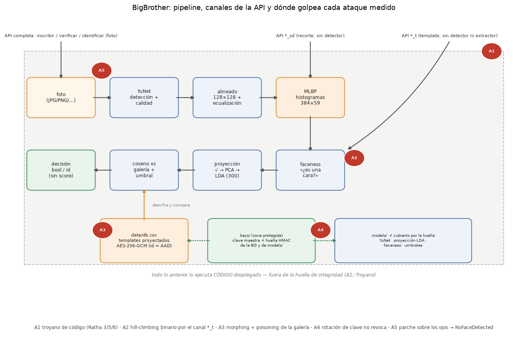
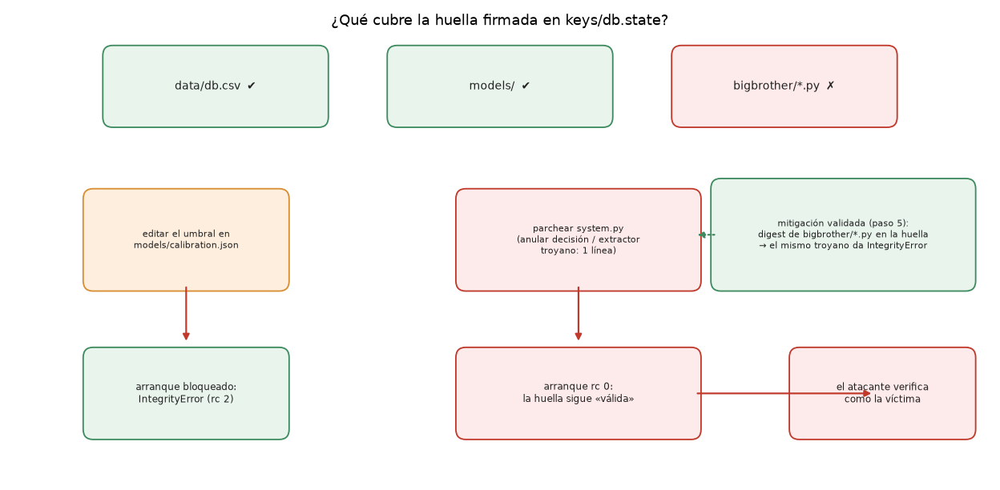
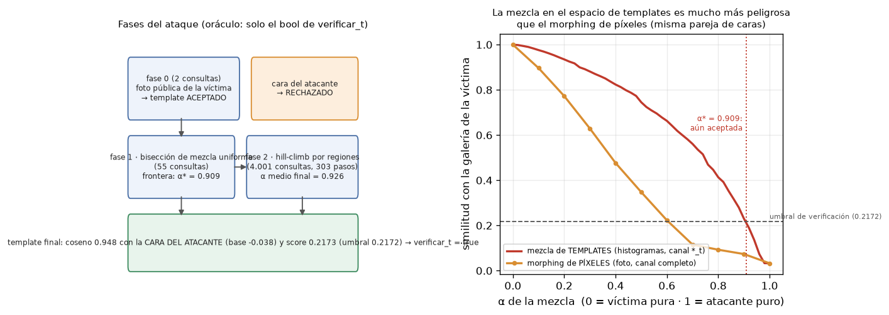
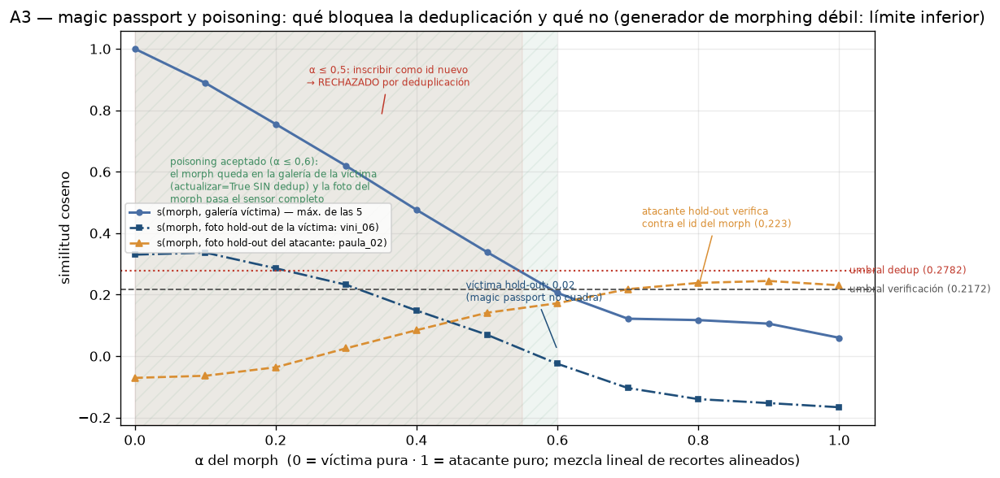
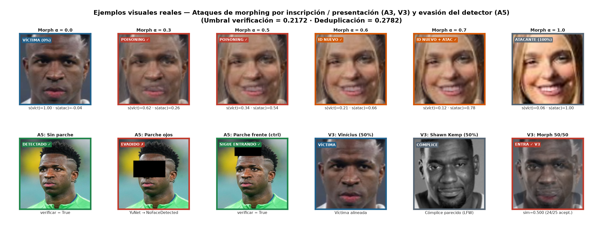

# Ataques empíricos: de la literatura a resultados medidos

Grupo EVE · Sistemas Biométricos

Ejecución práctica de los ataques cuyo mapeo teórico está en
[`ATAQUES_LITERATURA.md`](ATAQUES_LITERATURA.md) (huecos H1–H4 de su sección 7, más *dodging*
del detector). Todo el ataque está automatizado en **`scripts/ataques_literatura.py`** y las
cifras salen de **[`resultados/ataques_literatura.json`](resultados/ataques_literatura.json)**
(26,8 s de ejecución, re-ejecutado tras las correcciones de *anti-aliasing* en `align()` y filtrado `faceness` en `recortar()`). Este informe recoge el **proceso** (cómo se montó cada ataque) y los
**resultados**, y actualiza la matriz de vulnerabilidades del [`INFORME.md`](INFORME.md).



Cada ataque se describe en tres niveles: **modelo de amenaza** (quién es el atacante,
qué tiene y qué no tiene; encaja en la taxonomía de modelos del INFORME §5), **camino de
ataque** (la cadena concreta de componentes que recorre, con los puntos de Ratha y el canal
de la API que usa) y **escenario** (la historia de despliegue real en la que ocurre).

Montaje común: imagen Docker oficial del sistema (`docker build -t bigbrother .`, clave y BD
propias de la imagen) + las fotos de Paula Etxeberria como **atacante** (la gemela de una
identidad inscrita, ella **no** inscrita). Víctima: `vinicius_junior`. Umbrales calibrados:
verificación **0,2172**, identificación **0,2847**, deduplicación **0,2782**. Ningún
experimento toca la BD original: cada ataque trabaja sobre copias (`/tmp/bb_sbx`) o sobre
una copia del árbol completo (`/tmp/bb_t1`).

```
docker run -d --name bbattack --entrypoint sleep bigbrother infinity
docker cp data/ataques/gemela_paula/paula_0{1,2}.jpg bbattack:/app/data/ataques/gemela_paula/
docker cp scripts/ataques_literatura.py bbattack:/app/scripts/
docker exec -w /app bbattack python scripts/ataques_literatura.py
```

---

## A1 — Troyanos de software (H1 · Ratha puntos 3, 5 y 8) — **VULNERABLE, mitigación validada**

**Modelo de amenaza.** Atacante **interno / de infraestructura**: acceso de *escritura al
código desplegado* (paquete `bigbrother/`), p. ej. personal de operaciones o de un
contratista, malware en el pipeline de despliegue, o `docker exec` como root (V18). No
necesita la clave, ni descifrar la BD, ni nada del rostro: su única condición previa es que
el artefacto desplegado sea modificable (imagen sin digest pinneado, volumen escribible).

**Camino de ataque.** Escribir `bigbrother/system.py` → parchear la decisión final
(`verificar_t`, punto 8 de Ratha) o el extractor (`extraer_sd`, punto 3: el Troyano devuelve
el template de una **foto pública** de la víctima) → el sistema arranca, porque la huella de
`keys/db.state` solo cubre BD + `models/` → `python -m bigbrother verificar <víctima>
<foto atacante>` devuelve `true`. Ratha 3 → 5 → 8; ningún dato biométrico ni criptográfico
se ve comprometido: solo software.

**Escenario.** Despliegue real del servicio (contenedor corriendo con la BD construida). En
una ventana de mantenimiento — o tras comprometer la CI que construye la imagen — el
atacante toca una línea del paquete. El operador comprueba que el sistema arranca y que "la
integridad está intacta" (no hay error de arranque), y a partir de ahí el compinche verifica
como la víctima indefinidamente, con la BD y la clave perfectamente sanas.

**Hipótesis (ATAQUES_LITERATURA §5.3):** la huella firmada de `keys/db.state` cubre la BD y
`models/` (YuNet, proyección, faceness, calibración) pero **no los ficheros Python**: quien
tenga escritura en `bigbrother/` controla extractor, comparador y decisión sin que el
arranque falle-closed lo note.

**Proceso.** Copia del árbol completo a `/tmp/bb_t1` (con su BD ya construida) y tres
manipulaciones de una sola línea, ejecutando la CLI normal (`python -m bigbrother …`) en
la copia:

1. *Punto 8 (anulación de la decisión)* — `bigbrother/system.py`, `verificar_t`:
   ```diff
   -        return self._score_id(id, y) >= self.threshold
   +        return True  # TROYANO
   ```
2. *Punto 3 (Troyano extractor: fabricar los rasgos de la víctima)* — el atacante guarda el
   template de una **foto pública** de Vinícius y parchea `extraer_sd`:
   ```diff
   -        return self.extractor.extract(normalize_face(as_bgr(cara)))
   +        return np.load('/tmp/bb_t1/t_vini.npy')  # TROYANO
   ```
3. *Control:* bajar el umbral editando `models/calibration.json` (esto SÍ está cubierto por
   la huella).
4. *Mitigación (prototipo):* extender `models_digest` para que la huella incluya el código:
   ```diff
   -    h = hashlib.sha256()
   -    for f in files or config.MODEL_FILES:
   +    files = list(files or config.MODEL_FILES) + sorted(config.ROOT.glob('bigbrother/*.py'))
   +    h = hashlib.sha256()
   +    for f in files:
   ```

**Resultados** (atacante = `paula_01`, identidad reclamada = `vinicius_junior`):

| Paso | `verificar` atacante | ¿Arranca el sistema? |
|---|---|---|
| 0. Baseline (sin tocar nada) | rc 1, `verificado: false` | rc 0 |
| 1. Anular decisión (punto 8) | **rc 0, `verificado: true`** | **rc 0 — sin detección** |
| 2. Troyano extractor (punto 3) | **rc 0, `verificado: true`** | **rc 0 — sin detección** |
| 3. Control: editar `models/` | — | rc 2 `IntegrityError` ✔ |
| 4. Mitigación: digest del código + `construir_bd --force` | — | rc 0 |
| 5. Repetir el Troyano del paso 1 | — | **rc 2 `IntegrityError` ✔ capturado** |



**Lectura.** El H1 se confirma en su forma exacta: la integridad que el sistema anuncia
("si tocan la BD o los modelos, no arranco") da una **falsa sensación de seguridad frente a
quien puede escribir el código**, que es el mismo atacante que ya asume V1/V18 (`docker
exec`). La mitigación es barata y queda **validada empíricamente** (paso 5): bastaría con
que `models_digest()` (`bigbrother/security.py`) incluya el paquete `bigbrother/*.py`, tal
como ya incluye los modelos. En despliegue real: imagen Docker con digest *pinneado*
(readonly) o firma del paquete.

---

## A2 — Hill-climbing de caja negra con feedback binario (H3 · Dong et al. CVPR 2019) — **VULNERABLE**

**Modelo de amenaza.** Atacante **externo de caja negra** contra la API (el primer modelo
del INFORME §5). No tiene la clave, ni la BD, ni puntuaciones, ni acceso de escritura a
nada. Tiene: (a) el **código y los modelos públicos** — *grey-box*: el algoritmo es conocido
y reproducible, el único secreto es la BD —, (b) **una foto pública de la víctima** (el
punto de partida ACEPTADO que asume la literatura decision-based, Dong et al.) y (c) su
propia cara. Y sobre todo: **consultas ilimitadas** (V8).

**Camino de ataque.** `verificar_t` es literalmente el **punto 4 de Ratha** convertido en
API pública (el canal extractor→comparador): foto pública de la víctima → template aceptado
(fase 0) → bisección de mezclas en la retícula usando solo el `bool` (fase 1) → hill-climb
por regiones (fase 2) → histograma **válido en la retícula** que cabalga el umbral →
`verificar_t = true` con un template que ya es 0,95 la cara del atacante. Sin tocar clave,
BD ni detector: el oráculo de 1 bit es todo el contacto con el sistema.

**Escenario.** La verificación se ofrece como servicio no supervisado y programable (kiosko
de acceso, integración que acepta templates por API). El atacante ejecuta el script durante
la noche: ~4.000 consultas sin límite de tasa le dan una **credencial `_t` reutilizable** que
pasa por `verificar_t` para siempre (A4 confirma que ni la rotación de clave la mata). El
único requisito operativo es que nadie mire el registro de intentos fallidos.

**Hipótesis (ATAQUES_LITERATURA §4.2):** el INFORME tilda el hill-climbing (V9) de "solo
caja blanca" porque la API no expone puntuaciones. La literatura decision-based dice que un
**bool por consulta** basta si no hay límite de intentos (V8).


**Proceso.** Sobre la retícula de histogramas MLBP (384 regiones × 59 bins, cada región suma
256 cuentas — la validación de templates exige exactamente eso):

1. **Fase 0 (2 consultas):** sanity — la foto pública de la víctima verifica (`true`), la
   cara del atacante no (`false`).
2. **Fase 1 (55 consultas):** búsqueda de la frontera con mezcla uniforme α·atacante +
   (1−α)·víctima: escaneo grueso + bisección. **Frontera: α\* = 0,913** — ya aquí una mezcla
   con 91 % del atacante verifica.
3. **Fase 2 (4.001 consultas):** hill-climb con un α **por región** (no global): proponer
   subir el α de una región aleatoria (pasos 0,02/0,08/0,30); aceptar solo si el oráculo
   devuelve `true` (retroceso si no). Parada: presupuesto agotado (no convergencia).

**Resultados:**

| Métrica | Valor |
|---|---|
| Consultas bool totales | **4.058** (2 + 55 + 4.001) |
| Pasos aceptados en fase 2 | 300 |
| α medio final / regiones al máximo | 0,930 / 4,7 % |
| Similitud coseno del template final con **la cara del atacante** | **0,948** (base: −0,040) |
| Similitud con la foto de la víctima (punto de partida) | 0,217 |
| Puntuación real final (caja blanca, solo análisis) | 0,2172 — cabalgando el umbral 0,2172 |
| `verificar_t` con el template obtenido | **`true`** |
| `identificar_t` con el template obtenido | `null` (0,2172 < umbral de identificación 0,2847) |

> **Sesgo del montaje y repetición sin él.** La "foto pública" de partida es `vini_01.jpg`,
> que **también está inscrita**: el atacante parte de una copia exacta de un template de la
> BD (similitud 1,0), y eso infla las cifras de esta tabla. Con
> [`scripts/ataques_loo.py`](../scripts/ataques_loo.py) →
> [`resultados/ataques_loo.json`](resultados/ataques_loo.json) se repitió el ataque 5 veces,
> cada una con una foto de Vinícius **sacada de la galería** como foto pública (el caso
> realista, puntuación de partida 0,28–0,36). El ataque **sigue funcionando** (~4.040
> consultas, `verificar_t = true` en los 5 casos), pero con menos margen: frontera
> **α\* = 0,42–0,73** (no 0,913) y template final **0,61–0,91** similar al atacante (no
> 0,948). En uno de los 5 casos el template final se parece tanto a Paula que
> `identificar_t` lo asigna a su gemela `aitana_etxebarria`.



**Lectura.** La hipótesis se confirma: **la API de decisión única no da inmunidad, solo
encarece el ataque** — 4.058 consultas bool frente a las ~930–1.583 de caja blanca con
puntuaciones (V9, `resultados/hill_climbing.png`): el mismo orden de magnitud, sin tocar la
clave ni la BD. Lo que lo hace práctico es **V8** (sin límite de intentos); la mitigación de
la literatura (BioAPI/NIST SP 800-63B) es limitar la tasa de consultas.

Dos hallazgos añadidos que el mapeo no preveía:

- **La mezcla en el espacio de templates es mucho más peligrosa que el morphing de
  imágenes.** Comparar: una mezcla *uniforme al 91 %* de atacante en la retícula todavía
  verifica (α\*=0,913; 42–73 % si la foto de partida no está inscrita), mientras que en A3
  el 90 % en *píxeles* puntúa 0,106 (y sin la foto inscrita el morph de píxeles deja de
  verificar a partir de α = 0,1–0,4). Los
  histogramas promedian "con gracia" (siguen siendo caras válidas para el filtro y la
  retícula) y la proyección es lineal; los píxeles mezclados producen fantasmas que destruyen
  la textura. El canal `_t` es por tanto la superficie más débil del sistema, y la
  validación de retícula no lo cierra: la mezcla de dos histogramas válidos **es** un
  histograma válido.
- El template obtenido **no** sirve para `identificar_t` (el umbral de identificación, más
  estricto, lo corta) y no es una imagen: para usarlo en el canal completo habría que
  invertirlo (V1). Es un credencial solo-`_t`: grave, pero acotado.

---

## A3 — Morphing por la vía de la inscripción (H2 · Ferrara et al. IJCB 2014) + poisoning (V16) — **PARCIAL: dedup sí, poisoning sí, magic passport no**

**Modelo de amenaza.** Atacante **externo** con acceso a la **API de inscripción abierta**
(V15): el canal por el que el propio sistema deja entrar material nuevo en la BD. Tiene una
foto de la víctima (pública) y su propia cara (o un cómplice parecido). Sin clave, sin
acceso al sistema, sin privilegio alguno: su "arma" es que la inscripción no está
autenticada ni supervisada.

**Camino de ataque.** Morph = mezcla de los recortes alineados víctima+atacante → dos vías:
(a) `inscribir_sd("sospechoso", morph)` como id nuevo — aquí **choca con la deduplicación**
(moriría el *magic passport* clásico) — y (b) `inscribir_t(víctima, morph, actualizar=True)`
— ese camino **no aplica dedup** → el morph queda almacenado en la galería de la víctima.
Punto 6 de Ratha atacado *con credenciales legítimas*: la BD se corrompe sin escribir en
ella, a través de su propia API de inscripción.

**Escenario.** Análogo del *magic passport* (Ferrara et al.) en un control de acceso con
alta remota de fotos: el atacante —que ya entró una vez, o que comprometió la cuenta de la
víctima— envía como "foto nueva" de la víctima un retrato morphed que a un operador humano
le parecería ella. El sistema lo acepta (verifica contra la galería), y desde entonces el
atacante posee una **imagen imprimible** que el sistema acepta como la víctima por el
pipeline completo, además de una plantilla dormiente en su galería.

**Hipótesis (ATAQUES_LITERATURA §3):** el morphing canónico ataca la **inscripción**, no la
verificación; en BigBrother hay dos vías: (1) inscribir el morph como id nuevo (tropieza con
la deduplicación), (2) colarlo en la galería de la víctima con `actualizar=True` (**sin**
deduplicación en ese camino) y que después la cara pura del atacante verifique.

**Proceso.** Generador de morphs: mezcla lineal de los recortes alineados 128×128
(`cv2.addWeighted` de los crops de `vini_01` y `paula_01`) — el generador **más débil** de
la taxonomía de Venkatesh et al. (sin *warping* de landmarks): los resultados son un **límite
inferior** de la vulnerabilidad. Barrido α ∈ {0…1}: α=0 víctima pura, α=1 atacante puro.
Para cada α: inscripción como id nuevo en copia fresca de la BD (¿dedup?), verificación de
ambos padres con **fotos distintas a las del morph** (`vini_06` y `paula_02`, el caso real
de frontera), y poisoning por `actualizar=True`.

**Resultados** (s(m,v) = similitud del morph con la galería de la víctima, máxima de las 5;
umbral verificación 0,2172, dedup 0,2782):

| α | s(m,víct) | s(m,atac) | s(vini_06) | s(paula_02) | nuevo id | víct. verifica | atac. verifica | poisoning | atacante puro |
|---|---|---|---|---|---|---|---|---|---|
| 0,0 | 1,000 | −0,040 | 0,330 | −0,071 | ✗ dedup | — | — | ✔ | ✗ |
| 0,3 | 0,619 | 0,255 | 0,232 | 0,026 | ✗ dedup | — | — | ✔ | ✗ |
| **0,5** | **0,339** | **0,542** | 0,070 | 0,141 | ✗ dedup | — | — | **✔** | ✗ |
| 0,6 | 0,206 | 0,662 | −0,025 | 0,172 | **✔ inscrito** | ✗ | ✗ | ✗ | — |
| 0,7 | 0,122 | 0,779 | −0,104 | **0,218** | **✔ inscrito** | ✗ | **✔** | ✗ | — |
| 0,8 | 0,117 | 0,879 | −0,140 | 0,238 | ✗ dedup *(Aitana)* | — | — | ✗ | — |
| 1,0 | 0,060 | 1,000 | −0,166 | 0,231 | ✗ dedup *(Aitana)* | — | — | ✗ | — |

Además: la **foto del morph pasada por el sensor completo** (detector incluido) verifica
como la víctima para todo α ≤ 0,5 — sin necesidad de poisoning (re-medida de V3, consistente
con el 24/25 con cómplice parecido y 7/25 con cómplice aleatorio del INFORME).

> **Sesgo del montaje y repetición sin él.** El morph se fabrica con `vini_01.jpg`, que
> **está inscrita** (de ahí s(m,víct) = 1,000 con α = 0): las columnas de víctima y el
> *poisoning* de esta tabla están inflados. Repitiendo con cada foto de Vinícius fuera de la
> galería ([`scripts/ataques_loo.py`](../scripts/ataques_loo.py) →
> [`resultados/ataques_loo.json`](resultados/ataques_loo.json)), la foto del morph solo
> verifica como la víctima con **α ≤ 0,0–0,3** (el 50/50 no verifica en ningún caso) y el
> *poisoning* se acepta con **α ≤ 0,2–0,5** (mediana 0,3). La cara pura del atacante sigue sin
> verificar en ningún caso. Las conclusiones cualitativas se mantienen; los márgenes son menores.





**Lectura, en tres partes:**

1. **La deduplicación hace exactamente su trabajo** en la vía canónica del *magic
   passport*: los morphs que casan con la víctima (α ≤ 0,5, s(m,víct) ≥ 0,339) se rechazan
   como duplicado al inscribirlos como id nuevo. Los que la esquivan (α = 0,6 y 0,7) ya no
   casan con la víctima con una foto suya distinta (`s(vini_06) ≤ −0,025`), y para α ≥ 0,8
   la deduplicación bloquea incluso al propio atacante como duplicado de su gemela inscrita
   `aitana_etxebarria` (tras eliminar el *aliasing*, `paula_01` pasa a puntuar 0,293 > 0,2782
   contra Aitana). Con este generador, **ningún α da el magic passport con fotos hold-out de
   ambos padres**.
2. **El poisoning (V16) se confirma de punta a punta, y con un agujero de política**: el
   camino `actualizar=True` **no aplica la deduplicación**, así que el morph se cuela en la
   galería de la víctima para todo **α ≤ 0,5** (α ≤ 0,2–0,5 si la foto de partida no está inscrita; antes llegaba hasta α = 0,6 con 0,223; tras
   el *anti-aliasing* α = 0,6 cae a 0,206 < 0,2172 y queda bloqueado). El atacante queda con
   una **imagen imprimible** que verifica como Vinícius por el canal completo y además queda
   **persistida** en la BD como plantilla dormida, 0,54 similar a su cara.
3. **La escalada a la cara natural del atacante falla** en todos los α con poisoning (máx
   0,141 < 0,2172): la pareja genuina `paula_01↔paula_02` es débil (fotos muy distintas:
   contra Aitana puntúan 0,293 y 0,458). Es un límite del **atacante**, no una defensa del
   sistema: la literatura de morphing (Scherhag, Ramachandra) usa *warping* de landmarks y
   parecidos/gemelos como cómplices precisamente porque el blending lineal pierde demasiado.
   Con un generador mejor, la columna `atacante puro` y la `s(vini_06)` en la frontera son
   las dos brechas a vigilar.

---

## A4 — Rotación de clave ≠ revocación (H4 · ISO/IEC 24745) — **CONFIRMADO (de diseño)**

**Modelo de amenaza.** Atacante **post-compromiso**: ya tiene un template aceptado —
obtenido por V1 (clave + BD robadas, con inversión) o, peor, por A2, que **ni siquiera
necesitó la clave**. El defensor es honesto y reacciona con lo único que tiene a su alcance:
`construir_bd --force` (clave maestra nueva).

**Camino de ataque.** template t\* robado/reconstruido → el defensor reconstruye la BD con
clave nueva → `verificar_t(víctima, t\*)` sigue devolviendo `true`: no hay frescura, ni
validación de "antigüedad", ni cancelación; los templates re-inscritos son bit-idénticos
(rotar la clave solo cambia el ciphertext).

**Escenario.** Tras una filtración publicada, la respuesta estándar de la organización es
" hemos rotado todas las claves y vuelto a cifrar la BD". El atacante hace replay del
template viejo y sigue entrando: a diferencia de una contraseña, la cara de la víctima no
se puede cambiar; la única revocación real sería re-inscribirla con **muestras nuevas** que
el atacante no tenga, o proyecciones cancelables (Patel et al. 2015).

**Proceso.** Simular el desenlace de un compromiso (V1 + A2): el atacante conserva el
template aceptado t\* obtenido en A2 **sin clave**. El defensor responde con lo único que
tiene: `construir_bd --force` (clave maestra nueva, BD regenerada de las mismas fotos).

**Resultados:**

| Comprobación | Resultado |
|---|---|
| `verificar_t` del template robado contra la BD **nueva** (clave nueva) | **`true`** |
| Templates de la víctima antes/después | bit-idénticos (BD de 54 templates) |
| Ciphertexts antes/después | distintos (nonce nuevo) |

**Lectura.** La rotación de clave revoca el *ciphertext*, no la *credencial*: como no existe
frescura ni cancelabilidad (ISO/IEC 24745), un template filtrado o reconstruido es válido
para siempre — rotar la clave solo protege la confidencialidad futura de la BD. Para revocar
de verdad habría que re-inscribir a la víctima con **muestras nuevas** (que los atacantes no
tengan) o cambiar el par de claves criptográficas del *espacio* de templates (biometría
cancelable, Patel et al. 2015). El modelo de amenaza del sistema debería declararlo
explícitamente: *filtración de template = credencial permanente del usuario*.

---

## A5 — Dodging del detector con parche físico (Yang et al. 2019) — **FUNCIONA (trivial)**

**Modelo de amenaza.** Aquí el "atacante" es el propio **usuario genuino** (o una persona
vigilada) con **acceso físico** y **cero conocimiento** del sistema: no rompe nada, solo
quiere que `identificar` no le ponga nombre (*dodging*, evasión de vigilancia).

**Camino de ataque.** Cartulina/tira sobre los ojos → YuNet no encuentra cara →
`NoFaceDetected` → ni `identificar` ni `verificar` hacen nada. Punto 1 de Ratha en su
variante de *dodging*: el detector es un punto único de fallo, y no hacen falta parches
adversariales optimizados (Yang et al.) cuando la geometría que YuNet necesita (los ojos) se
tapona con una pieza física.

**Escenario.** Cámara de vigilancia con `identificar` contra la galería (listado de
inscritos): una persona marcada pasa ante la cámara con una tira que le cubre los ojos y el
sistema ni la detecta — no la nombra ni registra. En un uso de **verificación** el mismo
truco solo se lo hace a sí mismo (le deniegan el acceso, V7): es un ataque a la
disponibilidad/traceabilidad, no a la integridad de las cuentas.

**Proceso.** Sin redes adversariales: el principio de los parches universales (ciegar al
detector) se comprueba con su versión analógica — una cartulina. Rectángulo negro sobre los
ojos de `vini_06` (rectángulo equivalente en la frente como control; ver ejemplos visuales en
la fila inferior de la figura de A3).

**Resultados:** ojos cubiertos → **`NoFaceDetected`** (el genuino evita `identificar`);
frente → `verificado=True` (control). YuNet es un punto único de fallo para el *dodging*:
no hace falta un parche optimizado, basta con ocultar los ojos. Consecuencia operativa: es
un ataque de **negación** (el usuario se excluye a sí mismo), no de entrada de impostores —
coherente con V7.

---

## Síntesis: la matriz, después de medir

| Ataque | Modelo de amenaza (una línea) | Mapeo | Resultado empírico | Mitigación existente | Mitigación propuesta (validada) |
|---|---|---|---|---|---|
| A1 Troyano de software | interno con **escritura en el código** (V18) | H1 · Ratha 3/5/8 | **Éxito total**, arranque indetectado | ninguna para código | **digest del paquete en `db.state`** (paso 5 de A1 lo detecta); imagen firmada/readonly |
| A2 Hill-climb binario | externo de **caja negra** a la API, intentos ilimitados (V8) | H3 · Dong 2019 | **Éxito**: 4.058 consultas bool → template 0,95 similar al atacante (0,61–0,91 si la foto de partida no está inscrita) que verifica como la víctima | sin puntuaciones (solo encarece: ~3× las consultas de caja blanca) | **limitar intentos** (V8); el umbral de identificación ya lo corta para `identificar_t` |
| A3 Magic passport + poisoning | externo con acceso a la **inscripción abierta** (V15) | H2 · Ferrara 2014 | **Parcial**: dedup bloquea el id nuevo; poisoning entra sin dedup (α ≤ 0,5; 0,2–0,5 sin la foto inscrita) y persiste; sin escalada a cara natural con el generador débil | dedup ✔ (ids nuevos) | aplicar dedup también en `actualizar=True`; MAD fuera de alcance |
| A4 Rotación ≠ revocación | **post-compromiso** (tras V1 o A2) | H4 · ISO 24745 | **Confirmado**: el template robado verifica tras `--force` | ninguna (de diseño) | declarar en el modelo de amenaza; muestras nuevas al re-inscribir; biometría cancelable |
| A5 Dodging con parche | genuino con **acceso físico**, sin conocimiento | Yang 2019 | **Éxito trivial** (`NoFaceDetected`) | ninguna | aceptable (daña al propio dodger, V7) |

**Contra el INFORME.md**, dos correcciones de enfoque que la literatura anticipaba y la
medición confirma:

- **V9 deja de ser "solo caja blanca"**: el feedback binario basta (4.058 consultas, sin
  clave, sin BD, sin puntuaciones). La decisión sin puntuaciones es una buena defensa que
  debe ir **acompañada** de límite de intentos.
- **V16 se completa**: el poisoning no solo "encadena" — `actualizar=True` es un camino
  **sin deduplicación** que ya hemos usado para colar un morph en la galería de la víctima.

**Lo que NO probamos** (y por qué): presentación con hardware real (pantalla/impresión
físicas — solo simulación digital, como V2/V3), morphs con *warping* de landmarks (nuestro
generador es el más débil de la taxonomía: límite inferior), deepfakes, hill-climbing por
el canal de imagen completa (exigiría invertir el template a imagen, V1), y sesgo demográfico
cuantitativo del filtro de caras (documentado cualitativamente en [`ATAQUES_LITERATURA.md`](ATAQUES_LITERATURA.md) §4.4).
