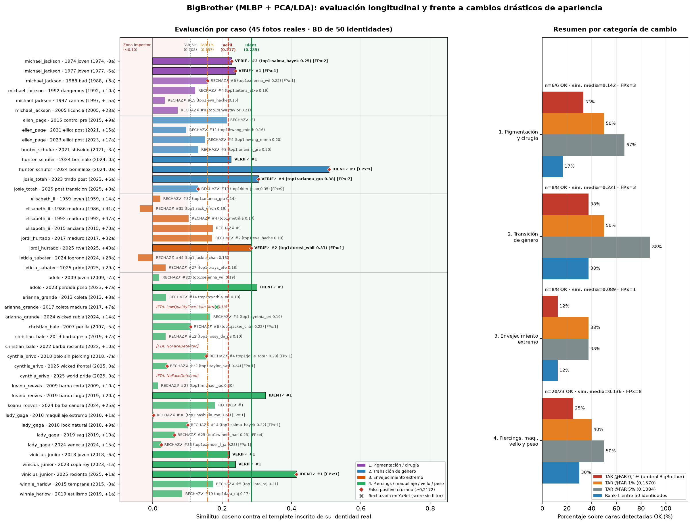
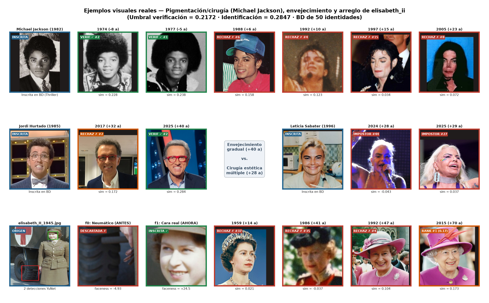
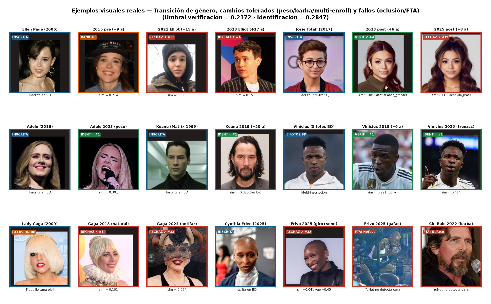

# Evaluación empírica frente a cambios longitudinales y transformaciones drásticas de apariencia

Evaluación del sistema real **BigBrother** (base de datos cifrada de **50 identidades** inscritas desde `data/fotos/dataset/` + `data/fotos/vinicius_junior/` en la imagen Docker `bigbrother:eval`) frente a **45 fotografías reales** de esas mismas personas tomadas en otras etapas de su vida o bajo cambios fuertes de apariencia.

Todo el experimento es reproducible mediante [`scripts/eval_cambios_apariencia.py`](../scripts/eval_cambios_apariencia.py), el inventario trazable de pruebas en [`data/pruebas_cambios/manifest.json`](../data/pruebas_cambios/manifest.json) y la salida numérica completa en [`resultados/eval_cambios_apariencia.json`](resultados/eval_cambios_apariencia.json). Las cifras de este informe corresponden a la ejecución **tras corregir los dos defectos destapados por esta auditoría y [`EVAL_INTEROCULAR.md`](EVAL_INTEROCULAR.md)**:
1. **Pre-reducción *anti-aliasing* (`cv2.INTER_AREA`)** en [`bigbrother/preprocess.py`](../bigbrother/preprocess.py) cuando `scale < 1`, que elimina la inflación de similitud por *aliasing* en retratos de alta resolución.
2. **Filtrado de multi-detecciones con `faceness`** en [`bigbrother/detector.py`](../bigbrother/detector.py), [`bigbrother/system.py`](../bigbrother/system.py) y [`scripts/build_db.py`](../scripts/build_db.py), que impide inscribir el neumático del camión en `elisabeth_II_1945.jpg` y selecciona el rostro real de Isabel II.

---

## 1. Resumen ejecutivo

| Indicador | Global (45 fotos) | Sobre detectadas (42 fotos) | Antes de los arreglos (42 OK) |
|---|---:|---:|---:|
| **Fallos de detección / calidad (FTA)** | **3 / 45 (6,67 %)** | — | 3 / 45 (6,67 %) |
| **Verificación positiva (`verificar()`, FAR 0,1 % = `0,2172`)** | **11 / 45 (24,44 %)** | **11 / 42 (26,19 %)** | 16 / 42 (38,10 %) *(inflado por aliasing + neumático)* |
| **Identificación correcta (`identificar()`, FPIR 1 % = `0,2847`)** | **4 / 45 (8,89 %)** | **4 / 42 (9,52 %)** | 6 / 42 (14,29 %) |
| **Identificación errónea (otra identidad ≥ `0,2847`)** | **4 / 45 (8,89 %)** | **4 / 42 (9,52 %)** | **18 / 42 (42,86 %)** *(−78 % tras arreglos)* |
| **Rank-1 (`top1_id == id_real`)** | **11 / 45 (24,44 %)** | **11 / 42 (26,19 %)** | **7 / 42 (16,67 %)** *(+9,5 pp tras arreglos)* |
| **Similitud media / mediana con `id_real`** | — | **0,1437 / 0,1310** | 0,2030 / 0,1900 |
| **Rango de similitud / Rank medio** | — | **−0,0425 a 0,5087 / 11,90** | −0,0317 a 0,6495 / 12,86 |
| **Superarían umbral relajado FAR 1 % (`0,1570`)** | 18 / 45 (40,00 %) | **18 / 42 (42,86 %)** | 24 / 42 (57,14 %) |
| **Superarían umbral relajado FAR 5 % (`0,1084`)** | 24 / 45 (53,33 %) | **24 / 42 (57,14 %)** | 32 / 42 (76,19 %) |
| **Nivel de impostor puro (`sim < 0,10`)** | — | **16 / 42 (38,10 %)** | 10 / 42 (23,81 %) |
| **Sondas con ≥ 1 falso positivo cruzado (`≥ 0,2172`)** | 15 / 45 (33,33 %) | **15 / 42 (35,71 %)** | **33 / 42 (78,57 %)** *(−55 % tras arreglos)* |
| **Total de emparejamientos cruzados falsos (`≥ 0,2172`)** | **36** | **36** | **234** *(−84,6 % tras arreglos)* |

*(Sin `elisabeth_ii`, sobre 41 fotos / 38 detectadas OK: TAR = `11/38` (`28,95 %`), Rank-1 = `10/38` (`26,32 %`), similitud media `0,1520`, rank medio `11,13`, mismos `36` emparejamientos cruzados falsos.)*

Cuatro conclusiones dominan el experimento:

1. **Corregir el *aliasing* y `elisabeth_ii` limpia drásticamente la seguridad y el ranking real.** Los falsos positivos cruzados se desploman un **84,6 %** (`234 → 36`), las identificaciones erróneas caen de **18/42 (42,86 %)** a **4/42 (9,52 %)** y la tasa **Rank-1 sube del 16,7 % al 26,2 % (`11/42`)**, incluyendo casos donde antes había falsos ganadores (`elisabeth_ii/2015`, `keanu_reeves/2019` y `2024`, `michael_jackson/1977`). Paralelamente desaparecen las verificaciones espurias infladas por *aliasing* (`lady_gaga/2024` con máscara de encaje y `elisabeth_ii/2015` contra el neumático), dejando un TAR genuino más honesto del **26,19 %** sobre caras detectadas.
2. **La identificación open-set sigue siendo muy exigente bajo cambios fuertes.** `identificar()` acierta en **4 de 42** casos (**9,52 %**: `hunter_schufer/2024_berlinale2`, `keanu_reeves/2019_barba_larga`, `adele/2023_perdida_peso`, `vinicius_junior/2025_reciente`) y devuelve otra identidad en **4 de 42** (**9,52 %**: las dos fotos de `josie_totah`, `jordi_hurtado/2025_rtve` → `forest_whitaker`, `cynthia_erivo/2018` → `josie_totah`), rechazando limpiamente (`None`) los 34 casos restantes.
3. **Desplome a nivel de impostor en transformaciones estructurales graves.** En **16 de las 42** fotos detectadas (**38,10 %**), la similitud cae por debajo de `0,10`: cirugía estética múltiple y despigmentación (`michael_jackson` 1997/2005, `leticia_sabater` 2024/2025), envejecimiento extremo con cambio de pose/escala (`elisabeth_ii` 1959/1986), oclusión en inscripción (`lady_gaga` 2010/2019/2024), barba/peso/giro (`christian_bale/2019`, `keanu_reeves/2009`, `cynthia_erivo/2025`) y cambios severos de estilismo/iluminación (`arianna_grande/2013`, `winnie_harlow/2019`, `adele/2009`, `ellen_page/2021`).
4. **El defecto crítico de `elisabeth_ii` quedó verificado y resuelto.** Antes de la corrección, `db.csv["elisabeth_ii"]` almacenaba el neumático del camión (`sim = 1,0000` con `faces[0]`); tras incorporar `faceness` en `FaceDetector.select()`, `db.csv["elisabeth_ii"]` corresponde exactamente a su rostro real de 1945 (`sim_db_con_f1_cara_real = 1,0000`, `faceness = +24,48`, frente a `-4,93` del neumático descartado), y su foto de 2015 (+70 años) logra incluso **Rank #1** (`0,1731`, `0` falsos positivos cruzados).

---

## 2. Metodología, arquitectura evaluada y umbrales

### 2.1 Conjunto de prueba (`data/pruebas_cambios/`)

Se recopilaron **45 imágenes JPG reales y verificadas visualmente** mediante hojas de contacto a partir de Wikimedia Commons, RTVE, TMDB y Fandom, cubriendo **15 identidades** de la BD real repartidas en 4 categorías (mínimo 2 fotos por persona):

1. **Pigmentación / cirugía / décadas (`pigmentacion_cirugia`, 6 fotos):** `michael_jackson` (inscrito con `1982`, época *Thriller*): 1974, 1977, 1988, 1992, 1997, 2005.
2. **Transición de género (`transicion_genero`, 8 fotos):** `ellen_page` (2006 → control 2015 + Elliot Page 2021 y 2023), `josie_totah` (2017 pre-transición → 2023 y 2025 post-transición), `hunter_schufer` (2024 → campaña 2021 y otros ángulos/maquillaje 2024).
3. **Envejecimiento extremo (`envejecimiento`, 8 fotos):** `elisabeth_ii` (1945 → 1959, 1986, 1992, 2015), `jordi_hurtado` (1985 → 2017 y 2025), `leticia_sabater` (1996 → 2024 y 2025).
4. **Piercings, maquillaje extremo, vello facial y peso/estilismo (`apariencia_estilismo`, 23 fotos):** `cynthia_erivo` (3), `lady_gaga` (4), `arianna_grande` (3), `winnie_harlow` (2), `christian_bale` (3), `keanu_reeves` (3), `adele` (2) y `vinicius_junior` (3).

### 2.2 Pipeline de extracción y umbrales de referencia

El pipeline real de [`BigBrother`](../bigbrother/system.py) y [`MLBPExtractor`](../bigbrother/mlbp.py#L17-L51) aplica sobre cada imagen:

1. **Detección y control de calidad ([`detector.py`](../bigbrother/detector.py), [`config.py`](../bigbrother/config.py#L28-L35)):** YuNet (`DETECTOR_SCORE_MIN = 0,75`), filtrado `faceness` de falsos positivos cuando hay varias detecciones, tamaño mínimo `40 px`, distancia interocular `MIN_EYE_DIST_PX = 16 px`, límite de giro lateral `MAX_YAW_RATIO = 0,45` y descarte de segunda cara si `area(f2)/area(f1) >= 0,45` (`AMBIGUOUS_FACE_RATIO`).
2. **Alineado geométrico sobre 5 landmarks ([`preprocess.py`](../bigbrother/preprocess.py#L8-L55)):** pre-reducción *anti-aliasing* de la ROI con `cv2.INTER_AREA` cuando `scale < 1`, seguida de transformación por similitud a **128×128 px** según `_TEMPLATE`: ojos en `y = 0,38` (`48,6 px`), nariz en `(0,50, 0,56)` (`64,0 × 71,7 px`) y comisuras bucales en `y = 0,78` (`99,8 px`).
3. **Normalización fotométrica y MLBP ([`mlbp.py`](../bigbrother/mlbp.py#L36-L47)):** pasa a gris 128×128, aplica **`cv2.equalizeHist` global** (`PHOTOMETRIC = "equalize"`), divide la cara en una **rejilla 8×8** (64 celdas de **16×16 px**):
   - **Filas 0–2 (`y = 0..47 px`)**: frente, flequillo, línea del cabello y cejas.
   - **Filas 3–4 (`y = 48..79 px`)**: región periocular, puente nasal y pómulos superiores.
   - **Filas 5–7 (`y = 80..127 px`)**: punta nasal, surco nasolabial, boca, mentón y vello facial.
   Para cada uno de los **6 radios** `LBP_RADII = (1, 2, 3, 4, 5, 6)` con `P = 8` vecinos (`nri_uniform`, **59 bins**), concatena `6 × 64 × 59 = 22.656` frecuencias normalizadas, aplica `sqrt` + PCA con blanqueo (1000 dim) + LDA (300 dim) y mide similitud coseno en $\mathbb{R}^{300}$.

Los umbrales de referencia de [`models/calibration.json`](../models/calibration.json) (calibrados en LFW test, 4.300 pares genuinos y 980.849 impostores) son:

| Punto de operación | Umbral (coseno) | Significado en BigBrother |
|---|---|---|
| **Impostor puro** | `< 0,1000` | Nivel típico de pares de identidades distintas |
| **FAR 10 % (LFW test)** | `0,0834` | Referencia diagnóstica relajada |
| **FAR 5 % (LFW test)** | `0,1084` | Referencia diagnóstica relajada |
| **FAR 1 % (LFW test)** | `0,1570` | `TAR@FAR=1 % = 54,07 %` en LFW |
| **Verificación 1:1 (`THRESHOLD`, FAR 0,1 %)** | **`0,2172`** | Umbral oficial de `bb.verificar()` (`TAR@FAR=0,1 % = 34,81 %` en LFW) |
| **Deduplicación (`DEDUP_THRESHOLD`)** | `0,2782` | Umbral anti-duplicados al inscribir |
| **Identificación open-set (`IDENT_THRESHOLD`, FPIR ~1 %)** | **`0,2847`** | Umbral oficial de `bb.identificar()` sobre galería de 50 IDs |

---

## 3. Resultados por categoría

| Categoría | Total | OK | FTA | `verificar()` (total / OK) | `identificar()` OK | Rank-1 (OK) | Pasa FAR 1 % | Pasa FAR 5 % | Nivel impostor (`<0,10`) | Similitud media (rango) | Rank medio | Cross-FPs |
|---|---:|---:|---:|---|---|---|---|---|---|---|---:|---:|
| **1. Pigmentación / cirugía** | 6 | 6 | 0 | **2** (33,3 % / 33,3 %) | **0** (0,0 %) | 1 (16,7 %) | 3 / 6 (50,0 %) | 4 / 6 (66,7 %) | 2 / 6 (33,3 %) | **0,1422** (`0,0344..0,2385`) | **6,00** | 4 (en 3 fotos) |
| **2. Transición de género** | 8 | 8 | 0 | **3** (37,5 % / 37,5 %) | **1** (12,5 %) | 3 (37,5 %) | 4 / 8 (50,0 %) | 7 / 8 (87,5 %) | 1 / 8 (12,5 %) | **0,2205** (`0,0964..0,5087`) | 6,12 | 20 (en 3 fotos) |
| **3. Envejecimiento extremo** | 8 | 8 | 0 | **1** (12,5 % / 12,5 %) | **0** (0,0 %) | 1 (12,5 %) | 3 / 8 (37,5 %) | 3 / 8 (37,5 %) | 4 / 8 (50,0 %) | **0,0888** (`-0,0425..0,2842`) | 19,00 | 1 (en 1 foto) |
| *— Sin `elisabeth_ii` (Jordi + Leticia)* | *4* | *4* | *0* | *1 (25,0 %)* | *0 (0,0 %)* | *0 (0,0 %)* | *2 / 4 (50,0 %)* | *2 / 4 (50,0 %)* | *2 / 4 (50,0 %)* | *0,1126 (`-0,0425..0,2842`)* | *18,75* | *1 (en 1 foto)* |
| **4. Piercings / maq. / vello / peso** | 23 | 20 | 3 | **5** (21,7 % / 25,0 %) | **3** (13,0 % / 15,0 %) | **6 (30,0 %)** | 8 / 20 (40,0 %) | 10 / 20 (50,0 %) | 9 / 20 (45,0 %) | **0,1355** (`0,0027..0,4142`) | 13,15 | 11 (en 8 fotos) |
| **TOTAL GLOBAL** | **45** | **42** | **3** | **11** (**24,4 % / 26,2 %**) | **4** (**8,9 % / 9,5 %**) | **11** (**26,2 %**) | **18 / 42 (42,9 %)** | **24 / 42 (57,1 %)** | **16 / 42 (38,1 %)** | **0,1437** (`-0,0425..0,5087`) | **11,90** | **36** (en 15 fotos) |

### Fallos de adquisición (FTA = 3 / 45 = 6,67 %)

Tres sondas no alcanzan la etapa de comparación en la API pública (idénticas antes y después de las correcciones):
- `cynthia_erivo/2025_world_pride` (`NoFaceDetected`): a pesar de ser primer plano del propio año 2025, las gafas oscuras reflectantes y el sombreado extremo impiden a YuNet superar el umbral `0,75`.
- `christian_bale/2022_barba_reciente` (`NoFaceDetected`): barba espesa + iluminación de estreno + inclinación leve hacen fallar a YuNet.
- `arianna_grande/2017_coleta_madura` (`LowQualityFace`): YuNet detecta la cara (`score = 0,942`, `eye_dist = 69,57 px`), pero el filtro de pose la rechaza por `yaw_ratio = 0,5078 > 0,45`. El diagnóstico sin filtro de calidad arroja una similitud de **`0,1836`** (bajo `0,2172`, habría superado FAR 1 %).

---

## 4. Defecto de inscripción de `elisabeth_ii`: diagnóstico y corrección verificada

Al inspeccionar inicialmente los recortes 128×128 de `data/fotos/dataset/` se descubrió que **`elisabeth_II_1945.jpg`** (`4879 × 3581 px`, Isabel II con 19 años posando junto a una ambulancia militar ATS) produce **dos detecciones en YuNet**:

| Detección YuNet | Bounding box `(x, y, w, h)` | Área (px²) | Score YuNet | Score `faceness` (umbral `−3,59`) | Contenido real | Sim. con BD (antes → **después**) |
|---|---|---:|---:|---:|---|---|
| **`faces[0]`** | `(2011.2, 2328.3, 371.1, 479.1)` | **177.772,3** | `0,7717` | **`−4,9347` (rechazada)** | Neumático y mano junto al camión (falso positivo YuNet) | `1,0000` → **`0,0172`** |
| **`faces[1]`** | `(2586.6, 1220.0, 211.0, 256.1)` | **54.037,7** | `0,9279` | **`+24,4814` (válida)** | **Rostro real de Isabel II en 1945** | `0,0488` → **`1,0000`** |

**Causa y corrección:** Como `area(faces[1]) / area(faces[0]) = 0,304 < 0,45` (`AMBIGUOUS_FACE_RATIO`), el detector original no disparaba `AmbiguousFace` y seleccionaba `faces[0]` por área. Al añadir el filtrado opcional `is_face` en [`FaceDetector.select()`](../bigbrother/detector.py) (activado en [`BigBrother.recortar()`](../bigbrother/system.py) y [`scripts/build_db.py`](../scripts/build_db.py), cubierto por el test de regresión `test_elisabeth_filtra_falso_positivo_detector`), `faces[0]` (`faceness = −4,93 < −3,59`) queda descartado y `data/db.csv["elisabeth_ii"]` almacena el rostro real (`sim = 1,0000`).

El impacto sobre las 4 pruebas longitudinales de `elisabeth_ii` es contundente:

| Sonda (`elisabeth_ii`) | Δ años | Antes (BD = neumático + sin *anti-alias*) | **Después (BD = cara real 1945 + `INTER_AREA`)** | Rank (antes → **después**) | Cross-FPs (antes → **después**) | ¿Supera FAR 0,1 % / 1 % / 5 %? |
|---|---:|---:|---:|---:|---:|---|
| `1959_joven` | +14 | `0,1417` | **`0,0212`** | #22 → #37 | 5 → **0** | `False` / `False` / `False` |
| `1986_madura` | +41 | `0,0218` | **`−0,0374`** | #21 → #35 | 0 → **0** | `False` / `False` / `False` |
| `1992_madura` | +47 | `0,1949` | **`0,1036`** | #8 → **#4** | 5 → **0** | `False` / `False` / `False` |
| `2015_anciana` | +70 | `0,3263` *(espurio vs neumático)* | **`0,1731`** | #2 → **#1** | 13 → **0** | `False` / **`True`** / **`True`** |

La falsa verificación de `2015_anciana` (`0,3263`) y las **23 colisiones cruzadas** que generaban las 4 fotos desaparecen por completo (`0` falsos positivos cruzados en las 4 sondas); además, pese a los **+70 años** transcurridos entre 1945 y 2015, el rostro real de Isabel II en 2015 alcanza **Rank #1** entre las 50 identidades (`0,1731`, superando FAR 1 %).

---

## 5. Análisis detallado por categoría y caso

### 5.1 Categoría 1 — Cambios de pigmentación, cirugía y décadas (`michael_jackson`)

Inscrito con `michael_jackson_1982.png` (época *Thriller*: piel oscura-media, nariz estrecha original post-primera rinoplastia, pelo rizado con flequillo sobre la frente).

| Foto sonda | Año (Δ) | `eye_dist` / `yaw` | Sim. `id_real` | Rank | Top-1 en BD (sim.) | `verificar` | `identificar` | Cross-FPs | Zona umbral |
|---|---|---:|---:|---:|---|---:|---|---:|---|
| `1974_joven` | 1974 (−8) | 56,1 px / 0,035 | **`0,2280`** | #2 | `salma_hayek` (`0,2499`) | **True** | `None` | 2 | ≥ FAR 0,1 % |
| `1977_joven` | 1977 (−5) | 30,9 px / 0,047 | **`0,2385`** | **#1** | `michael_jackson` (`0,2385`) | **True** | `None` | 1 | ≥ FAR 0,1 % |
| `1988_bad` | 1988 (+6) | 141,5 px / 0,240 | `0,1580` | #6 | `serenna_williams` (`0,2239`) | False | `None` | 1 | FAR 1 % |
| `1992_dangerous` | 1992 (+10) | 48,4 px / 0,151 | `0,1226` | #4 | `aitana_etxebarria` (`0,1911`) | False | `None` | 0 | FAR 5 % |
| `1997_cannes` | 1997 (+15) | 53,8 px / 0,219 | **`0,0344`** | #15 | `eva_hache` (`0,1535`) | False | `None` | 0 | Impostor |
| `2005_licencia` | 2005 (+23) | 40,8 px / 0,046 | **`0,0719`** | #8 | `anya_taylor_joy` (`0,2091`) | False | `None` | 0 | Impostor |

**Lectura técnica (MLBP):** Se confirma la **caída monotónica clásica** conforme se acumulan cirugías nasales/mentonianas y despigmentación por vitíligo, ahora mucho más limpia sin el ruido de *aliasing* (los falsos positivos cruzados caen de `26` a `4`, desaparecen las 2 identificaciones erróneas previas y el rank medio mejora de `9,67` a **`6,00`**):
- **Pre-1982 (`1974`, `1977`)**: ambas verifican (`0,2280` #2 y `0,2385` **Rank #1**). La estructura ósea nasal/malar y las filas superiores 0–2 conservan distribuciones LBP consistentes con `1982`.
- **1988 (`0,1580`, rank #6)**: pese a estar a solo +6 años de `1982`, el blanqueamiento incipiente + maquillaje escénico de *Bad* y el giro lateral (`yaw = 0,240`) reducen el score a la zona de FAR 1 % (antes el *aliasing* sobre `eye_dist = 141,5 px` disparaba 17 falsos positivos; ahora queda en solo `1`).
- **1997 y 2005 (`0,0344` y `0,0719`)**: la combinación de despigmentación completa, rinoplastias sucesivas (filas 3–6, columnas 3–4), cejas perfiladas y cambio de textura perioral destruye los gradientes de orden local de radios `r=1..6`, llevando la similitud al **nivel de impostor puro**.

---

### 5.2 Categoría 2 — Transición de género (`ellen_page`, `josie_totah`, `hunter_schufer`)

Sigue siendo la categoría con **mayor similitud media (`0,2205`)** y **mayor tasa de verificación (`3 / 8 = 37,5 %`)**, con **7 / 8 (`87,5 %`)** por encima de FAR 5 %. Sin embargo, solo `hunter_schufer` del mismo año logra identificarse correctamente; las dos sondas de `josie_totah` concentran 16 de los 36 falsos positivos cruzados de todo el experimento.

| Persona (año insc.) | Foto sonda | Año (Δ) | `eye_dist` / `yaw` | Sim. `id_real` | Rank | Top-1 en BD (sim.) | `verificar` | `identificar` | Cross-FPs |
|---|---|---|---:|---:|---:|---|---:|---|---:|
| `ellen_page` (2006) | `2015_control_pre` | 2015 (+9) | 215,3 / 0,070 | `0,2144` | **#1** | `ellen_page` (`0,2144`) | False | `None` | 0 |
| `ellen_page` (2006) | `2021_elliot_post` | 2021 (+15) | 155,6 / 0,030 | **`0,0964`** | #11 | `hwang_min-hyun` (`0,1613`) | False | `None` | 0 |
| `ellen_page` (2006) | `2023_elliot_post` | 2023 (+17) | 151,1 / 0,278 | `0,1510` | #4 | `hwang_min-hyun` (`0,1993`) | False | `None` | 0 |
| `josie_totah` (2017) | `2023_tmdb_post` | 2023 (+6) | 66,3 / 0,062 | **`0,3046`** | #4 | `arianna_grande` (`0,3757`) | **True** | `arianna_grande` ❌ | 7 |
| `josie_totah` (2017) | `2025_post_transicion` | 2025 (+8) | 27,1 / 0,001 | `0,1311` | #19 | `kim_jisoo` (`0,3491`) | False | `kim_jisoo` ❌ | 9 |
| `hunter_schufer` (2024) | `2021_shiseido` | 2021 (−3) | 114,5 / 0,074 | `0,1309` | #8 | `arianna_grande` (`0,2027`) | False | `None` | 0 |
| `hunter_schufer` (2024) | `2024_berlinale` | 2024 (0) | 185,0 / 0,144 | **`0,2265`** | **#1** | `hunter_schufer` (`0,2265`) | **True** | `None` | 0 |
| `hunter_schufer` (2024) | `2024_berlinale2` | 2024 (0) | 91,2 / 0,134 | **`0,5087`** | **#1** | `hunter_schufer` (`0,5087`) | **True** | **`hunter_schufer` ✅** | 4 |

**Lectura técnica (MLBP):**
- **`ellen_page` → Elliot Page:** Sus 3 sondas tenían muy alta resolución (`eye_dist = 151–215 px`), por lo que el *anti-aliasing* elimina los 16 falsos positivos cruzados que existían antes (ahora **`0` cross-FPs** en las 3 fotos). La foto control pre-transición `2015_control_pre` queda en **Rank #1** con `0,2144` (a solo `0,0028` del umbral de verificación), mientras que las fotos post-transición (`2021_elliot_post = 0,0964`, `2023_elliot_post = 0,1510`, rank #4) caen por debajo de `0,2172` al cambiar el corte de pelo en filas 0–1, el grosor de cejas y la línea mandibular.
- **`josie_totah` (2017 pre → 2023/2025 post):** Inscrita en 2017 (16 años, pre-transición), en `2023_tmdb_post` sigue logrando **`0,3046`** (`VERIF=True`, por encima incluso de `0,2847`), demostrando que la estructura central periocular y nasal (filas 3–5) sobrevive al cambio de estilismo cuando el retrato está bien iluminado (`eye_dist = 66,3 px`). No obstante, tanto `2023_tmdb_post` (7 cross-FPs, Top-1 `arianna_grande = 0,3757`) como `2025_post_transicion` (9 cross-FPs, Top-1 `kim_jisoo = 0,3491`, baja resolución `27,1 px`) sufren confusión con retratos femeninos muy suavizados.
- **`hunter_schufer` (2024):** En las dos capturas del mismo evento (`2024_berlinale = 0,2265` y `2024_berlinale2 = 0,5087`) logra **Rank #1** y `VERIF=True` (`IDENT=True` en la segunda), mientras que `2021_shiseido` (−3 años, maquillaje editorial e iluminación muy direccional) cae a `0,1309` (#8), confirmando que el cambio fotométrico/editorial pesa tanto como los años transcurridos.

---

### 5.3 Categoría 3 — Envejecimiento extremo (`elisabeth_ii`, `jordi_hurtado`, `leticia_sabater`)

| Persona (año insc.) | Foto sonda | Año (Δ) | `eye_dist` / `yaw` | Sim. `id_real` | Rank | Top-1 en BD (sim.) | `verificar` | `identificar` | Cross-FPs |
|---|---|---|---:|---:|---:|---|---:|---|---:|
| `elisabeth_ii` (1945) | `1959_joven` | 1959 (+14) | 56,8 / 0,390 | **`0,0212`** | #37 | `arianna_grande` (`0,1449`) | False | `None` | 0 |
| `elisabeth_ii` (1945) | `1986_madura` | 1986 (+41) | 24,0 / 0,095 | **`−0,0374`** | #35 | `zack_efron` (`0,1933`) | False | `None` | 0 |
| `elisabeth_ii` (1945) | `1992_madura` | 1992 (+47) | 92,3 / 0,011 | `0,1036` | #4 | `metrika` (`0,1317`) | False | `None` | 0 |
| `elisabeth_ii` (1945) | `2015_anciana` | 2015 (+70) | 186,1 / 0,050 | `0,1731` | **#1** | `elisabeth_ii` (`0,1731`) | False | `None` | 0 |
| `jordi_hurtado` (1985) | `2017_maduro` | 2017 (+32) | 85,1 / 0,006 | `0,1715` | #2 | `eva_hache` (`0,1888`) | False | `None` | 0 |
| `jordi_hurtado` (1985) | `2025_rtve` | 2025 (+40) | 160,4 / 0,070 | **`0,2842`** | #2 | `forest_whitaker` (`0,3148`) | **True** | `forest_whitaker` ❌ | 1 |
| `leticia_sabater` (1996) | `2024_logrono` | 2024 (+28) | 108,3 / 0,031 | **`−0,0425`** | **#44** | `jackie_chan` (`0,1516`) | False | `None` | 0 |
| `leticia_sabater` (1996) | `2025_pride` | 2025 (+29) | 50,8 / 0,229 | **`0,0371`** | #27 | `brays_efe` (`0,1788`) | False | `None` | 0 |

**Lectura técnica (MLBP):** La limpieza de falsos positivos en esta categoría es drástica (de `43` cross-FPs a solo **`1`** en las 8 sondas), dejando ver con nitidez el efecto puro del envejecimiento y la cirugía:
- **`jordi_hurtado` (+32 y +40 años):** Mantiene un excelente ranking (**#2** en ambas sondas) y verifica en **`2025_rtve` (`0,2842`)** tras 4 décadas (a solo `0,0005` del umbral de identificación, superado únicamente por `forest_whitaker = 0,3148`); `2017_maduro` (`0,1715`, #2) supera FAR 1 %. La conservación de las proporciones centrales (gafas/cejas/nariz y pose frontal `yaw <= 0,070`) preserva los macro-patrones de radios `r = 4..6`.
- **`elisabeth_ii` (+14 a +70 años, ya contra su cara real de 1945):** En las fotos frontales y nítidas (`1992_madura` #4 y `2015_anciana` **Rank #1**, `0,1731`), la señal geométrica sobrevive hasta +70 años aunque sin alcanzar el umbral estricto `0,2172`; en cambio, el giro acusado de `1959_joven` (`yaw = 0,390`) y la baja resolución de `1986_madura` (`eye_dist = 24,0 px`) desploman el score a nivel impostor.
- **`leticia_sabater` (+28 y +29 años):** **0 / 2 verificaciones** y la **peor similitud de toda la evaluación (`−0,0425`, rank #44/50 en 2024; `0,0371`, rank #27 en 2025)**. A diferencia de Jordi Hurtado o Isabel II en 2015, la concurrencia de múltiples cirugías faciales (labios, pómulos, nariz, cejas) + bronceado/maquillaje intenso destruye completamente la señal proyectada por LDA.

---

### 5.4 Categoría 4 — Piercings, maquillaje extremo, vello facial y peso/estilismo

| Persona (año insc.) | Foto sonda | Año (Δ) | `eye_dist` / `yaw` | Sim. `id_real` | Rank | Top-1 en BD (sim.) | `verificar` | `identificar` | Cross-FPs |
|---|---|---|---:|---:|---:|---|---:|---|---:|
| `cynthia_erivo` (2025) | `2018_pelo_sin_piercing` | 2018 (−7) | 80,3 / 0,248 | `0,1548` | #4 | `josie_totah` (`0,2935`) | False | `josie_totah` ❌ | 1 |
| `cynthia_erivo` (2025) | `2025_wicked_frontal` | 2025 (0) | 104,1 / 0,446 | **`0,0409`** | #32 | `taylor_swift` (`0,2444`) | False | `None` | 1 |
| `cynthia_erivo` (2025) | `2025_world_pride` | 2025 (0) | — | — | — | — (`NoFaceDetected`) | False | `None` (FTA) | 0 |
| `lady_gaga` (2009) | `2010_maquillaje_extremo` | 2010 (+1) | 74,6 / 0,404 | **`0,0027`** | #30 | `hasbulla_magomedov` (`0,2391`) | False | `None` | 1 |
| `lady_gaga` (2009) | `2018_look_natural` | 2018 (+9) | 112,8 / 0,252 | `0,1009` | #14 | `salma_hayek` (`0,2209`) | False | `None` | 1 |
| `lady_gaga` (2009) | `2019_sag` | 2019 (+10) | 230,0 / 0,022 | **`0,0627`** | #25 | `winnie_harlow` (`0,2467`) | False | `None` | 4 |
| `lady_gaga` (2009) | `2024_venecia` | 2024 (+15) | 125,7 / 0,065 | **`0,0243`** | #33 | `samuel_l_jackson` (`0,2793`) | False | `None` | 1 |
| `arianna_grande` (2010) | `2013_coleta` | 2013 (+3) | 102,4 / 0,207 | **`0,0388`** | #14 | `cynthia_erivo` (`0,1022`) | False | `None` | 0 |
| `arianna_grande` (2010) | `2017_coleta_madura` | 2017 (+7) | 69,6 / **0,508** | *(0,1836 sin filtro)* | — | — (`LowQualityFace`) | False | `None` (FTA) | 0 |
| `arianna_grande` (2010) | `2024_wicked_rubia` | 2024 (+14) | 128,3 / 0,061 | `0,1655` | #4 | `cynthia_erivo` (`0,1861`) | False | `None` | 0 |
| `winnie_harlow` (2018) | `2015_temprana` | 2015 (−3) | 114,7 / 0,102 | `0,1736` | #5 | `lara_raj` (`0,2131`) | False | `None` | 0 |
| `winnie_harlow` (2018) | `2019_estilismo` | 2019 (+1) | 47,7 / 0,061 | **`0,0849`** | #19 | `lara_raj` (`0,1663`) | False | `None` | 0 |
| `christian_bale` (2012) | `2007_perilla` | 2007 (−5) | 115,4 / 0,091 | `0,1093` | #6 | `jackie_chan` (`0,2180`) | False | `None` | 1 |
| `christian_bale` (2012) | `2019_barba_peso` | 2019 (+7) | 141,1 / 0,165 | **`0,0374`** | #12 | `rossy_de_palma` (`0,1002`) | False | `None` | 0 |
| `christian_bale` (2012) | `2022_barba_reciente` | 2022 (+10) | — | — | — | — (`NoFaceDetected`) | False | `None` (FTA) | 0 |
| `keanu_reeves` (1999*) | `2009_barba_corta` | 2009 (+10) | 88,6 / 0,209 | **`0,0148`** | #27 | `michael_jackson` (`0,2021`) | False | `None` | 0 |
| `keanu_reeves` (1999*) | `2019_barba_larga` | 2019 (+20) | 208,9 / 0,042 | **`0,3254`** | **#1** | `keanu_reeves` (`0,3254`) | **True** | **`keanu_reeves` ✅** | 0 |
| `keanu_reeves` (1999*) | `2024_barba_canosa` | 2024 (+25) | 80,2 / 0,049 | `0,1800` | **#1** | `keanu_reeves` (`0,1800`) | False | `None` | 0 |
| `adele` (2016) | `2009_joven` | 2009 (−7) | 97,6 / 0,174 | **`0,0192`** | #32 | `serenna_williams` (`0,1866`) | False | `None` | 0 |
| `adele` (2016) | `2023_perdida_peso` | 2023 (+7) | 121,8 / 0,039 | **`0,3006`** | **#1** | `adele` (`0,3006`) | **True** | **`adele` ✅** | 0 |
| `vinicius_junior` (2024) | `2018_joven` | 2018 (−6) | 32,5 / 0,257 | **`0,2208`** | **#1** | `vinicius_junior` (`0,2208`) | **True** | `None` | 0 |
| `vinicius_junior` (2024) | `2023_copa_rey` | 2023 (−1) | 84,7 / 0,355 | **`0,2382`** | **#1** | `vinicius_junior` (`0,2382`) | **True** | `None` | 0 |
| `vinicius_junior` (2024) | `2025_reciente` | 2025 (+1) | 118,2 / 0,034 | **`0,4142`** | **#1** | `vinicius_junior` (`0,4142`) | **True** | **`vinicius_junior` ✅** | 1 |

*\* `keanu_reeves_2021.png` en el dataset corresponde realmente a un fotograma de *The Matrix* (1999).*

**Lectura técnica caso por caso:**
- **`vinicius_junior` (efecto del multi-inscripción, 3 / 3 verificadas y 3 / 3 Rank-1):** Es la única identidad inscrita con **5 fotografías** en `db.csv`. Tras eliminar el *aliasing*, **3 / 3 verifican (`100 %`) y las 3 ocupan el puesto #1 (`rank_medio = 1,0`)** con apenas `1` falso positivo cruzado total (antes eran `8`): incluso `2018_joven` (`eye_dist = 32,5 px`, `yaw = 0,257`) verifica ahora (`0,2208`), `2023_copa_rey` verifica en #1 (`0,2382`) y `2025_reciente` (con trenzas/rastas en filas 0–1) alcanza **`0,4142`** (`IDENT=True`).
- **`keanu_reeves` (barba larga y canosa):** Tras eliminar el *aliasing* en alta resolución (`eye_dist = 208,9 px`), **`2019_barba_larga` (+20 años) pasa al puesto #1 con `0,3254` (`VERIF=True`, `IDENT=True`, `0` cross-FPs)** y `2024_barba_canosa` (+25 años) también alcanza **Rank #1** (`0,1800`, `0` cross-FPs). Solo `2009_barba_corta` cae a `0,0148` por giro lateral (`yaw = 0,209`) y sombras duras laterales.
- **`adele` (pérdida drástica de peso, 2016 → 2023):** `2023_perdida_peso` logra **`0,3006` (Rank #1, `VERIF=True`, `IDENT=True`, `0` cross-FPs)**, demostrando que la pérdida de peso en pose frontal (`yaw = 0,039`) apenas degrada la geometría central MLBP. En cambio `2009_joven` (blanco y negro en concierto, boca abierta cantando) cae a `0,0192` (#32).
- **`lady_gaga` (oclusión en inscripción, 0 / 4 verificaciones):** La foto de inscripción `lady_gaga_2009.jpg` tiene un **flequillo rubio espeso que cubre por completo las filas 0–3 y su ojo derecho**. Ninguna de sus 4 sondas despejadas o con antifaz verifica (`0,0027..0,1009`); notablemente, el *anti-aliasing* elimina el falso positivo previo de la máscara de encaje de `2024_venecia` (cae de `0,2315` con 15 cross-FPs a `0,0243` con solo 1 cross-FP y `faceness = −0,84`).
- **`cynthia_erivo` (0 / 3):** En `2018_pelo_sin_piercing` (con cabello rizado y sin piercings) queda en rank #4 (`0,1548`, casi en FAR 1 %), pero `josie_totah` (`0,2935`) provoca una identificación falsa. En `2025_wicked_frontal` (mismo año, `yaw = 0,446` al límite + sonrisa amplia) cae a `0,0409` (#32), aunque reduciendo sus cross-FPs de `19` a `1`.
- **`arianna_grande` (0 / 3) y `winnie_harlow` (0 / 2):** En ambos casos desaparecen por completo los falsos positivos cruzados (`0` cross-FPs), y sus mejores fotos frontales (`arianna_grande/2024_wicked_rubia = 0,1655` #4 y `winnie_harlow/2015_temprana = 0,1736` #5) superan FAR 1 % sin llegar a `0,2172`. En `winnie_harlow/2019_estilismo`, la iluminación de pasarela sobre el contraste del vitíligo deja `faceness = −3,44` (al borde de `−3,59`) y similitud `0,0849`.
- **`christian_bale` (barba y peso, 0 / 3):** Inscrito afeitado y delgado (2012), en `2007_perilla` alcanza `0,1093` (#6, pasa FAR 5 %), en `2019_barba_peso` (aumento de peso + barba espesa que altera filas 5–7) cae a `0,0374` (#12) y en `2022_barba_reciente` falla YuNet.

---

## 6. Reducción drástica de falsos positivos cruzados tras el *anti-aliasing*

En la evaluación inicial previa a las correcciones, el *aliasing* por submuestreo `INTER_LINEAR` de fotos de alta resolución (tanto en la galería como en las sondas de Wikimedia) provocaba una contaminación masiva: **33 / 42 sondas (`78,57 %`)** generaban **234 colisiones cruzadas**, con *plantillas lobo* extremas (`serenna_williams` y `anya_taylor_joy` con `19/42` cada una, `hunter_schufer` con `17/42`, `forest_whitaker` con `16/42`).

Tras incorporar `cv2.INTER_AREA` en `align()` y corregir `elisabeth_ii`, el fenómeno se reduce en casi un orden de magnitud: solo **15 / 42 sondas (`35,71 %`)** presentan algún falso positivo cruzado, acumulando **36 colisiones totales** (media de **0,86** por sonda válida frente a **5,57** antes), y ninguna identidad de la BD supera **3 / 42 (`7,1 %`)**:

| Identidad en BD | Sondas ajenas que verifican como ella (`≥ 0,2172`) | Antes de arreglos | Ejemplos actuales (similitud) |
|---|---:|---:|---|
| `salma_hayek` | **3 / 42 (7,1 %)** | 10 / 42 | `michael_jackson/1974` (`0,2499`), `josie_totah/2025` (`0,2286`), `lady_gaga/2018` (`0,2209`) |
| `aitana_etxebarria` | **3 / 42 (7,1 %)** | — | `josie_totah/2025` (`0,2343`), `michael_jackson/1974` (`0,2242`), `lady_gaga/2019` (`0,2218`) |
| `arianna_grande` | **3 / 42 (7,1 %)** | — | `josie_totah/2023` (`0,3757`), `hunter_schufer/2024_2` (`0,3379`), `josie_totah/2025` (`0,2784`) |
| `lara_raj` | **3 / 42 (7,1 %)** | — | `josie_totah/2023` (`0,3252`), `josie_totah/2025` (`0,2708`), `lady_gaga/2019` (`0,2259`) |
| `tini`, `mary-kate_olsen`, `kim_jisoo`, `hunter_schufer`, `anya_taylor_joy`, `taylor_swift` | **2 / 42 (4,8 %)** c/u | hasta 19 / 42 | Concentrados casi exclusivamente en `josie_totah` y `hunter_schufer/2024_2` |

Además, **20 de las 36 colisiones residuales (`55,6 %`)** se concentran en solo **3 sondas de retrato muy suavizado** (`josie_totah/2025`: 9, `josie_totah/2023`: 7, `hunter_schufer/2024_berlinale2`: 4), confirmando el mismo mecanismo de *wolf probe* por piel suavizada observado con `paula_02.jpg` en [`EVAL_FAR.md`](EVAL_FAR.md).

---

## 7. Conclusiones y recomendaciones

1. **Impacto verificado de los dos arreglos aplicados al pipeline:**
   - **Filtrado `faceness` en multi-detecciones (`detector.py` / `system.py` / `build_db.py`)**: resolvió el defecto crítico de `elisabeth_II_1945.jpg` (del neumático a su rostro real) y elevó `elisabeth_ii/2015_anciana` (+70 años) a **Rank #1** con `0` falsos positivos.
   - **Pre-reducción `INTER_AREA` en `align()` (`preprocess.py`)**: redujo los falsos positivos cruzados de **234 a 36 (−84,6 %)**, las identificaciones erróneas de **18/42 a 4/42 (−78 %)** y elevó la precisión **Rank-1 del 16,7 % al 26,2 % (`11/42`)**.
2. **Qué cambios tolera MLBP (cuando la inscripción es limpia y la pose frontal):**
   - **Inscripción multi-muestra** (`vinicius_junior`, 5 fotos): **3 / 3 verificaciones (`100 %`) y 3 / 3 Rank-1** frente a cambios de peinado/trenzas, edad (−6 años) y baja resolución (`32,5 px`).
   - **Pérdida notable de peso** (`adele`, `0,3006`, Rank #1, `IDENT=True`), **barba larga frontal** (`keanu_reeves` +20 años, `0,3254`, Rank #1, `IDENT=True`) y **envejecimiento gradual sin cirugía agresiva** (`jordi_hurtado` +40 años, `0,2842`, `VERIF=True`; `elisabeth_ii` +70 años, Rank #1).
   - **Transición de género** cuando la estructura periocular/nasal y el retrato frontal coinciden (`josie_totah` 2023 `0,3046`, `VERIF=True`), aunque vulnerable a competencia con otros retratos suavizados en identificación 1:N.
3. **Qué rompe al sistema:**
   - **Cirugía facial múltiple y despigmentación** (`michael_jackson` 1997/2005: `0,034–0,072`; `leticia_sabater` 2024/2025: `−0,043..0,037`), al destruir los micro-gradientes locales de nariz, labios y pómulos.
   - **Oclusión en la propia foto de inscripción** (`lady_gaga_2009.jpg` con flequillo cubriendo un ojo), que hace imposible verificar cualquiera de sus 4 fotos posteriores (`0/4`).
   - **Expresiones extremas / giro cercano al umbral / iluminación editorial** (`cynthia_erivo/2025_wicked_frontal = 0,0409`, `hunter_schufer/2021_shiseido = 0,1309`, `adele/2009_joven = 0,0192`).
4. **Siguientes pasos recomendados para producción:**
   - **Sustituir la inscripción 1-shot por plantillas multi-muestra (3–5 fotos frontales sin oclusiones)** como en `vinicius_junior`, única vía probada para elevar el TAR sin disparar los falsos positivos.
   - **Complementar MLBP con *embeddings* profundos invariantes a iluminación/textura** si el caso de uso requiere soportar envejecimiento severo con cirugía, transiciones de género completas o cambios drásticos de estilismo.
