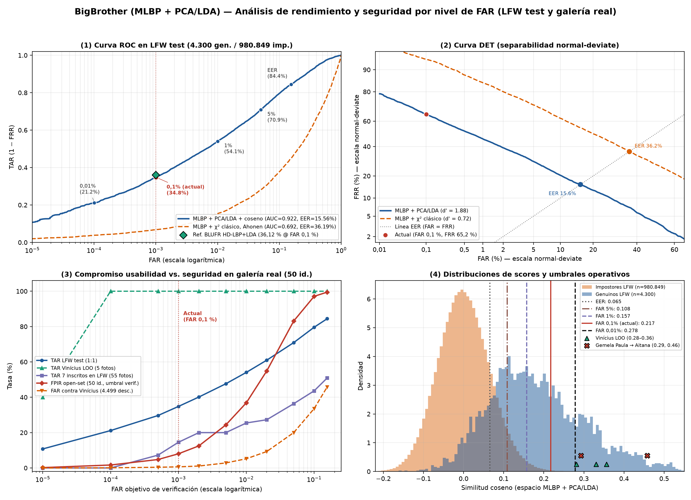
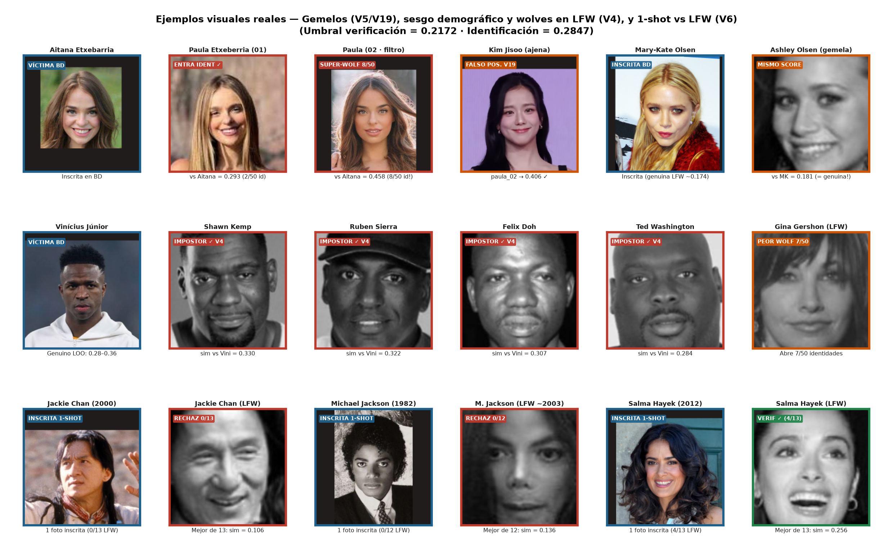

# Evaluación multi-umbral (FAR / FPIR) y compromiso seguridad–usabilidad — BigBrother

Análisis exhaustivo del rendimiento y la seguridad del sistema **BigBrother** (`MLBP + PCA blanqueado + LDA + similitud coseno`) a lo largo de distintos niveles objetivo de **FAR** (verificación 1:1) y **FPIR** (identificación *open-set* 1:N), comparando frente al *baseline* clásico **MLBP + $\chi^2$ (Ahonen et al.)** y midiendo el impacto real sobre la galería de **50 identidades** inscritas (re-ejecutado tras las correcciones de *anti-aliasing* `INTER_AREA` en `align()` y filtrado `faceness` de multi-detecciones en `recortar()`).

- **Script reproducible**: [`scripts/eval_far_levels.py`](../scripts/eval_far_levels.py)
- **Datos completos (tablas, métricas globales y curvas muestreadas)**: [`docs/resultados/eval_far_levels.json`](resultados/eval_far_levels.json)
- **Figura multi-panel**: [`docs/resultados/eval_far_levels.png`](resultados/eval_far_levels.png)

Reproducción íntegra dentro de la imagen Docker `bigbrother:eval` (sin modificar `models/`):

```bash
docker run --rm --entrypoint python \
  -v /home/cj/.cache/bigbrother:/cache:ro \
  -v "$(pwd)/scripts:/app/scripts:ro" \
  -v "$(pwd)/docs:/app/docs" \
  -v "$(pwd)/data/ataques:/app/data/ataques:ro" \
  bigbrother:eval scripts/eval_far_levels.py
```

---

## 1. Protocolo experimental y métricas globales (LFW test)

Se emplea exactamente el mismo protocolo y *split* oficial definido en [`models/lfw_split.json`](../models/lfw_split.json) y [`scripts/evaluate.py`](../scripts/evaluate.py):

- **Entrenamiento / calibración 1:N**: `8.677` imágenes de `4.017` identidades disjuntas de test y de las reservadas.
- **Evaluación 1:1 (*LFW test*)**: `4.499` imágenes de identidades no vistas ni inscritas, generando **`4.300` pares genuinos** (máx. 10 imágenes por identidad) y **`980.849` pares impostores** (`rng=1`, idéntico a `train_projection.pair_scores`).
- **Reservadas**: `57` imágenes de los `7` inscritos presentes en LFW (`55` fotos) y sus `2` gemelos en LFW (`Ashley_Olsen`, `Oliver_Phelps`), excluidas del entrenamiento y del conjunto de desconocidos.
- **Galería real**: `50` identidades (`54` *templates*: `49` identidades del docente con `1` foto —ya con el rostro real de `elisabeth_ii`— + `vinicius_junior` con `5` fotos).
- **Nota sobre el punto `0,1% (actual)`**: Se evalúa con el umbral operativo exacto de [`models/calibration.json`](../models/calibration.json) (`0,217241`), que arroja un FAR real en test de `0,1007 %` (`988 / 980.849`) frente al cuantil exacto `0,217406` (`981 / 980.849`, diferencia de `1,7e-4`). En identificación, el punto `1% (actual)` usa `0,284694` (`ident_threshold`, frente al cuantil actualizado en train `0,293798`).

### Separabilidad global: MLBP+LDA vs. MLBP+$\chi^2$

| Métrica global (LFW test: 4.300 gen. / 980.849 imp.) | MLBP + PCA/LDA + coseno (BigBrother) | MLBP + $\chi^2$ clásico (Ahonen) | Ganancia / Diferencia |
|---|---:|---:|---|
| **AUC-ROC** | **0,9224** | 0,6916 | **+0,2308** (+33,4 % rel.) |
| **EER** | **15,56 %** (umbral `0,0654`) | 36,19 % (dist. `322,30`) | **−20,63 pp** (2,33× menor error) |
| **Índice de separabilidad $d'$** | **1,883** | 0,721 | **2,61×** mayor separabilidad |
| **Media $\pm$ DE (genuinos)** | $0,1834 \pm 0,1211$ (med. `0,1686`) | $-304,85 \pm 48,21$ (med. `-305,11`) | — |
| **Media $\pm$ DE (impostores)** | $0,0009 \pm 0,0641$ (med. `-0,0005`) | $-335,49 \pm 35,83$ (med. `-334,95`) | — |
| **TAR @ FAR 0,1 % vs. BLUFR** | **34,81 %** | 6,81 % | Ref. BLUFR HD-LBP+LDA: **36,12 %** (otro protocolo, solo orientativo) |

> El blanqueo PCA + proyección discriminante LDA reduce el EER de `36,19 %` a `15,56 %`, multiplica por **2,61×** la separabilidad $d'$ y deja a BigBrother en el mismo orden que la referencia académica BLUFR (`HD-LBP+LDA`, `36,12 %` @ FAR `0,1 %`). Ojo: BLUFR usa otro protocolo (10 particiones, todo LFW, ~47 M de impostores), así que la comparación es orientativa, no un empate medido.



---

## 2. Verificación 1:1 en LFW test a lo largo de niveles de FAR

En las comparaciones sobre pares ya detectados y recortados (`4.300` genuinos, `980.849` impostores), se cumple `FMR = FAR` y `FNMR = FRR` (adicionalmente, en el flujo completo con YuNet existe un `FTA = 0,97 %` por calidad sobre LFW). Para la evaluación de **Precision** y **F1** bajo desbalanceo realista se define:
- **Prior 1:1**: $\text{Precision}_{1:1} = \frac{\text{TAR}}{\text{TAR} + \text{FAR}}$, $\text{F1}_{1:1} = \frac{2\,\text{TAR}}{1 + \text{TAR} + \text{FAR}}$.
- **Prior 1:100** (1 intento genuino por cada 100 impostores): $\text{Precision}_{1:100} = \frac{\text{TAR}}{\text{TAR} + 100\,\text{FAR}}$, $\text{F1}_{1:100} = \frac{2\,\text{TAR}}{1 + \text{TAR} + 100\,\text{FAR}}$.

### 2.1. Sistema actual: MLBP + PCA/LDA + coseno

| FAR objetivo | Umbral coseno | FAR / FMR real (FA / 980.849) | TAR (TA / 4.300) | FRR / FNMR (FR / 4.300) | Prec. (1:1) | F1 (1:1) | Prec. (1:100) | F1 (1:100) |
|---|---:|---:|---:|---:|---:|---:|---:|---:|
| **0,001 %** (`1e-5`) | `0,3381` | 0,0010 % (`10`) | 10,77 % (`463`) | 89,23 % (`3.837`) | 99,99 % | 0,194 | **99,06 %** | 0,194 |
| **0,01 %** (`1e-4`) | `0,2782` | 0,0101 % (`99`) | 21,16 % (`910`) | 78,84 % (`3.390`) | 99,95 % | 0,349 | 95,45 % | 0,346 |
| **0,05 %** (`5e-4`) | `0,2360` | 0,0501 % (`491`) | 29,67 % (`1.276`) | 70,33 % (`3.024`) | 99,83 % | 0,457 | 85,57 % | 0,441 |
| **0,1 % (actual)** | **`0,2172`** | **0,1007 % (`988`)** | **34,81 % (`1.497`)** | **65,19 % (`2.803`)** | **99,71 %** | **0,516** | **77,56 %** | **0,481** |
| **0,2 %** (`2e-3`) | `0,1998` | 0,2000 % (`1.962`) | 40,14 % (`1.726`) | 59,86 % (`2.574`) | 99,50 % | 0,572 | 66,74 % | **0,501** |
| **0,5 %** (`5e-3`) | `0,1754` | 0,5001 % (`4.905`) | 47,65 % (`2.049`) | 52,35 % (`2.251`) | 98,96 % | 0,643 | 48,79 % | 0,482 |
| **1 %** (`1e-2`) | `0,1569` | 1,0001 % (`9.809`) | 54,07 % (`2.325`) | 45,93 % (`1.975`) | 98,18 % | 0,697 | 35,09 % | 0,426 |
| **2 %** (`2e-2`) | `0,1372` | 2,0000 % (`19.617`) | 60,98 % (`2.622`) | 39,02 % (`1.678`) | 96,82 % | 0,748 | 23,36 % | 0,338 |
| **5 %** (`5e-2`) | `0,1083` | 5,0001 % (`49.043`) | 70,93 % (`3.050`) | 29,07 % (`1.250`) | 93,41 % | 0,806 | 12,42 % | 0,211 |
| **10 %** (`1e-1`) | `0,0834` | 10,0000 % (`98.085`) | 79,63 % (`3.424`) | 20,37 % (`876`) | 88,84 % | 0,840 | 7,38 % | 0,135 |
| **EER (~15,56 %)** | `0,0654` | 15,5581 % (`152.601`) | 84,44 % (`3.631`) | 15,56 % (`669`) | 84,44 % | **0,844** | 5,15 % | 0,097 |

Observaciones clave en 1:1:
- Bajo un prior realista **1:100**, la **F1 máxima (`0,501`)** se alcanza en torno a FAR `0,2 %` y el punto actual (`0,1 %`) ya obtiene `F1 = 0,481` con `77,56 %` de precisión. A partir de FAR `1 %`, la precisión bajo prior 1:100 cae al `35,09 %` (casi 2 de cada 3 aceptaciones serían impostores), y en FAR `5 %` se desploma al `12,42 %`.
- El umbral de deduplicación configurado en el sistema (`dedup_threshold = 0,278204`) coincide prácticamente con el punto **FAR 0,01 %** (`0,278215`).

### 2.2. Comparativa frente al baseline MLBP + $\chi^2$ (Ahonen)

Se evaluaron exactamente los mismos `4.300` pares genuinos y `980.849` pares impostores con distancia $\chi^2$ (menor distancia = mayor similitud):

| FAR objetivo | Umbral dist. $\chi^2$ | FAR real $\chi^2$ (FA) | TAR $\chi^2$ (TA) | FRR $\chi^2$ | TAR MLBP+LDA | Ganancia absoluta ($\Delta\text{TAR}$) | Factor de mejora |
|---|---:|---:|---:|---:|---:|---:|---:|
| **0,001 %** | $\le 201,05$ | 0,0010 % (`10`) | 2,00 % (`86`) | 98,00 % | 10,77 % | +8,77 pp | **5,38×** |
| **0,01 %** | $\le 216,16$ | 0,0101 % (`99`) | 3,84 % (`165`) | 96,16 % | 21,16 % | +17,33 pp | **5,52×** |
| **0,05 %** | $\le 227,59$ | 0,0501 % (`491`) | 5,74 % (`247`) | 94,26 % | 29,67 % | +23,93 pp | **5,17×** |
| **0,1 % (actual)** | $\le 232,93$ | 0,1000 % (`981`) | 6,81 % (`293`) | 93,19 % | **34,81 %** | **+28,00 pp** | **5,11×** |
| **0,2 %** | $\le 238,61$ | 0,2000 % (`1.962`) | 8,33 % (`358`) | 91,67 % | 40,14 % | +31,81 pp | **4,82×** |
| **0,5 %** | $\le 247,65$ | 0,5001 % (`4.905`) | 11,93 % (`513`) | 88,07 % | 47,65 % | +35,72 pp | **3,99×** |
| **1 %** | $\le 255,24$ | 1,0001 % (`9.809`) | 15,37 % (`661`) | 84,63 % | 54,07 % | +38,70 pp | **3,52×** |
| **2 %** | $\le 263,94$ | 2,0001 % (`19.618`) | 19,93 % (`857`) | 80,07 % | 60,98 % | +41,05 pp | **3,06×** |
| **5 %** | $\le 277,46$ | 5,0001 % (`49.043`) | 28,16 % (`1.211`) | 71,84 % | 70,93 % | +42,77 pp | **2,52×** |
| **10 %** | $\le 289,74$ | 10,0001 % (`98.086`) | 37,79 % (`1.625`) | 62,21 % | 79,63 % | +41,84 pp | **2,11×** |
| **EER** | $\le 322,30$ | 36,1860 % (`354.930`) | 63,81 % (`2.744`) | 36,19 % | 84,44 % (@15,56 %) | — | — |

La ganancia de PCA+LDA sobre $\chi^2$ es **superior en toda la curva ROC y DET** (paneles 1 y 2): supera el **5× en TAR** en toda la región de alta seguridad ($\text{FAR} \le 0,1\,\%$) y alcanza más de **+41 pp** de ventaja entre FAR `2 %` y `10 %`. En el régimen operativo `FAR = 0,1 %`, MLBP+$\chi^2$ apenas acepta el `6,81 %` de los genuinos (`F1_{1:100} = 0,117`), resultando inviable.

---

## 3. Impacto real en la galería de 50 identidades de BigBrother

Se evaluó cada umbral de verificación anterior sobre la galería real de `50` identidades (`54` *templates*), midiendo:
1. **Open-set `identificar`** con las `4.499` fotos de desconocidos de LFW test (qué FPIR produciría reutilizar el umbral de verificación).
2. **Sesgo contra `vinicius_junior`**: cuántos de los `4.499` desconocidos verifican como Vinícius.
3. **Efecto *wolf***: cuántas identidades distintas (de 50) llega a verificar el peor impostor de LFW test.
4. **Genuinos reales**: `vinicius_junior` (5 fotos en *leave-one-out*) y los `7` inscritos presentes en LFW (`55` fotos en total).

### 3.1. Impacto agregado por nivel de FAR de verificación

| FAR objetivo (umbral) | FPIR *open-set* si se usa umbral verif. (de 4.499) | FAR real vs. Vinícius (ratio vs. FAR) | *Wolf* máx. id./50 (peor sonda LFW) | Sondas $\ge 2$ / $\ge 5$ id. | Vinícius LOO (de 5) | 7 inscritos LFW (de 55) |
|---|---:|---:|---|---:|---:|---:|
| **0,001 %** (`0,3381`) | 0,20 % (`9`) | 0,00 % (`0`) — **0,0×** | **2** (`Naomi_Campbell`) | `1` / `0` | **2 / 5** (40 %) | **0 / 55** (0,0 %) |
| **0,01 %** (`0,2782`) | 1,67 % (`75`) | 0,09 % (`4`) — **8,8×** | **3** (`Laila_Ali`) | `10` / `0` | **5 / 5** (100 %) | **0 / 55** (0,0 %) |
| **0,05 %** (`0,2360`) | 4,78 % (`215`) | 0,40 % (`18`) — **8,0×** | **6** (`Lisa_Ling`) | `60` / `3` | **5 / 5** (100 %) | **4 / 55** (7,3 %) |
| **0,1 % (actual)** (`0,2172`) | **8,02 % (`361`)** | **0,64 % (`29`) — 6,4×** | **7** (`Gina_Gershon`) | `104` / `9` | **5 / 5** (100 %) | **8 / 55** (14,5 %) |
| **0,2 %** (`0,1998`) | 12,49 % (`562`) | 1,09 % (`49`) — **5,4×** | **8** (`Laila_Ali`) | `178` / `23` | **5 / 5** (100 %) | **11 / 55** (20,0 %) |
| **0,5 %** (`0,1754`) | 24,38 % (`1.097`) | 2,85 % (`128`) — **5,7×** | **13** (`Alanna_Ubach`) | `363` / `82` | **5 / 5** (100 %) | **11 / 55** (20,0 %) |
| **1 %** (`0,1569`) | 36,85 % (`1.658`) | 5,20 % (`234`) — **5,2×** | **17** (`Lisa_Ling`) | `652` / `151` | **5 / 5** (100 %) | **14 / 55** (25,5 %) |
| **2 %** (`0,1372`) | 54,88 % (`2.469`) | 9,29 % (`418`) — **4,6×** | **18** (`Lisa_Ling`) | `1.233` / `267` | **5 / 5** (100 %) | **15 / 55** (27,3 %) |
| **5 %** (`0,1083`) | 83,15 % (`3.741`) | 20,00 % (`900`) — **4,0×** | **24** (`Wei_Wu`) | `2.605` / `799` | **5 / 5** (100 %) | **20 / 55** (36,4 %) |
| **10 %** (`0,0834`) | 97,11 % (`4.369`) | 33,59 % (`1.511`) — **3,4×** | **29** (`Natasha_McElhone`) | `3.947` / `1.990` | **5 / 5** (100 %) | **24 / 55** (43,6 %) |
| **EER** (`0,0654`) | 99,49 % (`4.476`) | 45,83 % (`2.062`) — **2,9×** | **32** (`Natasha_McElhone`) | `4.376` / `3.306` | **5 / 5** (100 %) | **28 / 55** (50,9 %) |

Análisis de los fenómenos observados en galería:
1. **Explosión de FPIR en 1:N si se reutiliza el umbral de verificación**: Con `50` identidades (`54` *templates*), la probabilidad de al menos una falsa alarma crece aproximadamente como $1 - (1 - \text{FAR})^{N}$. A FAR `0,1 %`, la FPIR alcanza el `8,02 %` (`361` desconocidos identificados falsamente), en FAR `1 %` salta al **`36,85 %`** (más de 1 de cada 3 desconocidos entra como alguien inscrito) y en FAR `5 %` llega al **`83,15 %`**. Esto demuestra cuantitativamente por qué BigBrother separa el umbral de verificación del de identificación.
2. **Sesgo demográfico y efecto multi-template sobre `vinicius_junior`**: En prácticamente todos los niveles de FAR ($\ge 0,01\,\%$), el FAR real contra `vinicius_junior` es entre **3× y 8,8× superior** al FAR nominal de LFW test (`0,64 %` vs `0,10 %` actual; `5,20 %` vs `1,00 %`; `20,00 %` vs `5,00 %`). Se debe a dos factores combinados: (a) tener `5` *templates* inscritos aumenta la superficie de coincidencia (`max` de 5 comparaciones), y (b) LFW está fuertemente sesgado hacia hombres blancos, mientras que hombres negros similares en LFW (`Shawn_Kemp = 0,3295`, `Ruben_Sierra = 0,3218`, `Felix_Doh = 0,3075`, `Ted_Washington = 0,2840`) alcanzan puntuaciones del orden de las genuinas de Vinícius (`0,2815–0,3564`).
3. **Efecto *wolf***: Un mismo rostro bien iluminado y frontal en LFW (`Gina_Gershon`, `Lisa_Ling`, `Natasha_McElhone`, `Wei_Wu`) actúa como *wolf* biométrico: a FAR `0,1 %`, el peor *wolf* (`Gina_Gershon`, empatada a 7 con `Lisa_Ling` y `Natasha_McElhone`) verifica contra **`7` identidades distintas** (`hwang_min-hyun`, `salma_hayek`, `rossy_de_palma`, `lady_gaga`, `ellen_page`, `metrika`, `anya_taylor_joy`; bajó de 8 tras el *anti-aliasing*); a FAR `1 %` sube a **`17/50`**, a FAR `5 %` alcanza **`24/50`** (casi la mitad de la BD) y en EER llega a **`32/50`**. Si no se limita el número de intentos (V8), un atacante con una foto *wolf* puede ir probando identificadores en `verificar()` hasta abrir una cuenta.

### 3.2. Desglose por persona de los 7 inscritos presentes en LFW (55 fotos)

Las `49` identidades del docente solo cuentan con **una foto de inscripción**, a menudo de otra época, pose o expresión respecto a LFW:

| Identidad (`n` fotos LFW) | Score medio (rango) | 0,001 % | 0,01 % | 0,05 % | **0,1 % (actual)** | 0,2 % | 0,5 % | 1 % | 2 % | 5 % | 10 % | EER |
|---|---:|---:|---:|---:|---:|---:|---:|---:|---:|---:|---:|---:|
| `salma_hayek` (`13`) | `0,154` (`0,047–0,256`) | 0 | 0 | 2 | **4** (31 %) | 7 | 7 | 7 | 7 | 7 | 9 | 10 |
| `keanu_reeves` (`12`) | `0,133` (`0,042–0,259`) | 0 | 0 | 2 | **3** (25 %) | 3 | 3 | 4 | 5 | 7 | 7 | 9 |
| `mary-kate_olsen` (`3`) | `0,174` (`0,131–0,223`) | 0 | 0 | 0 | **1** (33 %) | 1 | 1 | 2 | 2 | 3 | 3 | 3 |
| `michael_jackson` (`12`) | `0,040` (`-0,014–0,136`) | 0 | 0 | 0 | **0** (0 %) | 0 | 0 | 0 | 0 | 2 | 2 | 3 |
| `jackie_chan` (`13`) | `0,027` (`-0,067–0,106`) | 0 | 0 | 0 | **0** (0 %) | 0 | 0 | 0 | 0 | 0 | 2 | 2 |
| `james_phelps` (`1`) | `0,158` (`0,158`) | 0 | 0 | 0 | **0** (0 %) | 0 | 0 | 1 | 1 | 1 | 1 | 1 |
| `christian_bale` (`1`) | `0,052` (`0,052`) | 0 | 0 | 0 | **0** (0 %) | 0 | 0 | 0 | 0 | 0 | 0 | 0 |
| **Total (`55`)** | — | **0** (0,0 %) | **0** (0,0 %) | **4** (7,3 %) | **8** (14,5 %) | **11** (20,0 %) | **11** (20,0 %) | **14** (25,5 %) | **15** (27,3 %) | **20** (36,4 %) | **24** (43,6 %) | **28** (50,9 %) |

> **Conclusión crítica de usabilidad**: Mientras `vinicius_junior` (con `5` fotos de inscripción) obtiene **`5/5` (100 %)** desde FAR `0,01 %` hasta EER (scores LOO `0,2815–0,3564`), los `7` inscritos con **1 única foto** alcanzan apenas `14,5 %` (`8/55`) en el punto actual y `0 %` en alta seguridad (`0,01 %`). Mejorar la usabilidad no debe hacerse bajando el umbral global (lo que dispara el FPIR y los *wolves*), sino inscribiendo **3–5 fotos variadas** por usuario.

---

## 4. Calibración propia de identificación 1:N (`FPIR`)

Siguiendo [`scripts/calibrate_identification.py`](../scripts/calibrate_identification.py), se calibró el umbral específico de `identificar` tomando el cuantil $1 - \text{FPIR}_{\text{obj}}$ del máximo de similitud contra las `50` identidades sobre las `8.677` caras de **LFW train**, y se evaluó su comportamiento en **LFW test** (`4.499` desconocidos) y sobre los genuinos de la galería:

| FPIR objetivo | Umbral 1:N | FPIR real train (FA / 8.677) | FPIR real test (FA / 4.499) | Vinícius LOO DIR / TAR | 7 inscritos LFW: DIR (rank-1 $\land \ge \tau$) | 7 inscritos LFW: TAR ($\ge \tau$) | Errores de confusión (*misid.*) / 55 | Paula `01` / `02` (`identificar`) |
|---|---:|---:|---:|---:|---:|---:|---:|---|
| **0,1 %** | `0,3614` | 0,10 % (`9`) | **0,07 % (`3`)** | **0 / 5** (0 %) / 0/5 | 0 / 55 (0,00 %) | 0 / 55 (0,00 %) | `0` | `None` / `aitana_etxebarria` |
| **0,5 %** | `0,3141` | 0,51 % (`44`) | **0,51 % (`23`)** | **4 / 5** (80 %) / 4/5 | 0 / 55 (0,00 %) | 0 / 55 (0,00 %) | `2` (`salma_hayek`) | `None` / `aitana_etxebarria` |
| **1 % (actual)** | **`0,2847`** | **1,39 % (`121`)** | **1,38 % (`62`)** | **4 / 5** (80 %) / 4/5 | **0 / 55 (0,00 %)** | **0 / 55 (0,00 %)** | **`3`** (`salma_hayek` 2, `mary-kate_olsen` 1) | `aitana_etxebarria` / `aitana_etxebarria` |
| **2 %** | `0,2734` | 2,01 % (`174`) | **1,76 % (`79`)** | **5 / 5** (100 %) / 5/5 | 0 / 55 (0,00 %) | 0 / 55 (0,00 %) | `3` | `aitana_etxebarria` / `aitana_etxebarria` |
| **5 %** | `0,2406` | 5,00 % (`434`) | **4,22 % (`190`)** | **5 / 5** (100 %) / 5/5 | 3 / 55 (5,45 %) | 4 / 55 (7,27 %) | `11` | `aitana_etxebarria` / `aitana_etxebarria` |
| **10 %** | `0,2132` | 10,00 % (`868`) | **8,85 % (`398`)** | **5 / 5** (100 %) / 5/5 | 5 / 55 (9,09 %) | 8 / 55 (14,55 %) | `19` | `aitana_etxebarria` / `aitana_etxebarria` |

Hallazgos importantes de la tabla 1:N:
- **Buena generalización de la calibración train $\to$ test**: La FPIR medida en LFW test (`0,07 %`, `0,51 %`, `1,76 %`, `4,22 %`, `8,85 %`) sigue fielmente a la FPIR objetivo calibrada en train (`0,1 %` a `10 %`). En el umbral fijo de `models/calibration.json` (`0,2847`), la FPIR tras las correcciones de `align()` y `elisabeth_ii` se sitúa en `1,38 %` (`62/4.499`; el cuantil exacto de 1 % en train pasa a `0,2938`).
- **`0,5 %`–`2 %` acotan la zona útil para identidades multi-muestra**: Con `1 % (actual)` (`0,2847`) o `0,5 %` (`0,3141`), Vinícius logra **`4/5` (80 %) DIR** (`vini_04.jpg` queda en `0,2815`, a `0,0032` de `0,2847`), y en `2 %` (`0,2734`) alcanza **`5/5` (100 %)** manteniendo `FPIR < 1,8 %`. En cambio, endurecer hasta `0,1 %` (`0,3614`) destruye la identificación de Vinícius (`0/5`, ya que su máximo LOO es `0,3564`).
- **Peligro de relajar el FPIR para rescatar usuarios de 1 foto**: Al bajar el umbral de identificación a FPIR `5 %` o `10 %`, los `7` inscritos apenas suben al `5,45 %` y `9,09 %` de DIR (`3/55` y `5/55`), pero **se disparan las confusiones de identidad** (`11/55` y `19/55` fotos genuinas son identificadas como *otra persona distinta* de la galería, como le ocurre a 8 fotos de Salma Hayek o 6 de Michael Jackson en FPIR `10 %`).

---

## 5. Análisis de gemelos a lo largo de los niveles de FAR

Se evaluaron las `2` fotos públicas de **Paula Etxeberria** ([`data/ataques/gemela_paula/`](../data/ataques/gemela_paula/)) contra su gemela inscrita `aitana_etxebarria` (y contra las `50` identidades de la BD), así como los gemelos presentes en LFW (**Ashley Olsen** $\to$ `mary-kate_olsen`, score `0,1813`, y **Oliver Phelps** $\to$ `james_phelps`, score `0,1324`):

| FAR objetivo (umbral) | `paula_01.jpg` (`0,2928` vs Aitana) ¿Aceptada? (id./50) | `paula_02.jpg` (`0,4581` vs Aitana) ¿Aceptada? (id./50) | `Ashley_Olsen` (`0,1813` vs MK) ¿Aceptada? (id./50) | `Oliver_Phelps` (`0,1324` vs JP) ¿Aceptada? (id./50) |
|---|---:|---:|---:|---:|
| **0,001 %** (`0,3381`) | No (`0/50`) | **Sí** (**`4/50`**) | No (`0/50`) | No (`0/50`) |
| **0,01 %** (`0,2782`) | **Sí** (`1/50`) | **Sí** (**`5/50`**) | No (`0/50`) | No (`0/50`) |
| **0,05 %** (`0,2360`) | **Sí** (`2/50`) | **Sí** (**`8/50`**) | No (`1/50`: `lara_raj`) | No (`0/50`) |
| **0,1 % (actual)** (`0,2172`) | **Sí** (`2/50`) | **Sí** (**`8/50`**) | No (`1/50`: `lara_raj`) | No (`0/50`) |
| **0,2 %** (`0,1998`) | **Sí** (`3/50`) | **Sí** (**`8/50`**) | No (`2/50`) | No (`1/50`: `rossy_de_palma`) |
| **0,5 %** (`0,1754`) | **Sí** (`4/50`) | **Sí** (**`11/50`**) | **Sí** (`3/50`) | No (`1/50`) |
| **1 %** (`0,1569`) | **Sí** (`5/50`) | **Sí** (**`15/50`**) | **Sí** (`4/50`) | No (`2/50`) |
| **2 %** (`0,1372`) | **Sí** (`5/50`) | **Sí** (**`18/50`**) | **Sí** (`6/50`) | No (`2/50`) |
| **5 %** (`0,1083`) | **Sí** (`8/50`) | **Sí** (**`23/50`**) | **Sí** (`13/50`) | **Sí** (`7/50`) |
| **10 %** (`0,0834`) | **Sí** (`11/50`) | **Sí** (**`25/50`**) | **Sí** (`19/50`) | **Sí** (`12/50`) |
| **EER** (`0,0654`) | **Sí** (`12/50`) | **Sí** (**`29/50`**) | **Sí** (`22/50`) | **Sí** (`14/50`) |

Conclusiones sobre gemelos y efecto *super-wolf* de `paula_02.jpg`:
- **`paula_02.jpg` no se frena ajustando el umbral** (aunque con solo 2 fotos de Paula, y una de ellas (`paula_02`, retrato retocado) verifica como 8 identidades (la segunda, `kim_jisoo`, con 0,406 frente a 0,458 de Aitana), no se puede separar cuánto se debe a ser gemela y cuánto a que la foto se comporte como *wolf*): Su similitud con `aitana_etxebarria` (`0,4581`) supera ampliamente incluso el umbral extremo `FAR = 0,001 %` (`0,3381`). En **todos** los niveles evaluados (`0,001 %` a `EER`) entra como Aitana y además se comporta como un *wolf* extremo (retrato frontal con filtro de belleza): verifica como **`4/50`** identidades en `FAR 0,001 %` (`aitana_etxebarria`, `kim_jisoo`, `zoe_saldana`, `taylor_swift`), **`5/50`** en `FAR 0,01 %`, **`8/50`** en el punto actual (`FAR 0,1 %`, bajando desde `10/50` antes del *anti-aliasing*), **`15/50`** en `FAR 1 %` y **`23/50`** en `FAR 5 %`.
- **`paula_01.jpg` (`0,2928`)** supera ahora tanto el umbral de verificación actual (`0,2172`) como el de alta seguridad `FAR 0,01 %` (`0,2782`) y el de identificación `0,2847` (verificando además contra `adele = 0,2426` en `FAR 0,1 %`); solo queda frenada en `FAR 0,001 %` (`0,3381`) o `FPIR 0,5 %` (`0,3141`).
- **Ashley Olsen y Oliver Phelps**: Con el preprocesado con *anti-aliasing*, `Ashley_Olsen` (`0,1813`) se rechaza contra `mary-kate_olsen` en FAR $\le 0,2\,\%$ pero entra ya a partir de **FAR `0,5 %`** (y verifica erróneamente como `lara_raj = 0,2433` desde FAR `0,05 %`), mientras que `Oliver_Phelps` (`0,1324`) se rechaza hasta FAR `2 %` y entra en FAR `5 %`. Como las fotos genuinas de `mary-kate_olsen` (`media 0,1740`) y `james_phelps` (`0,1585`) puntúan en el mismo rango, con estos datos MLBP no muestra margen para separar a estos gemelos (1 foto por gemelo de LFW y 2 de Paula: muestra muy pequeña).



---

## 6. Comparativa de puntos operativos clave y recomendación

A continuación se comparan los cuatro puntos operativos de referencia para la toma de decisiones de despliegue:

| Criterio | Alta seguridad (`FAR 0,01 %`) | **Actual (`FAR 0,1 %`)** | Equilibrado (`FAR 1 %`) | Permisivo (`FAR 5 %`) |
|---|---|---|---|---|
| **Umbral coseno** | `0,2782` | **`0,2172`** | `0,1569` | `0,1083` |
| **LFW test: FAR real (FA / 980.849)** | `0,0101 %` (`99`) | **`0,1007 %` (`988`)** | `1,0001 %` (`9.809`) | `5,0001 %` (`49.043`) |
| **LFW test: TAR / FRR (1:1)** | `21,16 %` / `78,84 %` | **`34,81 %` / `65,19 %`** | `54,07 %` / `45,93 %` | `70,93 %` / `29,07 %` |
| **Precision / F1 (prior 1:100)** | `95,45 %` / `0,346` | **`77,56 %` / `0,481`** | `35,09 %` / `0,426` | `12,42 %` / `0,211` |
| **FPIR *open-set* (umbral verif.)** | `1,67 %` (`75 / 4.499`) | **`8,02 %` (`361 / 4.499`)** | `36,85 %` (`1.658 / 4.499`) | `83,15 %` (`3.741 / 4.499`) |
| **FAR vs. `vinicius_junior`** | `0,09 %` (`4 / 4.499`) | **`0,64 %` (`29 / 4.499`)** | `5,20 %` (`234 / 4.499`) | `20,00 %` (`900 / 4.499`) |
| **Peor *wolf* LFW (id./50)** | `3 / 50` | **`7 / 50`** | `17 / 50` | `24 / 50` |
| **Vinícius LOO (5 fotos)** | **`5 / 5`** (`100 %`) | **`5 / 5` (`100 %`)** | `5 / 5` (`100 %`) | `5 / 5` (`100 %`) |
| **7 inscritos LFW (55 fotos)** | `0 / 55` (`0,0 %`) | **`8 / 55` (`14,5 %`)** | `14 / 55` (`25,5 %`) | `20 / 55` (`36,4 %`) |
| **Gemelas (`paula_01` / `paula_02`)** | Sí (`1/50`) / Sí (`5/50`) | **Sí (`2/50`) / Sí (`8/50`)** | Sí (`5/50`) / Sí (`15/50`) | Sí (`8/50`) / Sí (`23/50`) |

### Escenarios de aplicación y recomendación

1. **Alta seguridad (`FAR 0,01 %`, umbral `0,2782`)**:
   - *Escenario*: Control de acceso crítico, operaciones financieras, validación de identidad sin segundo factor o política *zero-trust* donde una falsa aceptación tiene coste alto.
   - *Coste*: El FAR contra Vinícius cae a `0,09 %` (`4/4.499`) y los *wolves* se limitan a `3/50`; además el umbral coincide con el de deduplicación (`dedup_threshold`), evitando *false matches* al inscribir. Sin embargo, exige **inscripción multi-muestra obligatoria** (5 fotos): con 1 sola foto de baja calidad/otra época, los 7 inscritos caen al `0 %` (`FRR = 78,84 %` en LFW), mientras Vinícius mantiene `5/5`.
2. **Punto operativo actual (`FAR 0,1 %` en verificación = `0,2172`; `FPIR ~1 %` en identificación = `0,2847`) — *Recomendado por defecto***:
   - *Escenario*: Sistema general de verificación 1:1 e identificación *open-set* 1:N de BigBrother en su configuración actual (descriptor clásico MLBP+LDA).
   - *Justificación*: En 1:1 logra casi el máximo de `F1` bajo prior realista 1:100 (`0,481`, frente al pico de `0,501` en `0,2 %`), con `77,56 %` de precisión y `100 %` (`5/5`) en Vinícius LOO. Además, el uso de un umbral independiente para `identificar` (`0,2847`) reduce las falsas identificaciones de desconocidos del `8,02 %` (`361/4.499`) al `1,38 %` (`62/4.499`), manteniendo `4/5` DIR en Vinícius (y `0,2938` devolvería exactamente `FPIR = 1,0 %` si se recalibrara `models/calibration.json`).
3. **Equilibrado (`FAR 1 %`, umbral `0,1569`)**:
   - *Escenario*: **Solo** en flujos de baja criticidad o **con segundo factor** (p. ej. PIN/tarjeta + cara, o filtro previo de calidad/reintento asistido) donde se busque reducir la FRR en condiciones no controladas.
   - *Coste*: Aunque sube el TAR 1:1 al `54,07 %`, el coste de seguridad en esta galería es severo: `1` de cada `19` desconocidos verifica como Vinícius (`5,20 %`), el peor *wolf* abre `17/50` identidades y usarlo en `identificar` dispararía la FPIR al `36,85 %`. Además, apenas recupera `6` fotos más de los 7 inscritos (`14/55` frente a `8/55`).
4. **Permisivo (`FAR 5 %`, umbral `0,1083`)**:
   - *Escenario*: Únicamente como pre-filtro candidato (*shortlist* de revisión humana asistida por un operador) o demostración de usabilidad sin valor de control de acceso.
   - *Coste*: Inaceptable como mecanismo de autenticación autónomo: `20,00 %` de desconocidos entra como Vinícius (`900/4.499`), un *wolf* verifica `24/50` identidades, todos los gemelos (`paula_01`, `paula_02`, `Ashley_Olsen`, `Oliver_Phelps`) superan el umbral y la precisión bajo prior 1:100 cae al `12,42 %`.

### Recomendación de ingeniería derivada

- **Mantener `FAR = 0,1 %` (`0,2172`) para verificación y `FPIR ~1 %` (`0,2847`, o `0,2938` en una recalibración futura) para identificación** mientras se conserve el extractor MLBP+LDA (o pasar a `FAR 0,01 %` / `FPIR 0,5 %` si todos los usuarios cuentan con 5 fotos frontales de inscripción).
- **No intentar compensar la FRR de usuarios con 1 sola foto (`14,5 %` TAR en los 7 inscritos) bajando el umbral**: bajar de `0,217` a `0,157` (10× más FAR) apenas sube su TAR de `14,5 %` a `25,5 %`, pero multiplica por **8×** las falsas aceptaciones contra Vinícius y por **4,6×** la FPIR. La solución real es **enrolamiento multi-muestra (3–5 fotos)** + **bloqueo por límite de intentos (*rate limiting*)** frente a sondas *wolf*.
