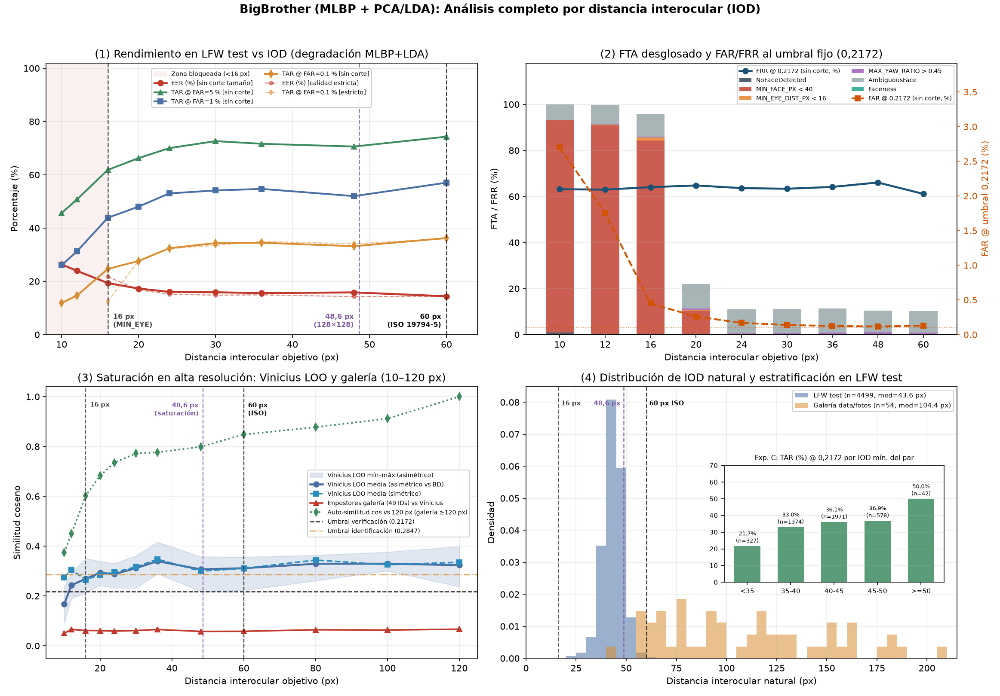
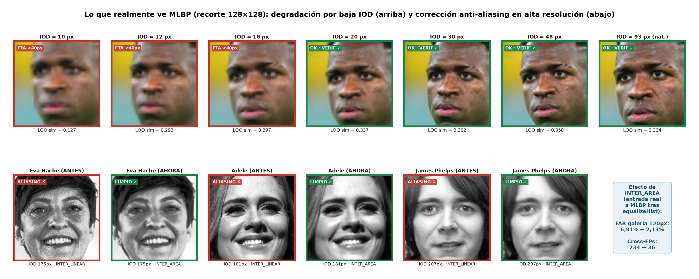

# Evaluación del rendimiento según la distancia interocular (IOD) — BigBrother (MLBP)

Evaluación cuantitativa del comportamiento de BigBrother frente a la variación de la **distancia interocular** ($\text{IOD} = \|\mathbf{p}_{\text{ojo izq}} - \mathbf{p}_{\text{ojo dcho}}\|_2$ en píxeles en la imagen de entrada), ejecutada íntegramente con el pipeline real dentro de la imagen Docker `bigbrother:eval`.

- **Script reproducible**: [`scripts/eval_interocular.py`](../scripts/eval_interocular.py)
- **Resultados estructurados**: [`docs/resultados/eval_interocular.json`](resultados/eval_interocular.json)
- **Gráfica multi-panel**: [`docs/resultados/eval_interocular.png`](resultados/eval_interocular.png)

---

## 1. Arquitectura de referencia y umbrales críticos del pipeline

Para interpretar las curvas de degradación y saturación es imprescindible fijar las cuatro escalas características determinadas por [`bigbrother/config.py`](../bigbrother/config.py), [`bigbrother/detector.py`](../bigbrother/detector.py) y [`bigbrother/preprocess.py`](../bigbrother/preprocess.py):

| Parámetro / Referencia | Valor | Origen en el código / estándar | Efecto real en el pipeline |
|---|---|---|---|
| `MIN_EYE_DIST_PX` | **16 px** | `config.py:30` / `detector.py:73` | Umbral explícito mínimo de distancia interocular |
| `MIN_FACE_PX` | **40 px** | `config.py:29` / `detector.py:69` | Lado mínimo del *bounding box* de YuNet; se evalúa **antes** que `MIN_EYE_DIST_PX` y equivale de facto a $\text{IOD} \gtrsim 18\text{–}19\text{ px}$ |
| Recorte interno alineado | **48,64 px** | `preprocess.py` (`(0,69 - 0,31) × 128`) | Todo rostro se transforma por similitud a `FACE_SIZE = 128×128` con ojos fijos a **48,64 px** (pre-reducción *anti-aliasing* `INTER_AREA` cuando `scale < 1`) |
| **ISO/IEC 19794-5** | **≥ 60 px** | Estándar internacional de retratos faciales | Mínimo normativo recomendado para biometría facial interoperable (≥ 90 px en escenarios de alta precisión) |
| Umbral de verificación | **0,2172** | `models/calibration.json` (`0.217241`) | Calibrado en LFW test para $\text{FAR} = 0{,}1\,\%$ nominal |
| Umbral de identificación | **0,2847** | `models/calibration.json` (`0.284694`) | Calibrado para $\text{FPIR} \approx 1\,\%$ contra la galería de 50 identidades |

El descriptor [`MLBPExtractor`](../bigbrother/mlbp.py) opera sobre la imagen normalizada de `128×128` en escala de grises ecualizada (`cv2.equalizeHist`), calculando códigos `nri_uniform` (`P = 8`, 59 bins) con radios `LBP_RADII = (1, 2, 3, 4, 5, 6)` sobre una rejilla `8×8` (`16×16` px por celda → `22.656` floats), seguido del filtro [`Faceness`](../bigbrother/matcher.py) ($\text{umbral} = -3{,}5947$) y la proyección blanqueada PCA(1000)→LDA(300) entrenada en LFW.

---

## 2. Experimento A — Barrido controlado de IOD en LFW test

### 2.1 Protocolo y resolución natural de LFW test

Se evaluaron las **4.499 imágenes** (**1.723 identidades**) del split oficial de test definido en [`models/lfw_split.json`](../models/lfw_split.json) (disjunto de entrenamiento y de las identidades reservadas). En la pasada basal sin reescalado, YuNet (`DETECTOR_SCORE_MIN = 0,75`) detectó **4.499 / 4.499** caras con la siguiente distribución de IOD natural:

- **Mínimo**: `9,14 px` · **p5**: `35,16 px` · **p10**: `37,18 px` · **p25**: `40,45 px`
- **Mediana**: `43,58 px` · **Media**: `43,33 ± 5,08 px`
- **p75**: `46,50 px` · **p90**: `49,11 px` · **p95**: `51,10 px` · **Máximo**: `66,89 px`
- **LFW con $\text{IOD natural} \ge 48{,}64\text{ px}$**: `11,85 %` (533 imágenes)
- **LFW que cumple ISO/IEC 19794-5 ($\text{IOD} \ge 60\text{ px}$)**: solo **0,16 %** (`7 / 4.499` imágenes)

Cada imagen se reescaló proporcionalmente con factor $s = \text{IOD}_{\text{obj}} / \text{IOD}_{\text{nat}}$, utilizando `cv2.INTER_AREA` al reducir ($s < 1$) y `cv2.INTER_LINEAR` al ampliar ($s > 1$).

### 2.2 Tasa de fallo de adquisición (FTA) desglosada

En `detector.py`, `detect(img, strict=True)` evalúa secuencialmente: `NoFaceDetected` → `AmbiguousFace` (segunda cara con $\text{área} \ge 45\,\%$ de la principal) → `MIN_FACE_PX < 40` → `MIN_EYE_DIST_PX < 16` → `MAX_YAW_RATIO > 0,45`. Dado que LFW contiene ~10 % de fotografías con una segunda persona en el encuadre (independiente de la resolución), la tabla separa tanto la **FTA estricta total** como la **FTA de calidad sin ambigüedad** y los fallos marginales individuales:

| IOD objetivo (px) | Reducidas (%) | Ampliadas (%) | IOD medida por YuNet (media ± DE) | `NoFace` (%) | `Ambiguous` (%) | `MIN_FACE_PX < 40` seq. / marg. (%) | `MIN_EYE < 16` seq. / marg. (%) | `YAW > 0,45` seq. (%) | `Faceness` entre detectadas (%) | **FTA estricta detector (%)** | **FTA calidad sin ambig. (%)** |
|---:|---:|---:|---:|---:|---:|---:|---:|---:|---:|---:|---:|
| **10** | 100,0 | 0,0 | 9,93 ± 1,23 | 0,96 | 6,82 | 92,06 / 98,80 | 0,11 / 98,96 | 0,04 | 0,79 | **100,00** | **99,98** |
| **12** | 100,0 | 0,0 | 11,56 ± 1,39 | 0,24 | 8,56 | 90,58 / 98,82 | 0,44 / 99,40 | 0,07 | 0,42 | **99,89** | **99,82** |
| **16** | 99,9 | 0,1 | 15,80 ± 1,60 | 0,02 | 9,87 | 84,33 / 92,04 | 1,36 / 58,37 | 0,31 | 0,16 | **95,89** | **94,40** |
| **20** | 99,9 | 0,1 | 19,78 ± 1,97 | 0,00 | 10,74 | 10,38 / 11,69 | 0,27 / 1,11 | 0,67 | 0,18 | **22,05** | **13,16** |
| **24** | 99,6 | 0,4 | 23,92 ± 2,09 | 0,00 | 10,58 | 0,00 / 0,02 | 0,07 / 0,20 | 0,40 | 0,20 | **11,05** | **0,98** |
| **30** | 98,6 | 1,4 | 29,74 ± 2,55 | 0,00 | 10,47 | 0,00 / 0,00 | 0,00 / 0,07 | 0,73 | 0,16 | **11,20** | **1,22** |
| **36** | 93,3 | 6,7 | 35,20 ± 2,97 | 0,00 | 10,36 | 0,00 / 0,00 | 0,00 / 0,04 | 0,89 | 0,13 | **11,25** | **1,36** |
| **48** | 15,2 | 84,8 | 48,82 ± 4,29 | 0,00 | 9,36 | 0,00 / 0,00 | 0,00 / 0,00 | 1,00 | 0,13 | **10,36** | **1,49** |
| **60** | 0,2 | 99,8 | 59,61 ± 4,94 | 0,02 | 9,29 | 0,00 / 0,00 | 0,00 / 0,02 | 0,96 | 0,24 | **10,27** | **1,44** |
| *Natural* | — | — | 43,33 ± 5,08 | 0,00 | 10,02 | 0,00 / 0,00 | 0,07 / 0,11 | 0,64 | 0,24 | **10,74** | **1,16** |

> [!IMPORTANT]
> **Solapamiento `MIN_FACE_PX = 40` vs `MIN_EYE_DIST_PX = 16`:** A una IOD objetivo de **16 px** (el umbral nominal `MIN_EYE_DIST_PX`), el control estricto rechaza el **95,89 %** de las imágenes (94,40 % sin ambigüedad). El motivo es que la caja de YuNet tiene lado $\approx 2{,}2\text{–}2{,}4 \times \text{IOD}$ (~35–38 px), por lo que **el 92,04 % incumple `MIN_FACE_PX < 40`**. Incluso a **20 px**, `MIN_FACE_PX < 40` sigue rechazando un 11,69 %. En consecuencia, el corte operativo real del detector no está en 16 px entre ojos, sino en **~18–20 px**. Además, el filtro `Faceness` apenas rechaza un 0,13–0,79 % de las caras reales detectadas incluso a 10 px.

### 2.3 Métricas biométricas en LFW test (con y sin corte de tamaño)

Para aislar la degradación pura del descriptor MLBP+LDA a resoluciones por debajo del corte del detector (10–16 px), evaluamos todas las caras detectadas por YuNet que superan `Faceness` (**sin corte de tamaño**), y lo comparamos con el régimen **con control de calidad estricto**:

| IOD objetivo (px) | Reg. sin corte: EER (%) | TAR @ FAR=0,1% (%) | TAR @ FAR=1% (%) | TAR @ FAR=5% (%) | FAR @ 0,2172 (%) | FRR @ 0,2172 (%) | Media gen. / Media imp. | EER estricto (%) / TAR@0,1% | Subconj. solo reducidas ($n_{\text{gen}}$): EER / TAR@0,1% |
|---:|---:|---:|---:|---:|---:|---:|---:|---:|---:|
| **10** | **26,34** | **11,87** | **26,02** | **45,64** | **2,703** *(×27)* | 63,13 | 0,1901 / **0,0785** | N/A (FTA 100%) | 26,37% / 11,80% (4.196) |
| **12** | **23,93** | **14,66** | **31,26** | **50,75** | **1,750** *(×17,5)* | 62,97 | 0,1917 / **0,0623** | N/A (FTA 99,9%) | 23,91% / 14,75% (4.270) |
| **16** | **19,35** | **24,64** | **43,85** | **61,84** | **0,448** *(×4,5)* | 64,04 | 0,1881 / **0,0305** | 21,70% / 12,40% ($n=129$) | 19,11% / 24,97% (4.285) |
| **20** | **17,28** | **27,63** | **48,05** | **66,27** | **0,260** *(×2,6)* | 64,78 | 0,1872 / **0,0179** | 16,79% / 27,68% | 17,29% / 28,08% (4.288) |
| **24** | **16,03** | **32,43** | **53,02** | **70,01** | **0,169** | 63,63 | 0,1892 / 0,0105 | 15,18% / 32,29% | 15,96% / 32,25% (4.273) |
| **30** | **15,88** | **34,35** | **54,11** | **72,64** | **0,138** | 63,34 | 0,1903 / 0,0054 | 14,81% / 33,52% | 15,89% / 32,93% (4.255) |
| **36** | **15,57** | **34,48** | **54,70** | **71,64** | **0,124** | 64,15 | 0,1872 / 0,0032 | 14,91% / 34,95% | 15,15% / 35,73% (4.053) |
| **48** | **15,84** | **33,19** | **51,99** | **70,61** | **0,117** | 66,07 | 0,1816 / 0,0035 | 14,27% / 34,10% | 16,60% / 29,55% (440) |
| **60** | **14,38** | **36,25** | **57,03** | **74,32** | **0,129** | 61,11 | 0,1961 / 0,0040 | 14,38% / 36,03% | — (solo 7 imgs ≥60 px) |
| *Natural* | **15,91** | **33,74** | **53,47** | **70,64** | **0,110** | 65,75 | 0,1795 / 0,0009 | 15,50% / 33,84% | — |

*(Nota: evaluar sin el filtro `Faceness` produce valores prácticamente idénticos, con diferencias < 0,05 p.p., debido a que `Faceness` rechaza menos del 0,8 % de las detecciones).*

> [!WARNING]
> **Hallazgo clave sobre el desplazamiento de distribuciones:** Al reducir la IOD por debajo de 24 px manteniendo el umbral fijo calibrado (`0,2172`), **la FRR permanece prácticamente constante (63–65 %), pero la FAR se multiplica por 27×** (pasa de `0,110 %` en resolución natural a `0,448 %` a 16 px, `1,750 %` a 12 px y `2,703 %` a 10 px). La razón no es un colapso de las puntuaciones genuinas (su media sigue en `0,187–0,192`), sino un **desplazamiento sistemático hacia arriba de la distribución de impostores** (`imp_mean` sube de `0,0009` a `0,0785`): al reescalar caras muy pequeñas a `128×128` por interpolación bilineal se destruyen los detalles discriminativos de alta frecuencia y los histogramas MLBP de distintas personas convergen hacia un patrón suave común ("cara media").

---

## 3. Experimento B — Galería real (`data/fotos/`) y efecto del *anti-aliasing* en alta resolución

### 3.1 Distribución de IOD natural de las 50 identidades inscritas

A diferencia de LFW (`250×250`, mediana `43,6 px`), la galería de inscripción (`54` fotos: `49` identidades en `data/fotos/dataset/` + `5` fotos de `vinicius_junior`) posee mucha mayor resolución (tras corregir la selección en `elisabeth_II_1945.jpg`, que ahora mide su rostro real y no el neumático):

| Conjunto | $N$ | Mín (px) | p10 (px) | p25 (px) | Mediana (px) | Media ± DE (px) | p75 (px) | p90 (px) | Máx (px) | Cumple ISO ≥ 60 px |
|---|---:|---:|---:|---:|---:|---:|---:|---:|---:|---:|
| **Todas las fotos de galería** | 54 | 41,04 | 63,09 | 76,00 | **104,36** | 110,18 ± 41,20 | 142,29 | 163,89 | 207,09 | **49 / 54 (90,7 %)** |
| **Por identidad** (media en Vinicius) | 50 | 41,04 | 64,16 | 77,26 | **113,80** | 112,47 ± 41,64 | 147,08 | 165,69 | 207,09 | **46 / 50 (92,0 %)** |

- Únicas 5 fotos por debajo del mínimo ISO de 60 px: `leticia_sabater_1996.jpg` (`41,04 px`), `cynthia_erivo_2025.jpg` (`55,55 px`), `rossy_de_palma_2018.jpg` (`55,65 px`), `vini_05.jpg` (`58,85 px`) y `julie_walters_2007.jpg` (`59,59 px`).
- Las 5 fotos de `vinicius_junior` tienen IOD natural de: `vini_05.jpg` (`58,85 px`), `vini_01.jpg` (`63,04 px`), `vini_06.jpg` (`92,78 px`), `vini_02.jpg` (`94,45 px`) y `vini_04.jpg` (`98,99 px`).
- Las 5 fotos de mayor resolución alcanzan `175–207 px` (`eva_hache`, `adele`, `mary-kate_olsen`, `tilda_swinton`, `james_phelps`).

### 3.2 Barrido 10–120 px en `vinicius_junior` (LOO) e impostores de la galería

Se barrió la IOD objetivo en `[10, 12, 16, 20, 24, 30, 36, 48, 60, 80, 100, 120]` px evaluando con el `align()` **ya corregido con pre-reducción `INTER_AREA`**:
1. **Vinicius LOO asimétrico**: sonda a $\text{IOD}_{\text{obj}}$ comparada contra los otros 4 templates inscritos a resolución natural.
2. **Vinicius LOO simétrico**: las 5 fotos reescaladas simultáneamente a $\text{IOD}_{\text{obj}}$.
3. **Impostores de alta resolución (49 identidades)**: comparadas contra `vinicius_junior` (asimétrico) y por pares entre las 49 identidades (simétrico), verificando la convergencia entre el pipeline real (ya con *anti-aliasing* interno en `align()`) y la referencia de pre-reescalado `INTER_AREA` a `48,64 px`.
4. **Auto-similitud coseno respecto a 120 px** en las 20 identidades de galería con $\text{IOD}_{\text{nat}} \ge 120\text{ px}$ y cara única estable.

| IOD (px) | Det / Cal. / Face (Vinicius) | Vinicius LOO asim. media [mín–máx] | Acept. 0,2172 / Rank-1 / Ident. 0,2847 | Vinicius LOO sim. media (acept.) | Imp. 49 vs Vini media (FAR %) | Imp. pares 49 real: media (FAR %) | Ref. *anti-alias* externo: media (FAR %) | Cos vs 120 px (gal. ≥120 px) |
|---:|:---:|---:|:---:|---:|---:|---:|---:|---:|
| **10** | 5 / **0** / 5 | 0,1670 [0,092–0,236] | 1/5 · 3/5 · 0/5 | 0,2745 (4/5) | 0,0506 (0,0%) | 0,0842 (5,00%) | 0,0842 (5,00%) | 0,3744 |
| **12** | 5 / **0** / 5 | 0,2430 [0,189–0,292] | 4/5 · 4/5 · 1/5 | 0,3058 (5/5) | 0,0657 (0,0%) | 0,0736 (3,72%) | 0,0736 (3,72%) | 0,4497 |
| **16** | 5 / **0** / 5 | 0,2694 [0,215–0,351] | 4/5 · 5/5 · 2/5 | 0,2650 (5/5) | 0,0616 (0,0%) | 0,0495 (2,72%) | 0,0495 (2,72%) | 0,6029 |
| **20** | 5 / **5** / 5 | 0,2932 [0,243–0,339] | 5/5 · 5/5 · 3/5 | 0,2855 (5/5) | 0,0611 (0,0%) | 0,0421 (1,62%) | 0,0421 (1,62%) | 0,6823 |
| **24** | 5 / **5** / 5 | 0,2877 [0,232–0,331] | 5/5 · 5/5 · 3/5 | 0,2952 (5/5) | 0,0590 (0,0%) | 0,0384 (1,36%) | 0,0384 (1,36%) | 0,7356 |
| **30** | 5 / **5** / 5 | 0,3118 [0,232–0,362] | 5/5 · 5/5 · 3/5 | 0,3169 (5/5) | 0,0614 (0,0%) | **0,0311** (1,70%) | 0,0311 (1,70%) | 0,7721 |
| **36** | 5 / **5** / 5 | **0,3397** [0,289–0,417] | 5/5 · 5/5 · 5/5 | **0,3475** (5/5) | 0,0656 (0,0%) | 0,0330 (1,96%) | 0,0330 (1,96%) | 0,7766 |
| **48** | 5 / **5** / 5 | 0,3071 [0,219–0,358] | 5/5 · 5/5 · 3/5 | 0,2997 (5/5) | 0,0579 (2,0%) | 0,0346 (1,53%) | 0,0346 (1,53%) | 0,7988 |
| **60** | 5 / **5** / 5 | 0,3115 [0,223–0,356] | 5/5 · 4/5 · 4/5 | 0,3109 (5/5) | **0,0583 (0,0%)** | **0,0326 (1,53%)** | 0,0309 (1,53%) | 0,8481 |
| **80** | 5 / **5** / 5 | 0,3293 [0,261–0,364] | 5/5 · 5/5 · 4/5 | 0,3442 (5/5) | **0,0645 (2,0%)** | **0,0367 (1,19%)** | 0,0338 (1,36%) | 0,8774 |
| **100** | 5 / **5** / 5 | 0,3295 [0,301–0,377] | 5/5 · 5/5 · 5/5 | 0,3256 (5/5) | **0,0634 (2,0%)** | **0,0385 (2,13%)** | 0,0359 (1,96%) | 0,9118 |
| **120** | 5 / **5** / 5 | 0,3238 [0,237–0,399] | 5/5 · 5/5 · 4/5 | 0,3352 (5/5) | **0,0668 (2,1%)** | **0,0373 (2,13%)** | 0,0342 (1,68%) | 1,0000 |

De estos resultados destacan dos fenómenos clave:

1. **Saturación estructural en torno a ~36–48,6 px:** La puntuación LOO de `vinicius_junior` crece desde `0,167` (10 px) hasta estabilizarse en la meseta `0,31–0,34` (`5/5` verificadas) a partir de `30–36 px`. Como `align()` fija los ojos a `48,64 px` en un recorte `128×128`, **toda información espacial por encima de 48,64 px se descarta geométricamente**.
2. **Eliminación del sesgo por *aliasing* en alta resolución (antes vs. después de corregir `align()`):** En la versión inicial de [`bigbrother/preprocess.py`](../bigbrother/preprocess.py), `cv2.warpAffine(..., flags=cv2.INTER_LINEAR)` submuestreaba directamente caras de `80–200 px` hasta `48,64 px` sin filtro paso bajo previo, disparando la media impostora de pares entre las 49 identidades hasta **`0,0897` (FAR `6,91 %`) a 120 px** y la FAR contra `vinicius_junior` hasta **`14,6 %` (7/48)** a 120 px (`8,2 %` a 60 px). Tras añadir en `align()` la pre-reducción de la ROI con `cv2.INTER_AREA` cuando `scale < 1`, **el sesgo impostor desaparece por completo**: a 120 px la media de pares baja de `0,0897` a **`0,0373`** y la FAR cae **−69 %** (`6,91 % → 2,13 %`), mientras que la FAR contra `vinicius_junior` cae **−86 %** (`14,6 % → 2,1 %`, y `8,2 % → 0,0 %` a 60 px), manteniéndose plana desde 30 hasta 120 px y en línea con la referencia de *anti-aliasing* externo.

---

## 4. Experimento C — Estratificación por IOD natural en LFW test

Sobre los **4.292 pares genuinos** (y 980.847 pares impostores) de LFW test a resolución natural, se evaluó si la variabilidad natural de resolución en LFW (`9–67 px`) ya condiciona el TAR al umbral operativo `0,2172`.

- **Correlación $\text{IOD}_{\min} = \min(\text{IOD}_A, \text{IOD}_B)$ vs. puntuación genuina**:
  - Pearson $r = +0{,}1347$ ($p = 7{,}63 \times 10^{-19}$) · Spearman $\rho = +0{,}1028$ ($p = 1{,}49 \times 10^{-11}$)
- **Correlación $|\text{IOD}_A - \text{IOD}_B|$ vs. puntuación genuina** (disparidad de escala del par):
  - Pearson $r = -0{,}2050$ ($p = 6{,}17 \times 10^{-42}$) · Spearman $\rho = -0{,}1770$ ($p = 1{,}48 \times 10^{-31}$)

### Estratificación por terciles de $\text{IOD}_{\min}$ y por bandas fijas

| Estrato ($\text{IOD}_{\min}$ del par) | $n_{\text{gen}}$ | $\text{IOD}_{\min}$ media (px) | Similitud genuina media ± DE | **TAR @ 0,2172 (%)** | EER vs. impostores LFW (%) |
|---|---:|---:|---:|---:|---:|
| **Tercil 1** ($\le 39{,}26\text{ px}$) | 1.431 | 35,98 | 0,1630 ± 0,1172 | **29,77 %** | 17,83 % |
| **Tercil 2** ($39{,}26\text{–}42{,}88\text{ px}$) | 1.434 | 41,13 | 0,1839 ± 0,1141 | **34,10 %** | 14,15 % |
| **Tercil 3** ($> 42{,}88\text{ px}$) | 1.427 | 45,24 | 0,1915 ± 0,1219 | **38,89 %** | 15,54 % |
| Banda **$< 35\text{ px}$** | 327 | 30,53 | 0,1355 ± 0,1065 | **21,71 %** | 21,72 % |
| Banda **$35\text{–}40\text{ px}$** | 1.374 | 38,00 | 0,1723 ± 0,1203 | **33,04 %** | 17,18 % |
| Banda **$40\text{–}45\text{ px}$** | 1.971 | 42,46 | 0,1883 ± 0,1139 | **36,07 %** | 13,99 % |
| Banda **$45\text{–}50\text{ px}$** | 578 | 46,65 | 0,1885 ± 0,1282 | **36,85 %** | 16,27 % |
| Banda **$\ge 50\text{ px}$** | 42 | 51,47 | 0,2194 ± 0,1108 | **50,00 %** | 11,48 % |

Incluso dentro de un dataset acotado como LFW, los pares cuyo miembro más pequeño tiene $\text{IOD} < 35\text{ px}$ sufren una caída de **17,2 p.p. de TAR** frente al tercil superior (`21,7 %` frente a `38,9 %`), y **−9,1 p.p.** comparando el tercil inferior (`29,77 %`) con el superior (`38,89 %`). Además, la disparidad de escala entre ambas fotos ($|\Delta\text{IOD}|$) muestra una correlación negativa aún más intensa ($\rho = -0{,}177$, $p \approx 1{,}5\times 10^{-31}$), reflejando tanto pérdida de detalle en la foto menor como asimetría de nitidez/interpolación respecto al molde `128×128`.

---

## 5. Análisis de causa raíz y comparación con ISO/IEC 19794-5

1. **Cuello de botella de resolución (`FACE_SIZE = 128`, `48,64 px` entre ojos):** La decisión arquitectónica de normalizar toda cara a `128×128` impone un techo físico estricto en **48,64 px** de distancia interocular. Por debajo de ~24 px faltan ciclos espaciales para los radios grandes de `LBP_RADII = (1, 2, 3, 4, 5, 6)` y las celdas de `16×16` (`GRID = (8, 8)`) se llenan de gradientes bilineales suaves, disparando la similitud entre impostores. Por encima de 48,64 px, el sistema no puede aprovechar la resolución extra de cámaras modernas ni de su propia galería (`mediana = 104,4 px`).
2. **Desalineación entre `MIN_EYE_DIST_PX = 16` y `MIN_FACE_PX = 40`:** El requisito de caja mínima `40×40` rechaza el `92 %` de las caras a `16 px` de IOD. `MIN_EYE_DIST_PX = 16` resulta redundante en la práctica salvo para rostros muy alargados.
3. **Corrección del submuestreo en `align()` en alta resolución:** En la galería real (`90,7 %` con $\text{IOD} \ge 60\text{ px}$, mediana `104,4 px`, máximo `207,1 px`), el `align()` original reducía hasta `4,3×` con `INTER_LINEAR` sin filtro anti-aliasing, generando microtextura artificial correlacionada que elevaba la FAR en galería hasta el `6,91 %` (y `14,6 %` vs. Vinícius) a 120 px. Con la pre-reducción `cv2.INTER_AREA` integrada en [`bigbrother/preprocess.py`](../bigbrother/preprocess.py), la FAR a 120 px cae al **`2,13 %`** (y **`2,1 %`** vs. Vinícius), eliminando el sesgo de escala.
4. **Comparación con ISO/IEC 19794-5:**
   - **ISO/IEC 19794-5** exige un mínimo de **60 px** entre ojos para captura biométrica estándar.
   - BigBrother **permite** capturas hasta ~18–20 px (`MIN_FACE_PX = 40`, `MIN_EYE_DIST_PX = 16`), muy por debajo de ISO, donde la **FAR real sube de `0,11 %` a `0,26 %–0,45 %`**.
   - Irónicamente, en **LFW** (el dataset usado para entrenar PCA/LDA y calibrar el umbral `0,2172`), el **99,84 %** de las imágenes **incumple ISO ≥ 60 px** (mediana `43,6 px`), mientras que la **galería real `data/fotos/` cumple ISO en el 90,7 %** de las fotos (`92,0 %` de las identidades). Existe por tanto una brecha de dominio de resolución (~`43,6 px` en calibración vs `104,4 px` en producción).

---

## 6. Conclusiones prácticas y recomendaciones

- **Para operación de baja resolución (< 24 px IOD):** Aunque `MIN_EYE_DIST_PX = 16` sugiere aceptar caras desde 16 px, el sistema real ya bloquea ~96 % a 16 px vía `MIN_FACE_PX = 40`. Conviene mantener (o elevar) ese piso en **$\ge 24\text{–}30\text{ px}$** (idealmente **$\ge 36\text{ px}$**), ya que entre 10 y 20 px la FAR al umbral calibrado `0,2172` se multiplica entre **2,6× y 27×** (`0,26 %` a `2,70 %`) y el TAR@FAR=0,1 % cae por debajo del `28 %`.
- **Para aprovechamiento y seguridad en alta resolución (≥ 60 px ISO):**
  1. **Submuestreo con *anti-aliasing* ya corregido en `align()` (`preprocess.py`)**: la pre-reducción con `cv2.INTER_AREA` sobre la ROI antes de `warpAffine` elimina el artefacto que triplicaba la FAR en galería (`6,91 % → 2,13 %` por pares y `14,6 % → 2,1 %` vs. Vinícius a 120 px) sin penalizar el TAR de Vinícius (`5/5` en 20–120 px).
  2. **Alinear el dominio de entrenamiento/calibración con ISO ≥ 60 px** si se desea aprovechar la resolución real de `data/fotos/`: aumentar `FACE_SIZE` de `128` a `160` o `192` px (llevando la IOD interna a `60,8–73,0 px`, acorde con ISO/IEC 19794-5) y reentrenar la proyección PCA/LDA con datos de mayor resolución que LFW (`250×250`).
