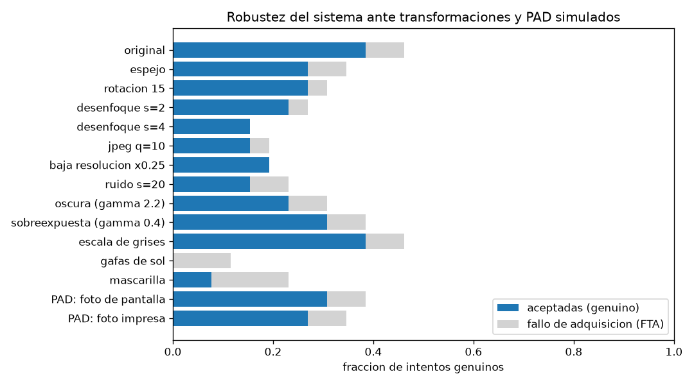

# Informe de vulnerabilidades y fortalezas — BigBrother (MLBP)

Grupo EVE · Sistemas Biométricos · Persona 50 del dataset: **vinicius_junior**

Todas las cifras salen de `python scripts/evaluate.py` → [`docs/resultados/resultados.json`](resultados/resultados.json).
Las gráficas están en [`docs/resultados/`](resultados/). El ataque a la luz de la **literatura científica**
(Ratha, Adler, morphing, menagerie, NIST FRVT…) y su mapeo a este sistema están en
[`ATAQUES_LITERATURA.md`](ATAQUES_LITERATURA.md); la **ejecución empírica** de esos ataques
(troyanos de código, hill-climbing binario, morphing por inscripción, revocación, dodging),
con proceso y cifras, está en [`ATAQUES_EMPIRICOS.md`](ATAQUES_EMPIRICOS.md).
Este informe recoge lo que **medimos nosotros**.

## 1. Sistema evaluado

| Etapa | Implementación |
|---|---|
| Detección | YuNet (OpenCV), 5 landmarks. Filtra falsos positivos con `faceness` cuando hay varias detecciones. Rechaza: sin cara, **2 caras de tamaño parecido**, cara < 40 px, perfil (yaw) |
| Normalización | Alineado por similitud a 128×128 con pre-reducción *anti-aliasing* (`INTER_AREA`) si `scale < 1` + ecualización de histograma |
| Extracción (**template**) | MLBP: LBP u2 (P=8, 59 bins) con radios 1…6, rejilla 8×8 → 22.656 floats |
| Filtro "¿es una cara?" | Regresión logística sobre el template (protege `_sd`, `_t` y multi-detecciones en `recortar`) |
| Comparación | √histograma → PCA blanqueado (1000) → LDA (300) entrenadas en LFW → coseno (variante MLBP+LDA de Chan et al., 2007) |
| Decisión | Verificación: umbral 0,217 (**FAR 0,1 %**). Identificación: umbral 0,285 (**FPIR ~1 %** contra la galería) |
| BD (`data/db.csv`) | `id, nonce, template` con el template **proyectado** y **cifrado** (AES-256-GCM, id como AAD). Huella SHA-256 de la BD **y de los modelos/umbrales**, firmada con HMAC, en `keys/` |

Entrenamiento y calibración: LFW (13.233 caras), con identidades **disjuntas** de las de test. Las
personas del dataset que están en LFW (Keanu Reeves, Salma Hayek, Jackie Chan, Michael Jackson,
Christian Bale, Mary-Kate Olsen, James Phelps) y los **gemelos** Ashley Olsen y Oliver Phelps se
excluyeron del entrenamiento y se usaron para atacar. La gemela de Aitana Etxebarria, **Paula
Etxeberria**, se atacó con 2 fotos públicas suyas (`data/ataques/gemela_paula/`, `python scripts/ataque_gemela.py`
→ [`resultados/gemela_paula.json`](resultados/gemela_paula.json)).

## 2. Rendimiento

| Prueba | Resultado |
|---|---|
| LFW test, MLBP+LDA (nuestro) | **EER 15,6 %** · TAR 54,1 % @FAR 1 % · TAR 34,8 % @FAR 0,1 % |
| LFW test, MLBP+χ² clásico (Ahonen) | EER 36,4 % · TAR 7,3 % @FAR 0,1 % |
| Vinícius, *leave-one-out* (5 fotos) | **5/5 aceptadas**, rank-1 5/5 (sim. 0,28–0,36; identificadas 4/5) |
| Inscritos con 1 foto del docente vs. sus fotos en LFW | **8/55 aceptadas (TAR 14,5 %)** |
| Desconocidos (4.499 de LFW) → `identificar` | FPIR **1,38 %** (con el umbral de verificación sería 8,0 %) |
| Desconocidos → `verificar(vinicius_junior)` | FAR **0,64 %** (29/4.499) |
| Tiempo por verificación (CPU) | ~38 ms (incl. pre-escalado *anti-aliasing* en alta resolución) |

## 3. Vulnerabilidades conocidas (ordenadas por gravedad)

| # | Ataque | ¿Funciona? | Detalle / evidencia |
|---|---|---|---|
| V1 | **Clave + BD robadas** (acceso al contenedor: `keys/master.key`) | **Sí** | Con la clave se descifra la BD y se **invierte** el template de Vinícius por gradiente (3,9 s en CPU / 3 s en GPU, sim. 0,992): `verificar_t` lo acepta e `identificar_t` devuelve `vinicius_junior`. En la demo la clave está en el mismo contenedor que la BD: quien tenga *shell* en él lo controla todo |
| V2 | **Foto/pantalla de Vinícius** (presentación) | **Sí** | No hay detección de vida. Simulaciones de foto en pantalla e impresa: 5/5 aceptadas. Cualquier foto pública de Vinícius sirve |
| V3 | **Morphing** 50/50 Vinícius + cómplice | **Sí** | Aceptado como Vinícius **24/25** con un cómplice parecido y **7/25** con uno aleatorio (bajó de 12/25 tras eliminar el *aliasing* en alta resolución) |
| V4 | **Parecidos (sesgo demográfico)** | Parcial | FAR contra Vinícius **0,64 %** (29/4.499), 6,4 veces el nominal. Los 4 desconocidos de LFW más parecidos (`Shawn_Kemp` 0,330, `Ruben_Sierra` 0,322, `Felix_Doh` 0,308, `Ted_Washington` 0,284) son hombres negros, con puntuaciones **del nivel de las genuinas de Vinícius (0,28–0,36)**. LFW está sesgado a hombres blancos, así que las parejas del mismo grupo demográfico son mucho más peligrosas |
| V5 | **Gemelos** | **Sí** | **Paula Etxeberria entra como `aitana_etxebarria`: 2/2 fotos verificadas e identificadas** (similitud **0,293 y 0,458**; umbral verif. 0,217, ident. 0,285): en las dos `identificar` devuelve `aitana_etxebarria` y Aitana es el rango #1 de la BD. Los gemelos de LFW (Ashley Olsen → mary-kate_olsen 0,181; Oliver Phelps → james_phelps 0,132) se rechazaron, pero **las fotos genuinas de Mary-Kate y James puntúan lo mismo** (0,174 y 0,158). MLBP no distingue gemelos idénticos: el resultado solo depende de lo parecida que sea la foto a la de inscripción. No hay defensa posible con este rasgo |
| V19 | **Retrato retocado que verifica como muchas personas** | Sí | La segunda foto de Paula (retrato frontal con filtro de belleza) verifica contra **8 de las mujeres inscritas** (`aitana_etxebarria` 0,458, `kim_jisoo` 0,406, `zoe_saldana` 0,355, `taylor_swift` 0,344…; bajó de 10/50 a 8/50 tras el *anti-aliasing*), y `paula_01` verifica contra 2 (`aitana_etxebarria` y `adele`). En LFW, el peor desconocido (`Gina_Gershon`) verifica como **7 identidades** distintas (bajó de 8). Un atacante puede elegir una foto así y probar ids hasta entrar (V8). Probamos exigir que el id reclamado sea además el más parecido de la BD: la FAR por intento baja ligeramente, pero los genuinos cruzados aceptados caen a la mitad, así que lo descartamos |
| V6 | **FRR alta en los 49 del docente** | Sí (disponibilidad) | Con una sola foto de inscripción y fotos de otra época o pose, TAR del 14,5 % (8/55): Jackie Chan 0/13, Michael Jackson 0/12 (la foto inscrita es de 1982), Keanu 3/12, Mary-Kate 1/3, Salma 4/13. Vinícius funciona porque tiene 5 fotos |
| V7 | **Oclusiones** | Sí (FRR) | Gafas de sol: 0/5 aceptadas. Mascarilla: 2/5. Desenfoque s=4, JPEG q=10 y ruido s=20: 4/5 (desenfoque s=2 y baja resolución x0,25: 5/5). No abren la puerta a nadie, solo rechazan al genuino |
| V8 | **Intentos ilimitados** | Sí | No hay bloqueo ni límite de intentos. Un atacante puede probar miles de parecidos o fotos (y permite hill-climbing binario en ~4.058 consultas, ver [`ATAQUES_EMPIRICOS.md`](ATAQUES_EMPIRICOS.md)) |
| V9 | **Hill-climbing** | Sí (caja blanca y caja negra) | Con puntuaciones (caja blanca) se llega al umbral en **~930–1.583 consultas**. Sin puntuaciones (caja negra binaria, A2 en [`ATAQUES_EMPIRICOS.md`](ATAQUES_EMPIRICOS.md)), bastan **4.058 consultas `bool`** en `verificar_t` porque no hay límite de intentos (V8) |
| V10 | **Disponibilidad de la BD (fail-closed)** | Sí (DoS) | Cualquier escritura externa en `db.csv` hace que el sistema se niegue a arrancar (`IntegrityError`). Se cambia un bypass por una denegación de servicio |
| V11 | **Fuga por la BD sin clave** | Parcial | Los templates van cifrados, pero los **ids y cuántas muestras tiene cada uno** se ven en claro |
| V12 | **Oráculo de inscripción** | 1 bit | `inscribir` con un id nuevo rechaza la foto si coincide con alguien inscrito (deduplicación). Eso revela si una cara "está" en la BD, igual que `identificar` |
| V13 | **Cara pequeña de Vinícius al fondo** | No | Se usa la cara más grande: identifica al atacante, no a Vinícius |
| V14 | **Filtro "¿es una cara?" adversarial** | Posible | Es lineal: un atacante de caja blanca puede fabricar una no-cara que lo pase (0,5 % de las no-caras de prueba ya lo pasan). Después aún tiene que superar el umbral de similitud |
| V15 | **Inscripción sin autenticar** | Sí | Cualquiera puede inscribir ids nuevos. No puede tocar los existentes (ver fortalezas) |
| V16 | **Persistencia con `actualizar=True`** | Encadenado | Si un impostor consigue verificar **una vez** (parecido, foto, morph), puede añadir su propia muestra a `vinicius_junior` con `inscribir(..., actualizar=True)` (sin deduplicación en esa vía) y dejar la plantilla persistida (*template poisoning*, validado en A3) |
| V17 | **Variables de entorno de rutas** | Solo con control del entorno | `BIGBROTHER_DB`, `BIGBROTHER_KEYS` y `BIGBROTHER_DATA` permiten apuntar a otra BD con su propia clave: equivale a montar un sistema paralelo. Los **umbrales ya no** se pueden cambiar por entorno |
| V18 | **Contenedor como root** | Sí | La imagen ejecuta como root y la clave está dentro: cualquier `docker exec` llega a V1 |

## 4. Fortalezas (ataques que el sistema resiste)

| Ataque | Resultado |
|---|---|
| Escribir en la BD: copiar la fila de otro como `vinicius_junior`, borrar filas, cambiar un byte, intercambiar ids, borrar la BD, restaurar una versión antigua, usar otra clave | **Detectado en todos los casos** (`IntegrityError`); el sistema no arranca |
| Modificar modelos o umbrales: bajar el umbral en `models/calibration.json`, borrar el filtro de caras, alterar la proyección LDA | **Detectado** (`IntegrityError`): su SHA-256 está firmado en `keys/db.state` |
| Bajar el umbral con `BIGBROTHER_THRESHOLD` / `BIGBROTHER_IDENT_THRESHOLD` | Ignorado (ya no existe esa vía) |
| Borrar `keys/master.key` con la BD presente | `IntegrityError` (ya no se genera una clave nueva en silencio) |
| Imágenes enormes o bombas de descompresión | Ficheros de más de 30 MB rechazados, límite de píxeles en Pillow, detección sobre copia reducida a 1600 px |
| Leer la BD sin la clave | Templates cifrados (AES-GCM) y además **proyectados** a 300 dimensiones (no se puede reconstruir el histograma) |
| `inscribir("vinicius_junior", foto_atacante)` | Rechazado: el id ya existe |
| `inscribir(..., actualizar=True)` con otra cara | Rechazado: la muestra nueva debe verificar contra el id |
| Inscribir a Vinícius con otro nombre | Rechazado (deduplicación) |
| Ids maliciosos (`=HYPERLINK(...)`, comas, saltos de línea, `../`) | Rechazados (`InvalidInput`): sin inyección CSV/fórmulas |
| Ruido, gris, ajedrez o degradados por `_sd` | **27/27 rechazados** por `faceness`. Además, tras eliminar el *aliasing* en `align()` y corregir la inscripción de `elisabeth_ii`, incluso **sin el filtro de cara caen de 24/27 identificaciones falsas a 0/27** (antes el ruido blanco y el gris empataban con el *aliasing* de `forest_whitaker`/`stevie_wonder` y los recortes desalineados con el neumático inscrito en `elisabeth_ii`) |
| Templates manipulados por `_t` (NaN, negativos, escalados, dimensión incorrecta, uniformes, interpolados) | Rechazados: el template debe ser un histograma MLBP exacto (cada región suma 1 y en múltiplos de 1/256) |
| Templates válidos aleatorios o la "media de caras" (*wolf*) | **21/21 no identificados** (antes 2/20 aleatorios coincidían con el neumático de `elisabeth_ii`) |
| Foto con Vinícius y el atacante del mismo tamaño | `AmbiguousFace` |
| Gemelos de LFW (1 foto cada uno) | No aceptados, pero por suerte: la gemela de Aitana sí entra (V5) |
| Formatos raros (el dataset trae un **AVIF con extensión .jpg** y un WebP), imágenes gigantes | Soportados; las imágenes de más de 6000 px se reescalan |
| Espejo, rotación de 15°, desenfoque s=2, baja resolución x0,25, gamma, escala de grises | Vinícius **5/5** en todos (JPEG q=10, ruido s=20 y desenfoque s=4: 4/5) |

## 5. Modelo de amenaza y decisiones

- **Atacante de caja negra** (solo la API/CLI): solo ve decisiones, no puntuaciones. Le quedan V2–V9 (hill-climbing binario) y V19.
- **Atacante con lectura o escritura en `data/` o en `models/`**: protegido (cifrado e integridad), salvo DoS (V10) y metadatos (V11).
- **Atacante con acceso a `keys/` o al código** (por ejemplo, `docker exec`): el sistema cae (V1, A1). En
  un despliegue real la clave iría en un KMS/HSM y la huella de la BD en un almacenamiento de solo-anexado.
- El umbral prioriza la seguridad (FAR 0,1 %) a costa de una FRR alta (V6). Es intencionado.

## 6. Problemas encontrados durante el desarrollo

1. `cv2.imread` no abre `aitana_etxebarria_(twin_melody)_2024.jpg`, que en realidad es AVIF. Ahora se carga con Pillow como respaldo.
2. Tan-Triggs empeoraba el EER (19,7 % frente a 15,6 % con ecualización). LBP ya es invariante a cambios monótonos de iluminación.
3. **Ruido aleatorio por `identificar_sd` se identificaba como `salma_hayek`.** Solución: filtro "¿es una cara?".
4. La primera versión de ese filtro (entrenada solo con LFW) **rechazaba caras reales de Adam Pearson,
   Forest Whitaker y Samuel L. Jackson**, y dejaba en el límite a Stevie Wonder y una foto de Vinícius.
   Es un sesgo demográfico del entrenamiento. Se reentrenó con aumentos fotométricos (caras oscuras y de bajo contraste) y un umbral más permisivo.
5. Identificar con el umbral de verificación daba un 6,6–8,0 % de falsas identificaciones de desconocidos. Se calibró un umbral propio (~1 %).
6. Revisión final de código (en modo atacante), con cuatro problemas corregidos, cada uno con su test:
   - Editar `models/calibration.json` o la variable `BIGBROTHER_THRESHOLD` permitía **bajar el umbral y aceptar a cualquiera**.
   - Borrar `models/faceness.npz` **desactivaba el filtro de caras** sin avisar.
   - Sin la clave pero con la BD presente, se generaba en silencio una clave nueva.
   - Las imágenes gigantes se detectaban a resolución completa (segundos por foto).
7. Auditoría empírica de alta resolución y cambios longitudinales (`docs/EVAL_INTEROCULAR.md` y `docs/EVAL_CAMBIOS_APARIENCIA.md`), que destapó y permitió corregir dos defectos reales del pipeline:
   - **Aliasing en `align()` (`preprocess.py`)**: reducir caras de alta resolución ($\text{IOD} > 48{,}6\text{ px}$, el 90,7 % de la galería) con `cv2.warpAffine(..., INTER_LINEAR)` sin filtro paso bajo inflaba los scores impostores (FAR en galería hasta 6,9 % y 234 colisiones cruzadas en pruebas de apariencia, además de hacer que el ruido blanco coincidiera con `forest_whitaker` sin `faceness`). Solución: pre-reducción de la ROI con `cv2.INTER_AREA` antes de la afín.
   - **Falso positivo en `elisabeth_II_1945.jpg`**: YuNet detectaba un neumático de camión con mayor área (`score = 0,77`) que la cara real de Isabel II (`score = 0,93`), y `recortar()` elegía por área sin pasar `faceness` antes de seleccionar. Solución: filtrar multi-detecciones mediante `faceness` antes de aplicar la selección por área y la comprobación de ambigüedad (`elisabeth_ii` pasó de inscribir el neumático a su rostro real; los 2/20 *wolf templates* aleatorios que caían en `elisabeth_ii` pasaron a **0/20**).

## 7. Limitaciones de la evaluación

- Solo 5 fotos de Vinícius (LOO): con tan pocas muestras, la estimación de su FRR es muy imprecisa.
- Ataques de presentación y morphing **simulados** digitalmente, no capturados con cámara.
- Gemelos: solo 1 foto de cada gemelo de LFW y 2 de Paula Etxeberria.
- Identidades: 49 fotos del docente + Vinícius (la persona 50 del dataset) = 50 identidades inscritas.
