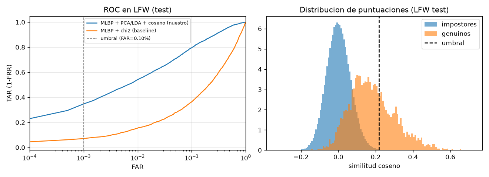

# Informe de vulnerabilidades y fortalezas — BigBrother (MLBP)

Grupo EVE · Sistemas Biométricos · Persona 51: **vinicius_junior**

Todas las cifras salen de `python scripts/evaluate.py` → [`docs/resultados/resultados.json`](resultados/resultados.json).
Las gráficas están en [`docs/resultados/`](resultados/).

## 1. Sistema evaluado

| Etapa | Implementación |
|---|---|
| Detección | YuNet (OpenCV), 5 landmarks. Rechaza: sin cara, **2 caras de tamaño parecido**, cara < 40 px, perfil (yaw) |
| Normalización | Alineado por similitud a 128×128 + ecualización de histograma |
| Extracción (**template**) | MLBP: LBP u2 (P=8, 59 bins) con radios 1…6, rejilla 8×8 → 22.656 floats |
| Filtro "¿es una cara?" | Regresión logística sobre el template (protege `_sd` y `_t`) |
| Comparación | √histograma → PCA blanqueado (1000) → LDA (300) entrenadas en LFW → coseno (variante MLBP+LDA de Chan et al., 2007) |
| Decisión | Verificación: umbral 0,217 (**FAR 0,1 %**). Identificación: umbral 0,285 (**FPIR 1 %** contra la galería) |
| BD (`data/db.csv`) | `id, nonce, template` con el template **proyectado** y **cifrado** (AES-256-GCM, id como AAD). Huella SHA-256 + HMAC de la BD en `keys/` |

Entrenamiento y calibración: LFW (13.233 caras), con identidades **disjuntas** de las de test. Las
personas del dataset que están en LFW (Keanu Reeves, Salma Hayek, Jackie Chan, Michael Jackson,
Christian Bale, Mary-Kate Olsen, James Phelps) y los **gemelos** Ashley Olsen y Oliver Phelps se
excluyeron del entrenamiento y se usaron para atacar.

## 2. Rendimiento

| Prueba | Resultado |
|---|---|
| LFW test, MLBP+LDA (nuestro) | **EER 15,5 %** · TAR 54 % @FAR 1 % · TAR 35 % @FAR 0,1 % |
| LFW test, MLBP+χ² clásico (Ahonen) | EER 36,5 % · TAR 7 % @FAR 0,1 % |
| Vinícius, *leave-one-out* (5 fotos) | **5/5 aceptadas**, rank-1 5/5 (sim. 0,31–0,36) |
| Inscritos con 1 foto del docente vs. sus fotos en LFW | **8/55 aceptadas (TAR 15 %)** |
| Desconocidos (4.499 de LFW) → `identificar` | FPIR **0,84 %** (con el umbral de verificación sería 6,6 %) |
| Desconocidos → `verificar(vinicius_junior)` | FAR **0,67 %** (30/4.499) |
| Tiempo por verificación (CPU) | ~20 ms |

## 3. Vulnerabilidades conocidas (ordenadas por gravedad)

| # | Ataque | ¿Funciona? | Detalle / evidencia |
|---|---|---|---|
| V1 | **Clave + BD robadas** (acceso al contenedor: `keys/master.key`) | **Sí** | Con la clave se descifra la BD y se **invierte** el template de Vinícius por gradiente (3 s en GPU): `verificar_t` lo acepta e `identificar_t` devuelve `vinicius_junior`. En la demo la clave está en el mismo contenedor que la BD: quien tenga *shell* en él lo controla todo |
| V2 | **Foto/pantalla de Vinícius** (presentación) | **Sí** | No hay detección de vida. Simulaciones de foto en pantalla e impresa: 5/5 aceptadas. Cualquier foto pública de Vinícius sirve |
| V3 | **Morphing** 50/50 Vinícius + cómplice | **Sí** | Aceptado como Vinícius 23/25 con un cómplice parecido y 12/25 con uno aleatorio |
| V4 | **Parecidos (sesgo demográfico)** | Parcial | FAR contra Vinícius 0,67 %, 6,7 veces el nominal. Los 4 desconocidos de LFW más parecidos (0,32–0,35) son hombres negros, con puntuaciones **del nivel de las genuinas de Vinícius (0,31–0,36)**. LFW está sesgado a hombres blancos, así que las parejas del mismo grupo demográfico son mucho más peligrosas |
| V5 | **Gemelos** | Hoy no, pero no es una defensa | Ashley Olsen → mary-kate_olsen: 0,142. Oliver Phelps → james_phelps: 0,130. Ambos rechazados, pero **las fotos genuinas de Mary-Kate y James en LFW puntúan lo mismo** (0,147 y 0,125). El sistema no distingue gemelos: los rechaza solo porque con una única foto de inscripción también rechaza al genuino. Con una foto del gemelo parecida a la de inscripción, entraría. No hemos probado la gemela de Aitana Etxebarria (no tenemos fotos) |
| V6 | **FRR alta en los 50 del docente** | Sí (disponibilidad) | Con una sola foto de inscripción y fotos de otra época o pose, TAR del 15 %: Jackie Chan 0/13, Michael Jackson 0/12 (la foto inscrita es de 1982), Keanu 2/12, Salma 6/13. Vinícius funciona porque tiene 5 fotos |
| V7 | **Oclusiones** | Sí (FRR) | Gafas de sol: 0/5 aceptadas. Mascarilla: 3/5. Desenfoque y baja resolución: 4/5. No abren la puerta a nadie, solo rechazan al genuino |
| V8 | **Intentos ilimitados** | Sí | No hay bloqueo ni límite de intentos. Un atacante puede probar miles de parecidos o fotos |
| V9 | **Hill-climbing con puntuaciones** | Solo en caja blanca | Si se expusiera la similitud, se llega al umbral en **~900–1.600 consultas**. La API pública solo devuelve `bool`/id, pero el código Python es accesible (`bb._score_id`): un atacante con el código lo usa directamente |
| V10 | **Disponibilidad de la BD (fail-closed)** | Sí (DoS) | Cualquier escritura externa en `db.csv` hace que el sistema se niegue a arrancar (`IntegrityError`). Se cambia un bypass por una denegación de servicio |
| V11 | **Fuga por la BD sin clave** | Parcial | Los templates van cifrados, pero los **ids y cuántas muestras tiene cada uno** se ven en claro |
| V12 | **Oráculo de inscripción** | 1 bit | `inscribir` con un id nuevo rechaza la foto si coincide con alguien inscrito (deduplicación). Eso revela si una cara "está" en la BD, igual que `identificar` |
| V13 | **Cara pequeña de Vinícius al fondo** | No | Se usa la cara más grande: identifica al atacante, no a Vinícius |
| V14 | **Filtro "¿es una cara?" adversarial** | Posible | Es lineal: un atacante de caja blanca puede fabricar una no-cara que lo pase (0,5 % de las no-caras de prueba ya lo pasan). Después aún tiene que superar el umbral de similitud |
| V15 | **Inscripción sin autenticar** | Sí | Cualquiera puede inscribir ids nuevos. No puede tocar los existentes (ver fortalezas) |

## 4. Fortalezas (ataques que el sistema resiste)

| Ataque | Resultado |
|---|---|
| Escribir en la BD: copiar la fila de otro como `vinicius_junior`, borrar filas, cambiar un byte, intercambiar ids, borrar la BD, restaurar una versión antigua, usar otra clave | **Detectado en todos los casos** (`IntegrityError`); el sistema no arranca |
| Leer la BD sin la clave | Templates cifrados (AES-GCM) y además **proyectados** a 300 dimensiones (no se puede reconstruir el histograma) |
| `inscribir("vinicius_junior", foto_atacante)` | Rechazado: el id ya existe |
| `inscribir(..., actualizar=True)` con otra cara | Rechazado: la muestra nueva debe verificar contra el id |
| Inscribir a Vinícius con otro nombre | Rechazado (deduplicación) |
| Ids maliciosos (`=HYPERLINK(...)`, comas, saltos de línea, `../`) | Rechazados (`InvalidInput`): sin inyección CSV/fórmulas |
| Ruido, gris, ajedrez o degradados por `_sd` | 27/27 rechazados. **Sin el filtro de cara, 22/27 se identificaban como alguien** (sobre todo forest_whitaker y stevie_wonder). Lo descubrimos y corregimos durante la evaluación |
| Templates manipulados por `_t` (NaN, negativos, escalados, dimensión incorrecta, uniformes, interpolados) | Rechazados: el template debe ser un histograma MLBP exacto (cada región suma 1 y en múltiplos de 1/256) |
| Templates válidos aleatorios o la "media de caras" (*wolf*) | 21/21 no identificados |
| Foto con Vinícius y el atacante del mismo tamaño | `AmbiguousFace` |
| Gemelos de LFW | No aceptados (con las salvedades de V5) |
| Formatos raros (el dataset trae un **AVIF con extensión .jpg** y un WebP), imágenes gigantes | Soportados; las imágenes de más de 6000 px se reescalan |
| Espejo, rotación de 15°, JPEG q=10, ruido, gamma, escala de grises | Vinícius 5/5 en todos |

## 5. Modelo de amenaza y decisiones

- **Atacante de caja negra** (solo la API/CLI): solo ve decisiones, no puntuaciones. Le quedan V2–V8.
- **Atacante con lectura o escritura en `data/`**: protegido (cifrado e integridad), salvo DoS (V10) y metadatos (V11).
- **Atacante con acceso a `keys/` o al código** (por ejemplo, `docker exec`): el sistema cae (V1, V9). En
  un despliegue real la clave iría en un KMS/HSM y la huella de la BD en un almacenamiento de solo-anexado.
- El umbral prioriza la seguridad (FAR 0,1 %) a costa de una FRR alta (V6). Es intencionado.

## 6. Problemas encontrados durante el desarrollo

1. `cv2.imread` no abre `aitana_etxebarria_(twin_melody)_2024.jpg`, que en realidad es AVIF. Ahora se carga con Pillow como respaldo.
2. Tan-Triggs empeoraba el EER (19,7 % frente a 15,5 % con ecualización). LBP ya es invariante a cambios monótonos de iluminación.
3. **Ruido aleatorio por `identificar_sd` se identificaba como `salma_hayek`.** Solución: filtro "¿es una cara?".
4. La primera versión de ese filtro (entrenada solo con LFW) **rechazaba caras reales de Adam Pearson,
   Forest Whitaker y Samuel L. Jackson**, y dejaba en el límite a Stevie Wonder y una foto de Vinícius.
   Es un sesgo demográfico del entrenamiento. Se reentrenó con aumentos fotométricos (caras oscuras y de bajo contraste) y un umbral más permisivo.
5. Identificar con el umbral de verificación daba un 6,6 % de falsas identificaciones de desconocidos. Se calibró un umbral propio (1 %).

## 7. Limitaciones de la evaluación

- Solo 5 fotos de Vinícius (LOO): con tan pocas muestras, la estimación de su FRR es muy imprecisa.
- Ataques de presentación y morphing **simulados** digitalmente, no capturados con cámara.
- Gemelos: solo 1 foto de cada gemelo en LFW.
- El dataset del docente que recibimos tiene **49** fotos, no 50: el sistema tiene 50 identidades.
