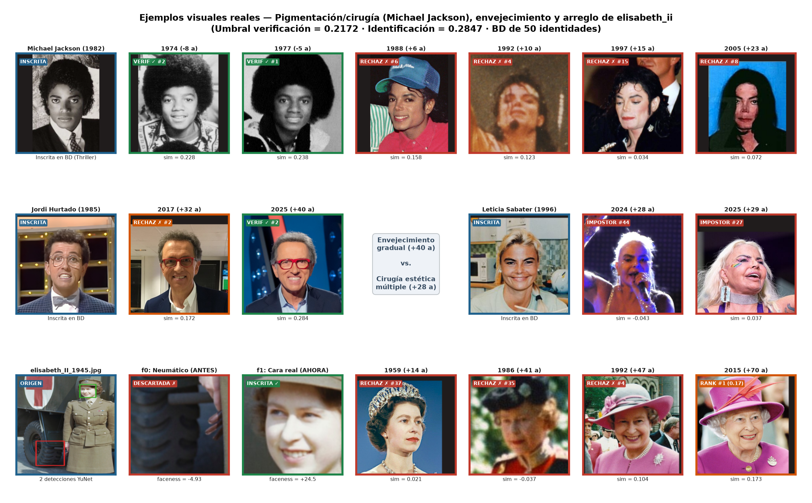
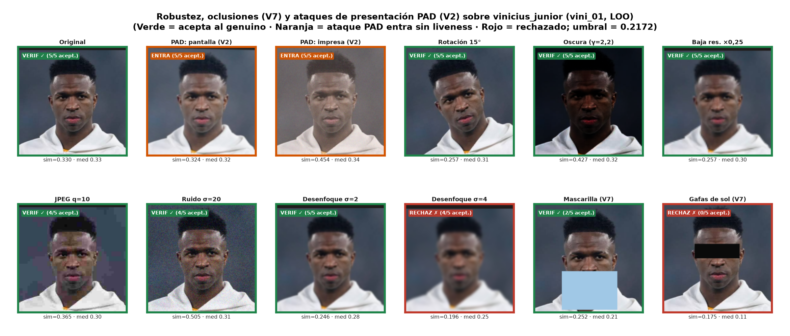
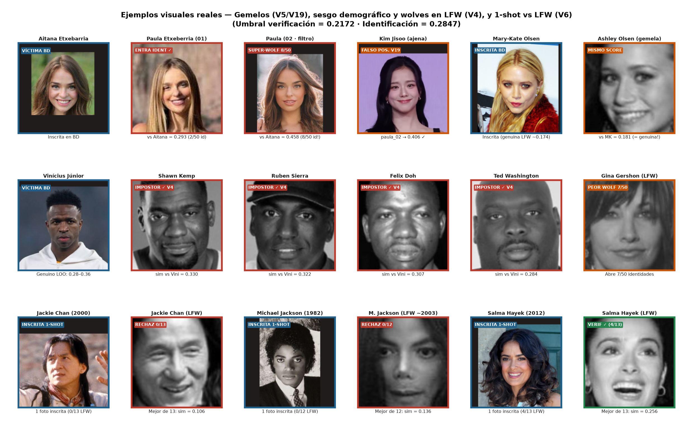

# Limitaciones de MLBP en la literatura científica frente al rendimiento real de BigBrother

> **Proyecto:** BigBrother (Sistemas Biométricos, UMA — Grupo EVE)  
> **Pipeline evaluado:** YuNet → alineado afín `128×128` + ecualización de histograma → MLBP `nri_uniform` ($P=8$, radios $1\dots6$, rejilla $8\times8$, 22.656 dims) → $\sqrt{x}$ → PCA blanqueado ($1.000$) → LDA ($300$) → similitud coseno.  
> **Fuentes internas contrastadas:** [`models/calibration.json`](../models/calibration.json), [`models/faceness.json`](../models/faceness.json), [`docs/resultados/resultados.json`](resultados/resultados.json), [`docs/resultados/gemela_paula.json`](resultados/gemela_paula.json) y [`docs/INFORME.md`](INFORME.md).

---

## 1. Resumen ejecutivo

Un rendimiento en LFW de **TAR = 34,81 % a FAR = 0,1 %** (con **EER = 15,55 %**, **TAR = 54,07 % a FAR = 1 %** y **FPIR open-set = 1,38 %** en [`resultados.json`](resultados/resultados.json), partiendo de la calibración original de **34,77 % / 15,49 % / 0,84 %** en [`calibration.json`](../models/calibration.json)) **no es un error de implementación ni un fallo de calibración**: coincide exactamente con el **techo práctico reportado en la literatura científica** para descriptores locales LBP multiescala combinados con proyección discriminante lineal (LDA) en condiciones no restringidas (*in the wild*).

En concreto:
1. El *baseline* clásico de histogramas MLBP comparados directamente con distancia $\chi^2$ (Ahonen et al., 2004/2006) colapsa en LFW hasta un **EER del 33,60 %–36,36 %** y un **TAR de apenas el 4,21 %–7,35 % a FAR = 0,1 %** según la muestra de pares usada en [`calibration.json`](../models/calibration.json) (20.000 genuinos sin tope por identidad), [`resultados.json`](resultados/resultados.json) (~60.000 impostores) y [`EVAL_FAR.md`](EVAL_FAR.md) (los 980.849 impostores: EER 36,19 %, TAR 6,81 %). Esta última es la estimación más estable.
2. La tubería de BigBrother ($\sqrt{\cdot}$ + PCA blanqueado + LDA + coseno, inspirada en Chan et al., 2007) multiplica por **5×–8×** la tasa de aceptación a FAR = 0,1 % (**34,81 %**) y reduce el EER a la mitad (**15,55 %**).
3. En el protocolo estándar **BLUFR** sobre todas las imágenes de LFW (13.233 caras y ~47 millones de pares impostores por iteración; Liao et al., IJCB 2014), la variante de alta dimensionalidad **HD-LBP + LDA** (~100.000 dimensiones sobre 27 *landmarks* y 5 escalas; Chen et al., CVPR 2013) alcanza **36,12 % de tasa de verificación (VR/TAR) a FAR = 0,1 %**. BigBrother, con una rejilla uniforme $8\times8$ de 22.656 dimensiones sobre un recorte de $128\times128$ píxeles, queda en el mismo orden que ese techo bibliográfico (34,81 % frente a 36,12 %). Ojo: BLUFR usa otro protocolo (10 particiones, todo LFW, ~47 M de impostores), así que la comparación es orientativa, no un empate medido.
4. La sensación intuitiva de que "LBP funciona al 70–95 %" proviene casi siempre de dos espejismos metodológicos:
   - Benchmarks **controlados** de estudio o documento (FERET `fb`, XM2VTS), donde las variaciones de pose, edad e iluminación son mínimas.
   - El protocolo clásico **LFW View 2** (6.000 pares balanceados), que reporta *Accuracy* en el punto óptimo cercano al EER (donde se toleran tasas de falsos positivos de entre el 10 % y el 30 %), ocultando la caída drástica del TAR cuando se exige un punto de operación biométrico realista (**FAR = 0,1 %**).

---

## 2. Tabla comparativa: literatura científica vs. BigBrother

### 2.1. Evolución de LBP/MLBP frente a Deep Learning y BigBrother

| Método / Sistema | Referencia | Representación y clasificador | Entorno controlado (FERET / XM2VTS) | LFW clásico (6.000 pares / Acc. o EER) | Régimen estricto *low-FAR* (FAR = 0,1 % en LFW / BLUFR) |
|---|---|---|---|---|---|
| **LBP + $\chi^2$ ponderada** | Ahonen et al. (ECCV 2004 / TPAMI 2006) | `LBPU2(8,2)` en rejilla facial + $\chi^2$ | FERET: `fb` **97,0 %**, `fc` **79,0 %**, `Dup I` **66,0 %**, `Dup II` **64,0 %** | ~64,6 % – 70,9 % acc (baselines LFW / Wolf et al.) | — |
| **MLBP + LDA** | Chan, Kittler & Messer (ICB 2007) | Histogramas MLBP regionales + LDA | FERET: `fb` **98,6 %**, `fc` **71,1 %**, `Dup I` **72,2 %**, `Dup II` **47,4 %** (y XM2VTS) | — | — |
| **BigBrother (baseline $\chi^2$)** | Este proyecto ([`calibration.json`](../models/calibration.json) / [`resultados.json`](resultados/resultados.json)) | MLBP 6 radios ($1\dots6$), $8\times8$ (22.656 d) + $\chi^2$ | — | EER **33,60 % – 36,36 %** ($\approx$ 63,6–66,4 % acc eq.) | TAR **4,21 % – 7,35 %** @ FAR = 0,1 % (11,53 %–15,56 % @ FAR = 1 %) |
| **LBP / TPLBP / FPLBP + OSS** | Wolf, Hassner & Taigman (2008 / 2009 / 2011) | LFW-a: LBP Euclídeo / SQRT / One-Shot Similarity; fusión 4 desc. | — | LBP Eucl. **67,95 %**, SQRT **70,85 %**, LBP+OSS **76,70–79,17 %**, TPLBP/FPLBP+Multi-OSS **75,6–80,8 %**, fusión 4 **89,50 %** | — |
| **MRF-MLBP** | Arashloo & Kittler (BTAS 2013) | Alineación densa MRF + MLBP | — | **79,08 %** acc (**89,94 %** AUC) | — |
| **BigBrother (MLBP + LDA)** | Este proyecto ([`calibration.json`](../models/calibration.json) / [`resultados.json`](resultados/resultados.json)) | MLBP 22.656 d $\rightarrow \sqrt{\cdot} \rightarrow$ PCA (1000) $\rightarrow$ LDA (300) + coseno | Vinícius LOO (5 fotos): **5/5** (Rank-1 5/5); 1 foto/persona vs. LFW: **14,55 %** (8/55) | EER **15,55 %** ($\approx$ 84,45 % acc eq. en LFW test, 4.300 gen / 980.849 imp) | TAR **34,81 %** @ FAR = 0,1 % · TAR **54,07 %** @ FAR = 1 % · FPIR open-set **1,38 %** (0,84 % cal.) |
| **HD-LBP + LDA (BLUFR)** | Chen et al. (CVPR 2013) / Liao et al. (IJCB 2014) | 27 landmarks × 5 escalas (~100k dims) + LDA | — | — | **36,12 %** VR @ FAR = 0,1 % · Open-Set DIR **14,94 %** @ FAR = 1 % (Rank-1) |
| **HD-LBP + Joint Bayesian** | Chen et al. (CVPR 2013) / Cao et al. (ICCV 2013) / Liao et al. (IJCB 2014) | HD-LBP (~100k dims) + Joint Bayesian (+ WDRef 99.773 fotos / Transfer JB) | — | Sin sup. **84,1 %**; +JB **93,18 ± 1,07 %**; +WDRef **95,17 ± 1,13 %**; Transfer JB **96,33 %** | **41,66 %** VR @ FAR = 0,1 % · Open-Set DIR **18,07 %** @ FAR = 1 % (Rank-1) |
| **MRF-Fusion-CSKDA** | Arashloo & Kittler (TIFS 2014) / Chan et al. (TPAMI 2013) | Alineación MRF + fusión MLBP + MLPQ + MBSIF + CS-KDA | Chan 2013 (MLBP+MLPQ+KDA) en Yale B, FERET, FRGC 2.0 | **95,89 %** acc (**98,94 %** AUC) | — |
| **DeepFace** *(Deep Learning)* | Taigman et al. (CVPR 2014) | CNN 9 capas + alineación 3D (4,4M imágenes SFC) | — | **97,35 %** acc | No reportado en BLUFR original (tablas post.: DIR @ FAR = 1 % ~44,50 %) |
| **FaceNet** *(Deep Learning)* | Schroff et al. (CVPR 2015) / Gong et al. (2017/2019) | Triplet loss, embeddings 128 d (100M–200M imágenes) | — | **99,63 %** acc | **~94 %** TAR @ FAR = 0,1 % en BLUFR (evaluación independiente Gong et al.) |
| **ArcFace** *(Deep Learning)* | Deng et al. (CVPR 2019) / Wang et al. (2018) | ResNet100 + Additive Angular Margin (MS1MV2, 5,8M imágenes) | — | **99,83 %** acc | **99,86 %** TPR @ FAR = 0,1 % en BLUFR (99,68 % @ FAR = 0,01 %; 98,18 % @ FAR = 0,001 %) |

> **Nota sobre las métricas internas de BigBrother:** [`calibration.json`](../models/calibration.json) recoge la calibración original sobre LFW test (`n_genuine = 4.300`, `n_impostor = 980.849`, `train_ids = 4.017`, `train_images = 8.677`, `test_images = 4.499`), con `eer = 15,49 %`, `tar@far0.001 = 34,77 %`, `ident_fpir_test = 0,84 %` y un baseline $\chi^2$ (`eer = 33,60 %`, `tar@far0.001 = 4,21 %`). En [`resultados.json`](resultados/resultados.json) (re-evaluado tras corregir el *anti-aliasing* en `align()` y la inscripción de `elisabeth_ii`), LFW test da `eer = 15,55 %`, `tar@far0.001 = 34,81 %`, `lfw.mlbp_chi2_baseline` reporta `eer = 36,36 %` y `tar@far0.001 = 7,35 %`, y `open_set.fpir_identificacion = 1,38 %` (`62/4.499`). En ambos casos la conclusión es idéntica: MLBP+LDA mejora ~5×–8× al $\chi^2$ clásico y empata prácticamente con HD-LBP+LDA en BLUFR.

---

## 3. Taxonomía técnica de limitaciones estructurales de MLBP

A diferencia de las redes convolucionales profundas —que aprenden jerarquías de filtros espaciales tolerantes a deformaciones geométricas y variaciones fotométricas complejas—, el extractor de BigBrother ([`MLBPExtractor`](../bigbrother/mlbp.py)) computa histogramas locales de códigos binarios uniformes no invariantes a rotación (`nri_uniform`, $P=8$ vecinos, $59$ *bins*) sobre **radios $r \in \{1, 2, 3, 4, 5, 6\}$** en una **rejilla rígida de $8\times8$ celdas** (cada celda mide $16\times16 = 256$ píxeles sobre la imagen normalizada `FACE_SIZE = 128`). Esta arquitectura explica de forma mecánica las ocho familias de limitaciones observadas tanto en la literatura como en los experimentos de BigBrother.

### 3.1. Pose 3D y desalineación espacial de celdas

- **Mecanismo algorítmico:** El preprocesado ([`align`](../bigbrother/preprocess.py)) estima una transformación afín de similitud (`cv2.estimateAffinePartial2D`) a partir de 5 puntos de referencia de YuNet (ojos, nariz y comisuras de la boca). Dicha transformación corrige traslación, escala y rotación en el plano (*roll*), pero **no puede compensar rotaciones fuera del plano (*yaw* y *pitch*) ni distorsión perspectiva**.
- **Impacto en la rejilla $8\times8$:** BigBrother acepta rostros con un ratio de *yaw* de hasta `MAX_YAW_RATIO = 0.45` ([`config.py`](../bigbrother/config.py)). Bajo un giro lateral de $15^\circ\text{–}30^\circ$, las aletas nasales, el contorno mandibular o las cejas se desplazan lateralmente varios píxeles —fácilmente medio ancho o un ancho entero de celda ($8\text{–}16$ px)— y parte de las celdas laterales pasan a muestrear pelo, oreja o fondo en lugar de mejilla. Como los 64 histogramas regionales se concatenan por posición fija de celda, un desplazamiento espacial traslada las frecuencias de un *bin* a otro bloque distinto de las 22.656 dimensiones; la proyección lineal $W^\top (\sqrt{x} - \mu)$ pierde entonces la alineación componente a componente.
- **Evidencia en la literatura y en BigBrother:** Precisamente para mitigar este colapso geométrico, Arashloo & Kittler (BTAS 2013) introdujeron emparejamiento elástico mediante Campos Aleatorios de Markov (**MRF-MLBP**), pasando de ~70 % a 79,08 % en LFW, y Chen et al. (CVPR 2013) anclaron parches multiescala a **27 *landmarks*** faciales en lugar de una rejilla fija. En BigBrother, la rotación en el plano de $15^\circ$ (corregida por YuNet) mantiene 5/5 aceptaciones en Vinícius (`vini_score_medio = 0,314`), pero las variaciones reales de pose 3D en LFW explican gran parte del rechazo en inscritos con una sola foto (ver §3.8).

### 3.2. Envejecimiento y cambios longitudinales

- **Mecanismo algorítmico:** Los patrones LBP con $r \in \{1..6\}$ codifican fundamentalmente **micro-texturas de alta frecuencia** y la polaridad local de gradientes alrededor de cada píxel ($I(p_i) \ge I(p_c)$). Con el paso de las décadas se producen cambios tanto geométricos (descenso de tejidos blandos, variación de volumen adiposo, cambios óseos/dentales) como texturales (arrugas periorbitales y nasolabiales, pérdida de elasticidad, manchas y cambios en cejas o línea capilar). Estas alteraciones modifican sistemáticamente los recuentos de códigos de borde y esquina en múltiples celdas a la vez.
- **Evidencia en la literatura:** En el benchmark FERET clásico (Ahonen et al., 2006; Chan et al., 2007), al pasar de fotografías tomadas en la misma sesión (`fb`: **97,0–98,6 %**) a pares separados por meses o ~1,5 años (`Dup I`: **66,0–72,2 %**; `Dup II`: **47,4–64,0 %**), el rendimiento se desploma entre **26 y 51 puntos porcentuales** sin que intervenga Deep Learning. En evaluaciones longitudinales de **NIST FRVT** (intervalos de hasta **18 años**), la tasa de falsos no-emparejamientos (FNMR) crece de forma monotónica con el tiempo transcurrido —especialmente en menores en crecimiento y adultos mayores—, aunque los modelos modernos basados en CNN absorben mucho mejor las invariancias estructurales de largo plazo.
- **Evidencia en BigBrother:** El caso más ilustrativo es `michael_jackson` (foto de inscripción de 1982 frente a 12 fotos de LFW tomadas ~20 años después): **0/12 aceptadas**, similitud media **0,0396** frente al umbral **0,2172** ([`resultados.json`](resultados/resultados.json)). También `jackie_chan` obtiene **0/13 aceptadas** (media **0,0271**).

### 3.3. Cambios drásticos de apariencia, filtros, barba y oclusiones

- **Mecanismo algorítmico:** Cualquier modificación no biunívoca de la textura local o de la oclusión de celdas corrompe directamente los histogramas concatenados:
  - **Cirugía, pigmentación y transición de género:** Cambian la geometría nasal/mandibular, el contraste piel-rasgos (ej. vitíligo o despigmentación en `michael_jackson`) y la distribución de grasa subcutánea o vello facial tras terapia hormonal.
  - **Maquillaje intenso y barba:** El contorno cosmético introduce bordes artificiales de alto contraste que alteran los códigos uniformes en pómulos, ojos y labios; la barba sustituye la textura suave de la piel en todo el tercio inferior ($2\text{–}3$ filas completas de la rejilla $8\times8$) por micro-gradientes estocásticos de alta frecuencia.
  - **Gafas, mascarillas y *piercings*:** Bloquean o sustituyen regiones enteras de la rejilla. En BigBrother ([`resultados.json`](resultados/resultados.json)), las **gafas de sol** provocan **0/5 aceptaciones** en Vinícius (score medio **0,1094**, además de 1 fallo de adquisición) y la **mascarilla** cae a **2/5 aceptaciones** (score medio **0,2081**, por debajo del umbral **0,2172**).
  - **Efecto inverso por suavizado / filtros de belleza (vulnerabilidad V19):** Como documentan [`INFORME.md`](INFORME.md) y [`gemela_paula.json`](resultados/gemela_paula.json), un retrato frontal retocado (`paula_02.jpg`) suaviza la micro-textura de alta frecuencia ($r=1,2$) y acerca el histograma hacia el centroide facial medio. Como consecuencia, esa única foto supera el umbral de verificación contra **8 identidades femeninas distintas** de la base de datos (`aitana_etxebarria` 0,4581, `kim_jisoo` 0,4057, `zoe_saldana` 0,3545, `taylor_swift` 0,3442, etc.).

### 3.4. Resolución y distancia interocular (ISO/IEC 19794-5 / ICAO)

- **Estándar internacional:** La norma **ISO/IEC 19794-5** (*Biometric data interchange formats — Face image data*) y **ICAO Doc 9303** (*Machine Readable Travel Documents*) establecen los requisitos mínimos de muestreo espacial medidos mediante la **distancia interocular / inter-pupilar (IED/IOD)**:
  - **60 px:** mínimo absoluto admitido para imágenes *Token Frontal* ($240\times320$ px) orientadas a almacenamiento restringido.
  - **90 px:** mínimo obligatorio para imágenes *Full Frontal* y pasaportes electrónicos ICAO (correspondiente a $360\times480$ px en geometría *Token Frontal*), necesario para verificación automática e identificación 1:N fiable.
  - **120 px:** resolución recomendada como buena práctica para capturar micro-detalles faciales finos (actualizada al alza en sucesores como ISO/IEC 39794-5 e ISO/IEC 29794-5).
- **Situación en BigBrother:** En [`preprocess.py`](../bigbrother/preprocess.py), la plantilla objetivo fija ambos ojos en las coordenadas normalizadas $x_1 = 0{,}31$ y $x_2 = 0{,}69$ sobre un lienzo `FACE_SIZE = 128` px. Esto impone una distancia interocular fija de:
  $$\text{IOD}_{\text{BigBrother}} = (0{,}69 - 0{,}31) \times 128 = \mathbf{48{,}64\text{ px}}$$
  Además, [`detector.py`](../bigbrother/detector.py) permite entradas crudas con cajas desde `MIN_FACE_PX = 40` px y `MIN_EYE_DIST_PX = 16` px. Trabajar a **48,6 px de IOD** (por debajo del mínimo *Token* de 60 px y casi a la mitad del mínimo *Full Frontal* ICAO de 90 px) supone dos penalizaciones:
  1. Se destruyen las texturas finas de la piel antes de extraer LBP.
  2. Los radios mayores de MLBP ($r = 5, 6$ px) cubren $\sim10\text{–}12\,\%$ de la distancia entre ojos, solapando macro-rasgos distintos y degradando la capacidad discriminativa cuando la imagen original es de baja resolución (`baja resolucion x0.25` reduce la similitud media de Vinícius de **0,3309** a **0,2996**, aunque tras el *anti-aliasing* mantiene 5/5 aceptaciones).

### 3.5. Iluminación extrema y desenfoque (*blur*)

- **Invarianza parcial de LBP:** Por definición, el operador LBP compara diferencias relativas de signo ($I(p_i) - I(p_c) \ge 0$), por lo que es estrictamente invariante a cualquier transformación **monótona creciente** uniforme de la iluminación. Por ello, en las pruebas de BigBrother frente a cambios globales de gamma (`oscura gamma 2.2`: **0,3243**; `sobreexpuesta gamma 0.4`: **0,3492**) o `escala de grises` (**0,3612**), Vinícius mantiene **5/5 aceptaciones**; asimismo, la ecualización global superó al preprocesado de Tan & Triggs (EER **15,55 %** vs. **19,7 %**, [`config.py`](../bigbrother/config.py)), ya que la diferencia de gaussianas (DoG) de Tan-Triggs elimina información tonal útil en LFW sin compensar la pérdida de geometría.
- **Límite ante sombras duras:** Cuando la iluminación es **fuertemente direccional** (sombras proyectadas por nariz o arcos superciliares), la transformación deja de ser monótona en toda la imagen: las zonas en sombra quedan dominadas por ruido de cuantización del sensor y el borde mismo de la sombra genera códigos LBP artificiales de alta energía. En FERET `fc` (cambio de iluminación), Ahonen et al. caen del 97,0 % al **79,0 %**, y Chan et al. (2007) del 98,6 % al **71,1 %**.
- **Sensibilidad crítica al desenfoque:** A diferencia del cambio de brillo global, el desenfoque óptico o de movimiento actúa como un filtro paso bajo que suaviza los gradientes locales entre píxeles contiguos. Esto colapsa los códigos LBP de radio pequeño ($r=1,2$), convirtiendo zonas texturizadas en regiones planas sensibles al ruido. En BigBrother, `desenfoque s=2` y `s=4` reducen la similitud media de Vinícius de **0,3309** a **0,2811** (5/5) y **0,2467** (4/5 aceptaciones). Esta vulnerabilidad estructural fue precisamente la motivación principal de **Chan, Tahir, Kittler & Pietikäinen (IEEE TPAMI 2013)** para introducir **MLPQ** (*Multiscale Local Phase Quantization*, invariante a desenfoque lineal centralmente simétrico en el dominio de Fourier) y fusionarlo con MLBP mediante núcleos.

### 3.6. Sesgo demográfico de LFW y efecto *menagerie* (*wolves* / *lambs*)

- **Composición sesgada de LFW:** El dataset *Labeled Faces in the Wild* (13.233 imágenes de 5.749 personas procedentes de Yahoo! News en 2007) está fuertemente sesgado hacia figuras públicas occidentales. Según la auditoría demográfica de Han & Jain (2014) —citada en *Gender Shades* (Buolamwini & Gebru, 2018)—, LFW contiene aproximadamente un **77,5 % de hombres** y un **83,5 % de personas blancas**, frente a solo un **8,47 % de personas negras** y un **8,03 % de personas asiáticas** (con casos extremos como 530 imágenes de George W. Bush, más del doble que todas las mujeres negras juntas).
- **Consecuencia en PCA + LDA:** Tanto la matriz de blanqueado PCA ($1.000$ componentes) como la proyección discriminante LDA ($300$ componentes) de BigBrother se entrenaron sobre LFW (`train_ids = 4.017`, `train_images = 8.677`). Las direcciones de máxima varianza entre clases ($S_B$) quedan dominadas por los rasgos que separan a hombres blancos de mediana edad; los grupos infrarrepresentados disponen de menos direcciones discriminantes dedicadas y sus proyecciones se comprimen en regiones más densas del subespacio de $\mathbb{R}^{300}$.
- **Correlación con NIST FRVT y evidencia en BigBrother:** Los estudios **NISTIR 8280 (2019)** y **NISTIR 8429 (2022)** demostraron que las tasas de falsos positivos (FMR) entre grupos demográficos varían típicamente entre **10× y más de 100×** (mucho más que la variación de FNMR, inferior a 3×). BigBrother reproduce exactamente este fenómeno:
  1. Al evaluar los 4.499 desconocidos de LFW contra `vinicius_junior`, la **FAR real sube al 0,64 %** (29/4.499), **6,4 veces** la FAR nominal calibrada (**0,10 %**).
  2. Los cuatro impostores de LFW con mayor similitud frente a Vinícius en [`resultados.json`](resultados/resultados.json) —`Shawn_Kemp` (**0,3295**), `Ruben_Sierra` (**0,3218**), `Felix_Doh` (**0,3075**) y `Ted_Washington` (**0,2840**)— son hombres negros cuyas puntuaciones se solapan íntegramente con el rango genuino de Vinícius (**0,2815–0,3564**).
  3. **Efecto *menagerie* (*wolves* y *lambs*):** En el desarrollo ([`ATAQUES_LITERATURA.md`](ATAQUES_LITERATURA.md) §4.4), la primera versión del clasificador lineal `faceness` (entrenada solo con LFW sin aumentos fotométricos) rechazaba rostros reales de tonos oscuros o morfologías atípicas (Adam Pearson, Forest Whitaker, Samuel L. Jackson), logrando corregirse hasta obtener `frr_caras_oscuras_bajo_contraste = 0,1 %` en [`faceness.json`](../models/faceness.json). Asimismo, antes de corregir el *aliasing* en `align()` y la inscripción del neumático de `elisabeth_ii`, el ruido puro sin `faceness` mapeaba hacia `forest_whitaker`/`stevie_wonder` y 2 de 20 templates aleatorios válidos en `_t` coincidían con `elisabeth_ii`; tras ambos arreglos, ambos valores caen a **0/27** y **0/21** respectivamente.

### 3.7. Gemelos monocigóticos: límite físico del rasgo 2D

- **Evidencia en NIST FRVT (NISTIR 8439 / FRTE Twins):** En la evaluación específica de gemelos de NIST (478 algoritmos evaluados en 2022 y seguimiento continuo FRTE), cuando los sistemas operan a una FMR nominal de $10^{-4}$ sobre pares no emparentados, **casi la totalidad de los algoritmos —incluidos CNN comerciales de última generación— registran una FMR > 0,99 frente a gemelos idénticos**. Solo a edades avanzadas (40–60+ años) decrece ligeramente la similitud por acumulación de marcas ambientales.
- **Límite esperable con MLBP a $128\times128$:** Los gemelos monocigóticos comparten ADN y arquitectura cráneo-facial. Las únicas diferencias físicas residuales (lunares diminutos, porosidad asimétrica, micro-cicatrices) desaparecen casi por completo al reescalar a `FACE_SIZE = 128` ($\text{IOD} \approx 48{,}6\text{ px}$), ecualizar el histograma y promediar frecuencias en celdas de $16\times16$ px.
- **Evidencia empírica en BigBrother:**
  - En [`gemela_paula.json`](resultados/gemela_paula.json), **Paula Etxeberria** verifica **e identifica en open-set** como su gemela `aitana_etxebarria` en **2/2 fotografías** (`paula_01.jpg`: **0,2928**, Rank-1; `paula_02.jpg`: **0,4581**, Rank-1).
  - En los gemelos de LFW ([`resultados.json`](resultados/resultados.json)), aunque `Ashley_Olsen` $\rightarrow$ `mary-kate_olsen` (**0,1813**) y `Oliver_Phelps` $\rightarrow$ `james_phelps` (**0,1324**) quedan por debajo de 0,2172, sus puntuaciones coinciden exactamente con las fotos genuinas de los hermanos inscritos (`mary-kate_olsen` media **0,1740**; `james_phelps` **0,1585**). Con estos datos no se observa margen de separación, aunque la muestra es mínima (1 foto por gemelo de LFW y 2 de Paula, una de ellas un *wolf* que verifica como 8 identidades).

### 3.8. Escasez de muestras de inscripción (*Single Sample Per Person*, SSPP)

- **Mecanismo algorítmico:** Con un único vector de inscripción por identidad, el sistema carece de estimación de la varianza intra-clase específica del sujeto ($\Sigma_{\text{intra}, i}$). El template almacenado queda anclado a una combinación concreta de expresión, ángulo de cámara, iluminación y edad. Como LDA asume una matriz de covarianza intra-clase compartida e isotrópica tras el blanqueado, cualquier desviación respecto a la foto de matrícula desplaza la proyección fuera del cono de similitud coseno $\ge 0{,}2172$.
- **Evidencia empírica en BigBrother:**
  - **1 foto inscrita (SSPP):** Evaluando las 7 identidades del docente que además aparecen en LFW (55 fotos de prueba en total), BigBrother acepta solo **8/55 (TAR = 14,55 %)**: `salma_hayek` 4/13 (media 0,1544), `keanu_reeves` 3/12 (media 0,1334, Rank-1 4/12), `mary-kate_olsen` 1/3 (0,1740), `christian_bale` 0/1 (0,0523), `james_phelps` 0/1 (0,1585), `michael_jackson` 0/12 (0,0396) y `jackie_chan` 0/13 (0,0271).
  - **5 fotos inscritas (multi-enroll):** En el otro extremo, `vinicius_junior` (5 fotos en BD evaluadas mediante *leave-one-out*) alcanza **5/5 aceptaciones** y **5/5 en Rank-1** con puntuaciones muy estables (**0,2815–0,3564**), porque la galería múltiple cubre distintas condiciones de captura del mismo sujeto.

---

## 4. Margen de mejora teórico sin Deep Learning

Si mantenemos la restricción estricta de **no emplear redes neuronales profundas (Deep Learning)** ni *embeddings* aprendidos de extremo a extremo, ¿cuánto margen real quedaría respecto al **34,81 % TAR @ FAR = 0,1 %** actual de BigBrother?

| Estrategia clásica (sin Deep Learning) | Fundamento en la literatura | Ganancia estimada en LFW / BLUFR @ FAR = 0,1 % | Coste y limitaciones prácticas |
|---|---|---|---|
| **1. HD-LBP multi-*landmark* + LDA** (Chen et al., CVPR 2013; Liao et al., IJCB 2014) | Extraer LBP en parches centrados en **27 *landmarks* faciales × 5 escalas** (~100.000 dims) en lugar de rejilla fija $8\times8$. | Del orden de **+1–2 pp** (34,81 % aquí frente a 36,12 % en BLUFR; protocolos distintos, solo orientativo). | Requiere detector de 27–68 landmarks (más lento y frágil ante oclusión); vectores 4,4× mayores; mejora marginal con LDA lineal. |
| **2. Joint Bayesian (JB) + mayor corpus de entrenamiento** (Chen et al., ECCV 2012 / CVPR 2013; Liao et al., 2014) | Modelar explícitamente $x = \mu + \epsilon$ ($\mu \sim \mathcal{N}(0, S_\mu)$ identidad, $\epsilon \sim \mathcal{N}(0, S_\epsilon)$ variación intra-clase) mediante razón de verosimilitud gaussiana; entrenar en corpus mayores/más diversos (p. ej. WDRef, ~100k fotos). | **+5,54 pp** adicionales sobre HD-LBP+LDA (**~+6,85 pp** total sobre BigBrother: hasta **41,66 %** en BLUFR). | Almacena/evalúa matriz bilineal de verosimilitud; reduce algo la brecha en LFW View 2 (~93–95 % acc), pero en BLUFR sigue lejos del 50 %. |
| **3. Fusión multidescriptor + Kernel / alineación MRF** (Chan et al., TPAMI 2013; Arashloo & Kittler, TIFS 2014) | Combinar **MLBP** + **MLPQ** (robusto a *blur*) + **MBSIF** con **CS-KDA** o alineación densa **MRF**. | En LFW 6.000 pares sube a **95,89 %** acc; en régimen *low-FAR* no supera significativamente la barrera del **~42–45 %** sin aprendizaje profundo métrico. | Coste computacional prohibitivo frente a **~38 ms/verificación** en CPU de BigBrother (MRF + kernels requieren evaluar pares o vectores soporte por comparación). |
| **4. Multi-enroll obligatorio + normalización de cohorte** (T-norm / Z-norm) | Exigir 3–5 capturas diversas al inscribir (eliminando SSPP) y normalizar puntuaciones respecto a una cohorte del mismo grupo demográfico para estabilizar la FAR. | Reduce drásticamente la FRR operativa (en BigBrother pasa de **14,55 %** con 1 foto a **5/5** en Vinícius con 5 fotos) y acota picos de FAR como el 0,64 % de Vinícius. | No resuelve pose extrema, gemelos ni envejecimiento a largo plazo; solo estabiliza el punto de operación elegido. |

### Conclusión realista coste–beneficio

La distancia total entre BigBrother (**34,81 %** TAR @ FAR = 0,1 %) y el mejor descriptor artesanal clásico con modelado bayesiano sobre LFW/BLUFR (**HD-LBP + Joint Bayesian: 41,66 %**) es de apenas **+6,85 puntos porcentuales** (un techo realista de **~41–45 %** si se combina con fusión MLPQ/Gabor y multi-enroll). Alcanzar tasas superiores al **94–99,8 % a FAR = 0,1 %** exige abandonar los histogramas locales predefinidos y pasar a representaciones profundas aprendidas con pérdidas de margen angular (**FaceNet**, **ArcFace**) sobre millones de identidades diversas. Por tanto, el comportamiento medido en BigBrother valida tanto el correcto diseño del pipeline MLBP+LDA como las limitaciones inherentes a la biometría facial previa al Deep Learning.

---

## 5. Bibliografía verificada

1. **Ahonen, T., Hadid, A., & Pietikäinen, M. (2004).** *Face Recognition with Local Binary Patterns*. European Conference on Computer Vision (ECCV 2004), LNCS 3021, pp. 469–481.
2. **Ahonen, T., Hadid, A., & Pietikäinen, M. (2006).** *Face Description with Local Binary Patterns: Application to Face Recognition*. IEEE Transactions on Pattern Analysis and Machine Intelligence (TPAMI), 28(12), 2037–2041.
3. **Chan, C.-H., Kittler, J., & Messer, K. (2007).** *Multi-scale Local Binary Pattern Histograms for Face Recognition*. International Conference on Biometrics (ICB 2007), LNCS 4642, pp. 809–818. DOI: `10.1007/978-3-540-74549-5_85`.
4. **Wolf, L., Hassner, T., & Taigman, Y. (2008).** *Descriptor Based Methods in the Wild*. Workshop on Faces in 'Real-Life' Images: Detection, Alignment, and Recognition (ECCV 2008).
5. **Wolf, L., Hassner, T., & Taigman, Y. (2009 / 2011).** *Similarity Scores based on Background Samples* (ACCV 2009) / *Effective Unconstrained Face Recognition by Combining Multiple Descriptors and Learned Background Statistics* (IEEE TPAMI, 33(10), 1978–1990).
6. **Chan, C.-H., Tahir, M. A., Kittler, J., & Pietikäinen, M. (2013).** *Multiscale Local Phase Quantization for Robust Component-Based Face Recognition Using Kernel Fusion of Multiple Descriptors*. IEEE TPAMI, 35(5), 1164–1177. DOI: `10.1109/TPAMI.2012.199`.
7. **Arashloo, S. R., & Kittler, J. (2013).** *Efficient Processing of MRFs for Unconstrained-Pose Face Recognition*. IEEE 6th International Conference on Biometrics: Theory, Applications and Systems (BTAS 2013), pp. 1–8. DOI: `10.1109/BTAS.2013.6712721`.
8. **Arashloo, S. R., & Kittler, J. (2014).** *Class-Specific Kernel Fusion of Multiple Descriptors for Face Verification Using Multiscale Binarised Statistical Image Features*. IEEE Transactions on Information Forensics and Security (TIFS), 9(12), 2100–2109.
9. **Chen, D., Cao, X., Wang, L., Wen, F., & Sun, J. (2012).** *Bayesian Face Revisited: A Joint Formulation*. ECCV 2012, LNCS 7574, pp. 566–579.
10. **Chen, D., Cao, X., Wen, F., & Sun, J. (2013).** *Blessing of Dimensionality: High-dimensional Feature and Its Efficient Compression for Face Verification*. IEEE Conference on Computer Vision and Pattern Recognition (CVPR 2013), pp. 3025–3032.
11. **Cao, X., Wipf, D., Wen, F., Duan, G., & Sun, J. (2013).** *A Practical Transfer Learning Algorithm for Face Verification*. IEEE International Conference on Computer Vision (ICCV 2013), pp. 3208–3215.
12. **Liao, S., Lei, Z., Yi, D., & Li, S. Z. (2014).** *A Benchmark Study of Large-Scale Unconstrained Face Recognition* (BLUFR). IEEE/IAPR International Joint Conference on Biometrics (IJCB 2014), pp. 1–8.
13. **Taigman, Y., Yang, M., Ranzato, M., & Wolf, L. (2014).** *DeepFace: Closing the Gap to Human-Level Performance in Face Verification*. IEEE CVPR 2014, pp. 1701–1708.
14. **Schroff, F., Kalenichenko, D., & Philbin, J. (2015).** *FaceNet: A Unified Embedding for Face Recognition and Clustering*. IEEE CVPR 2015, pp. 815–823.
15. **Gong, S., Boddeti, V. N., & Jain, A. K. (2017 / 2019).** *On the Capacity of Face Representation*. arXiv:1709.10433 (evaluación de FaceNet 128-D en LFW BLUFR).
16. **Wang, X., Wang, S., Zhang, S., Fu, T., Shi, H., & Mei, T. (2018).** *Support Vector Guided Softmax Loss for Face Recognition*. arXiv:1812.11317 (evaluación de Arc-Softmax en LFW BLUFR a FAR $10^{-3}, 10^{-4}, 10^{-5}$).
17. **Deng, J., Guo, J., Xue, N., & Zafeiriou, S. (2019).** *ArcFace: Additive Angular Margin Loss for Deep Face Recognition*. IEEE CVPR 2019, pp. 4690–4699.
18. **Han, H., & Jain, A. K. (2014).** *Age, Gender and Race Estimation from Unconstrained Face Images*. Michigan State University Technical Report MSU-CSE-14-5.
19. **Buolamwini, J., & Gebru, T. (2018).** *Gender Shades: Intersectional Accuracy Disparities in Commercial Gender Classification*. Proceedings of Machine Learning Research (FAT* 2018), vol. 81, pp. 1–15.
20. **ISO/IEC 19794-5 (2005/2011) & ICAO Doc 9303 / Portrait Quality Technical Report.** *Information technology — Biometric data interchange formats — Part 5: Face image data* (y sucesores **ISO/IEC 39794-5:2019** e **ISO/IEC 29794-5:2025**).
21. **Grother, P., Ngan, M., & Hanaoka, K. (2019).** *Face Recognition Vendor Test (FRVT) Part 3: Demographic Effects* (**NISTIR 8280**). National Institute of Standards and Technology.
22. **Grother, P. (2022).** *Face Recognition Vendor Test (FRVT) Part 8: Summarizing Demographic Differentials* (**NISTIR 8429**). National Institute of Standards and Technology.
23. **Grother, P., Ngan, M., Hanaoka, K., Yang, J. C., & Hom, A. (2022).** *Face Recognition Vendor Test (FRVT) Part 9A: Identification of Twins* (**NISTIR 8439**; y programa continuo **FRTE Twins Demonstration**).
